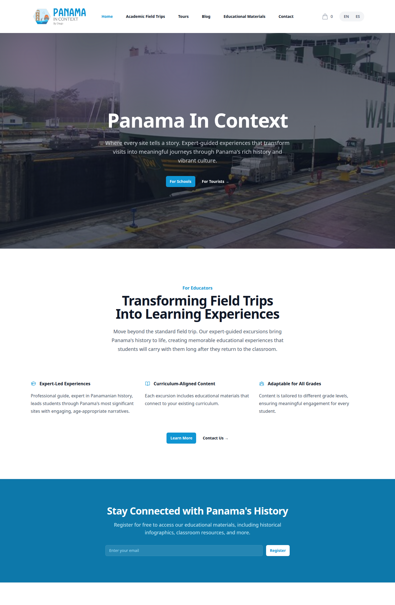
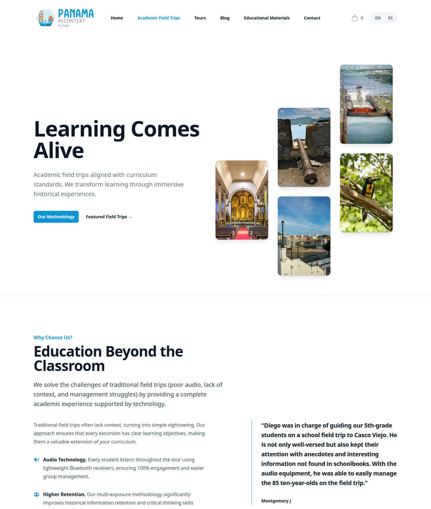

# Frontend & Design System

[← Back to overview](README.md)

The frontend is a single React 19 + Vite 6 SPA that does double duty: it's both the public marketing and booking site and the admin dashboard that drives every content pipeline. I keep them in one codebase but strictly separated. The admin half is lazy-loaded, so a tourist browsing tours never downloads the ag-grid and TipTap bundles that only the CMS needs.



## The stack, and why

- **React 19.2 + Vite 6.4**: fast dev server, instant HMR, and a small public bundle.
- **Tailwind CSS v4**: note the *v4*. The directive syntax and config model differ from v3, which trips people up. I drive the whole design system through CSS custom properties that map onto Tailwind's token names.
- **i18next + react-i18next**: bilingual ES/EN, Spanish-first.
- **react-router-dom 7**: with a deliberately bilingual route table (more below).
- **TipTap 3** (rich-text article editing) and **ag-grid 35** (admin data grids): both admin-only and code-split out of the public bundle.
- **@sentry/react 10**: error reporting with aggressive PII scrubbing.

## Routing: bilingual by construction

Routing is where the Spanish-first decision shows up most clearly. The public routes use Spanish slugs (`/excursiones-academicas`, `/tours-guiados`, `/materiales-educativos`, `/contacto`), and the blog is reachable under both language prefixes:

```
/blog            /en/blog            /es/blog
/articles/:slug  /en/articles/:slug  /es/articulos/:slug
/ask             /preguntar
```

The app is structured as **three sibling route trees**, each with its own layout shell:

- A **public tree** wrapped in `<AppShell>` (navbar, footer, analytics page-view tracking): home, the academic-excursions and tours hubs, six excursion detail pages, eight tour detail pages, the blog, the [Ask PIC](09-ask-pic.md) page under both `/ask` and `/preguntar` (lazy-loaded, like the admin), contact, the booking flow (`/checkout`, `/order-confirmation/:reference`, `/booking/{manage,cancel,renew-payment}`), mailing-list confirmation, the legal pages and a catch-all not-found page.
- A **materials tree** wrapped in `<EduMaterialsLayout>` at `/materiales-educativos`: a standalone, app-like **dashboard shell** (more below) that deliberately does *not* use the public navbar and footer.
- An **admin tree** wrapped in a lazy `<AdminLayout>` behind `<Suspense>`: `/admin/login` plus 16 dashboard routes, from the content grids to the [agent task queue](10-agent-driven-pipeline.md) and the [approvals page](11-mcp-server.md).

Providers nest around all three (`CartProvider > BookingModalProvider > EducatorAuthProvider` wrapping the whole `<Routes>`). The order between the first two matters: the cart has to outlive the booking modal, because you add to cart from inside the modal. The third is a leftover. It used to hold the token for the educator access gate in front of the materials; since the materials opened to every teacher, nothing reads it, and it's on my list to delete.

### The materials dashboard shell

The public educational-materials area used to be a flat three-tab page inside `<AppShell>`. It's now its own **standalone shell**, a sibling of `AppShell` and a near-twin of the admin `AdminLayout`, so browsing classroom resources feels like an app, not a marketing page. A persistent left sidebar (logo up top; **Media Library**; **Educational Content** → Presentations / Infographics / Audio Guides; **Activities** → Historical Trivia; a **"Back to website"** link pinned at the bottom, mirroring admin's "Sign out") drives a right-hand content pane, with the EN/ES toggle moved into a top bar since the public navbar is gone. Sections are deep-linkable nested routes (`/biblioteca`, `/presentaciones`, …), and the ones that aren't built yet render a shared `ComingSoonSection`. Everything in the shell is open: the [media library](05-media-library-and-acquisition.md) and the published [presentations, videos and study guides](04-educational-deliverables-pipeline.md) need no sign-up. One bug worth remembering: the sidebar accordion originally keyed its expanded state on the *translated* label, so it collapsed on every language toggle. It now keys on a stable, language-independent id.

```
src/
├── pages/            top-level pages + excursions/, tours/, admin/, edu/
├── components/
│   ├── admin/        CMS grids, editors, crawl panels
│   ├── booking/      booking modal, price breakdown
│   ├── cart/         cart drawer
│   ├── layout/       AppShell, Navbar, Footer, AdminLayout, EduMaterialsLayout
│   ├── public/       public media library, cards, detail modal
│   ├── sections/     home/, blog/, tours/, academic/ marketing sections
│   └── ui/           shared primitives
├── contexts/         Cart, BookingModal, AdminAuth, EducatorAuth
├── hooks/            useToast, useBeforeUnload, useAskStatus,
│                     useFactCheck, useNewDeployAvailable
└── services/         thin API clients (admin, articles, ask, booking, publicEdu, …)
```

The `services/` layer is intentionally thin: each file is a small wrapper around `fetch` for one API domain, so the components stay declarative and there's exactly one place that knows about auth headers per domain.

### Telling the admin it's out of date

One small piece of the admin shell earned its place through an incident. A long-lived admin tab running an old bundle against a newer backend once called an endpoint whose contract had changed (narration had become a background job) and set off a full re-narration I didn't want. Now the production build stamps a build hash into the bundle and writes the same value to `/version.json`; a hook in `AdminLayout` polls that file every minute and whenever the tab regains focus, and when the two differ it shows a sticky amber banner: a new version of the admin was deployed, reload before running any generation. The hook is inert without a build hash (dev, CI), ignores fetch errors, and lives only in the lazy admin chunk, so the public site never polls.

## Bilingual content & i18n

i18next is configured with an HTTP backend and browser language detection, falling back to Spanish. Translations live in `frontend/public/locales/{es,en}/translation.json` under a single `translation` namespace with 24 top-level domain keys (`home`, `nav`, `hero`, `excursions`, `tours`, `booking`, `cart`, `checkout`, `order`, `edu_materials`, `ask_pic`, …).

Two small details I care about:

- **Cache-busting on deploy.** The locale files are fetched with a `?v=<build-hash>` query so a new deploy guarantees fresh copy instead of a stale CDN cache. It's the same build hash the admin's reload banner compares.
- **`<html lang>` stays in sync.** Switching language updates the document's `lang` attribute, which matters for accessibility and for search engines that treat the ES/EN pages as distinct.

Database-backed content (articles, categories, materials) is bilingual at the column level (every model carries paired `field` / `field_es` columns), and the API picks the language from a `lang` query param, falling back to English when a Spanish field is empty. The [blog and content pipeline](02-blog-and-content-pipeline.md) page covers how the Spanish columns get populated (DeepL).

## The design system

The brand lives as a self-contained design skill (`.claude/skills/panama-in-context-design/`) that I invoke whenever I build UI: for the website, the admin, the slide decks, the study guides, the Instagram cards, or throwaway mockups. It's the single source of truth that keeps everything the platform shows or generates looking like the same brand.

What's in it:

- **Tokens**: CSS custom properties for color, type, spacing, radii, and shadows. The brand blue `#1095d3` is mapped onto Tailwind's `indigo` name, so `indigo-600` *is* the brand color throughout; neutrals are stock Tailwind gray. Semantic aliases (`--color-brand`, `--text-heading`, `--surface`, `--focus-ring`) sit on top.
- **React component primitives**: Icon, Button, Badge, Card, Alert, and form inputs, each shipped with a `.d.ts` and a `.prompt.md` so they're easy to reuse or regenerate on-brand.
- **Assets**: logos, heritage photography, and inline Heroicons for plain-HTML contexts (the slide, PDF and social renderers can't import React).
- **Four UI kits**: a recreation of the marketing website to copy patterns from; a 1280×720 slide kit with nine templates; a study-guide kit with the page layouts the printable guides are built from; and a social kit of 1080×1350 Instagram templates. The kits aren't decorative. The nine slide templates mirror the backend `SlideTemplate` enum one-to-one, so the decks the pipeline renders match the kit exactly, and the [Instagram pipeline](07-instagram-pipeline.md) renders its cards from the social kit's templates.

The house rules are deliberately spare: one brand-blue accent on white (the social cards add an orange accent family of their own), semibold tight-tracked system-sans headings, generous whitespace, heritage photos in `rounded-2xl` with a hairline ring, Heroicons, bilingual copy, **no emoji**, no gradient blobs or heavy shadows. You can see the language carry from the marketing page through to a generated study guide:



## Analytics & error reporting

- **Analytics** (`analytics.js`): Google Analytics and Meta Pixel, both gated behind a single `VITE_ANALYTICS_ENABLED` flag that's only on in the production build. `AppShell` fires a page-view on each SPA navigation and a content-view event for content routes (excursions, tours, articles). The checkout flow fires a real `Purchase` event with the order total.
- **Sentry**: initialized only when a DSN is present (it's baked into the production build, absent in dev). The interesting part is the privacy posture: `sendDefaultPii: false`, plus `beforeSend` / `beforeBreadcrumb` hooks that **redact magic-link tokens** out of URLs and strip request bodies, cookies, query strings, and user data before anything leaves the browser. Magic-link security is only as good as the weakest place a token can leak, and error reporting is an easy place to forget.

---

[Back to overview](README.md) · Next: [Blog & Content Pipeline →](02-blog-and-content-pipeline.md)
