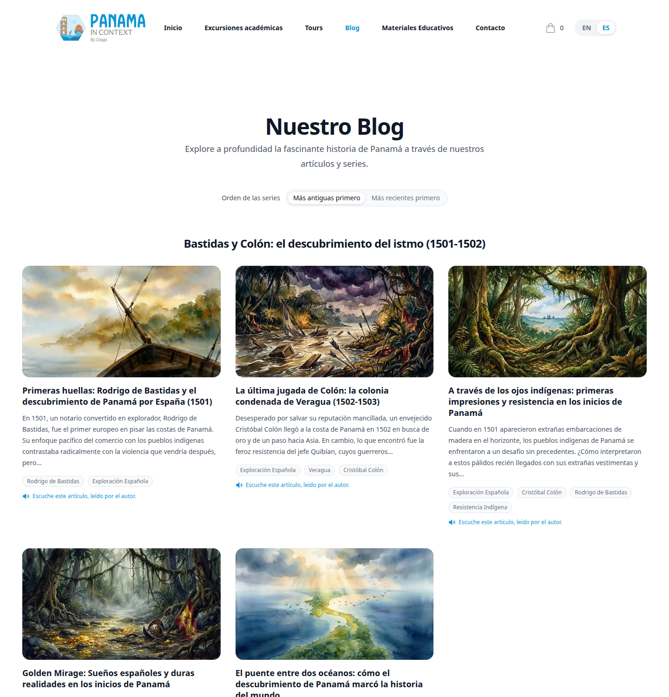
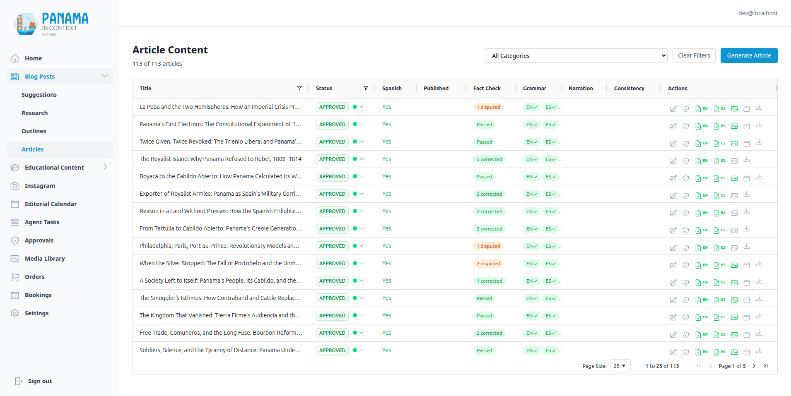

# Blog & Content Pipeline

[← Back to overview](README.md)

The blog looks simple from the front: bilingual, roughly 2,000-word articles about Panama's history, most of them grouped into short series, each one readable in English or Spanish and, in Spanish, listenable in Diego's voice. The interesting part is the factory behind it. I don't write these articles by hand, and I don't let an LLM publish them unsupervised. Every stage is a discrete endpoint, and the question that shaped the last three months was not "can a model do this stage?" but "where does a person still have to look?". The answer today: I approve the suggestion, I fact-check and approve the research, I clear the claims the research can't settle, and I run Grammarly over every article in both languages. Everything between those points (outlining, writing, tagging, translating, image generation, approving the finished article and picking its publish date) is run by an agent that works through a task graph, described on [An Agent Drives the Pipeline](10-agent-driven-pipeline.md).

## The pipeline, end to end

The whole thing is *research-first*: nothing gets written until a real deep-research document exists and has been approved. That single decision is what keeps the quality up. The model is condensing and structuring vetted research, not free-associating from its training data.

```mermaid
flowchart TD
    S["Suggestions (Sonnet)<br/>checked against what the site covers"] --> SA{{"I approve the suggestion"}}
    SA --> RP["Research prompt (Sonnet)"]
    RP --> DR["Deep research<br/>(PIC Companion drives Claude's UI)"]
    DR --> UP["Upload + validate<br/>(word floor, references, sub-topics)"]
    UP --> RA{{"I fact-check and approve the research"}}
    RA --> O["Outline + series split (Opus)<br/>outline approved by the driver"]
    O --> W["Condense + write (Opus)<br/>excerpt + summary (Haiku)"]
    W --> G["Ground every claim<br/>against the research"]
    G --> GW{{"Wait: uncovered claims<br/>settled by deep research"}}
    GW --> C["Apply corrections"]
    C --> GE{{"Wait: Grammarly EN<br/>+ Sonnet meaning check"}}
    GE --> T["Tags (Sonnet)"]
    T --> TR["Translate EN to ES<br/>(DeepL + glossary)"]
    TR --> EA["Spanish accuracy check (Sonnet)"]
    EA --> GS{{"Wait: Grammarly ES<br/>+ Sonnet meaning check"}}
    GS --> IM["Feature image<br/>(Sonnet prompt, Gemini render)"]
    IM --> SS["Series sections"]
    SS --> AP["Driver approves the article"]
    AP --> PD["Publish date picked<br/>(one series per day)"]
    PD -.-> N["Narration in Diego's voice<br/>(ElevenLabs + voice check)"]
```

Hexagons are the places where the pipeline waits for a person; every rectangle is a call the driver makes on its own. Narration is dotted because I start it from the admin rather than the driver.

A few stages deserve a closer look.

**Suggestions** come from Sonnet at high effort, and before generating it is shown the existing articles closest to the category so it steers away from ground the site already covers. Each new suggestion is then embedded and compared with every article and every earlier suggestion; a close match shows up as an amber pill in the admin's "Duplicate?" column. It's advisory, and the threshold behind it was calibrated rather than guessed (the mechanics are on [The Knowledge Layer](08-knowledge-layer.md)).

**The research prompt** is itself generated: Sonnet tailors a template targeting a 5,000 to 8,000-word document. Deep research has no API, so a Chrome extension treats the browser as the runtime: it runs the deep research in Claude's UI and uploads the result through the API. It's written up as its own project, [PIC Companion](https://feliu.dev/projects/pic-companion).

**Validation on upload** is stricter than you'd expect. The research has to clear a 4,000-word floor and contain a references section; Haiku checks that it covers at least two of the suggestion's sub-topics; and if the references section is missing, Haiku *generates* one from the inline citations rather than failing the upload.

**Fact-checking now holds the line instead of running alongside.** In July a pending claim never held anything up. Once an agent was approving articles, an open question about a fact had to stop the series. The driver waits until the research has no unresolved claims; after writing, every claim in the article is grounded against that research, and one the research neither supports nor contradicts goes to the deep-research queue while the series waits. Corrections are applied in place before the article moves on. The [fact-checking pipeline](06-fact-checking-pipeline.md) page covers how the claims are verified.

**Outlining gets the full research document, deliberately uncondensed.** This is the one place I *don't* condense, because the outline stage decides whether a topic is one article or a two-to-four-article series, and that decision needs the complete fact set.

**Writing condenses first.** Long research makes models ignore length and structure constraints, so research over 2,500 words is first condensed by an *outline-keyed* pass that keeps exact dates, names and figures but trims to about 1,800 words focused on that one article's outline. Feed a model 6,000 words and ask for 2,000 with seven sections, and you get neither. The prompt also forbids bold and italics, and code strips any that slip through: Grammarly drops emphasis when it rewords a sentence, and the meaning check downstream read every dropped asterisk as a change.

## Model routing

Three Claude models, chosen per stage, all pinned in the one LLM client described on [Architecture, Data & Operations](14-architecture-data-and-operations.md):

- **Opus** does the three judgement-heavy stages: the outline and series split, the condensation, and the article body. I moved them from Sonnet after an A/B on the same research: Opus connected the sections and drew the conclusions Sonnet only gestured at, for about six cents more per article. The trade-off is that Opus adds plausible, unsourced detail more freely, which is exactly what the grounding check exists to catch.
- **Sonnet** does the bounded work that still needs judgement: suggestions, the research prompt, tagging, the feature-image prompt, the Grammarly meaning check and the Spanish accuracy check.
- **Haiku** does the cheap work: excerpts, summaries, the sub-topic coverage check, the references autofix and the admin's research summaries.

Thinking is adaptive on all three, so effort is the only knob: high for the Opus stages and the generative Sonnet calls, low for tagging and the two reviewers, medium for Haiku. Two non-Claude services sit outside the client: DeepL translates and Google's Gemini renders images. Prompt caching was measured and left off for these stages: the calls sharing a research document start more than five minutes apart, and a reorder would save cents per series.

## Grammarly, with a reviewer

I built an LLM proofread first (Sonnet returning `FIND ||| REPLACE` corrections, applied only when the snippet occurs exactly once). It worked, but Grammarly is better at grammar and has no API that fixes text, so the [PIC Companion](https://feliu.dev/projects/pic-companion/driving-grammarly) extension drives its web editor and posts the result back. That page covers the browser side; this one covers what the backend does with the result.

The first live run showed why Grammarly can't have the last word. On one article it accepted 25 suggestions, and the Clarity rewrites among them flattened the voice and in places changed the meaning ("engineers would concentrate" became "engineers concentrated"). Now, before anything is written, Sonnet reads every changed paragraph next to the original and returns one verdict per pair: `KEEP`, a targeted `REVERT` (applied only if its snippet occurs exactly once), or `REVIEW` when it's unsure. A missing verdict counts as `REVIEW`, and a failed model call files every change for review rather than blocking the write, because silence must not read as approval. Reviews show up as an "N to review" pill on the articles grid.

The reviewer needed one recalibration: once articles lost their bold and italics, it started reverting harmless edits as "changed emphasis". The rewritten prompt names what to keep (intensifiers, splits, synonyms) and what to revert (claims, terms, certainty, opinion); on a labelled set, over-reverts of true keeps fell from 7 or 8 of 26 to 0 or 1, while it still caught 13 to 15 of 15 real meaning changes.

The apply endpoint refuses an article that changed since its source was fetched (`409`) or whose paragraph count moved (`400`), and stamps the language as checked, which is what the driver's Grammarly waits read. Every article on the site has been through it in both languages: about 7,800 fixes recorded, roughly 500 of them reverted or not applied.

## Tags

Tagging used to be Haiku, and the taxonomy showed it: 291 tags, 200 of which matched no article at all, and one article had collected 25. Tagging moved to Sonnet with a curator's brief (a tag must be central to the article and reusable across several; no era tags, because the category already encodes the period; canonical full names for people; two or three is normal). The prompt is not the only constraint. Code caps an article at five tags, counting the ones already attached, and collapses overlapping variants, so "Portobelo" wins over "Portobelo Fair". New tags arrive with their Spanish name from the same call. After a reset and retag, the site has 77.

## Bilingual content & translation

English is the source of truth; Spanish is DeepL-translated into `ES-419` (Latin-American Spanish). The non-obvious part is translating *markdown* without wrecking it: markdown goes to HTML so DeepL sees real document structure, code is protected with a `notranslate` marker, DeepL translates with `tag_handling="html"`, and the result comes back to markdown. Since July:

- **A glossary.** About 190 curated entries (proper nouns, period terms, names that must stay untranslated), drafted from the corpus by Sonnet and pruned by hand. Measured on three articles, the canonical-term rate went from 97.0% to 99.0%: a consistency nudge, not a quality jump, but it's on.
- **Thousands separators.** DeepL wrote `1.500` in some articles and `1,500` in others. Every translation now normalises to the comma, with a strict pattern that leaves decimals, years, dates and code alone.

Then Sonnet compares the Spanish with the already fact-checked English, paragraph by paragraph, and fixes only meaning: a number, a date, a name or a negation that no longer says what the English says. Wording belongs to Grammarly, which comes next.

## Feature images

Every article gets a watercolor feature image in one click. Sonnet writes the image prompt from the article, and Gemini renders it at 16:9 for about seven cents. It used to be a manual round trip through Gemini's web UI and an upload; removing it took out the last browser step in article production, which is what made an unattended series possible.

## Narration

Spanish articles carry a narration in Diego's cloned voice through ElevenLabs. Each paragraph is its own generation, stitched with the neighbouring text for continuity, and joined with real silence (one second between paragraphs, 1.4 before a heading). Headings are spoken as "Parte N: ..." so a listener can follow the structure. Each clip is post-processed (trailing blip trimmed, loudness levelled, outlier pace nudged). A per-paragraph content hash means editing one paragraph re-pays for that paragraph only, and a full article costs about 18,000 characters of synthesis. It runs as a background job, because a large article is over a hundred calls.

The hard part was quality control without listening to every paragraph. Some takes drift up in pitch and stop sounding like Diego. I measured the back catalogue first (76 articles, about 4,400 segments) and only then automated it: every run measures each clip's median pitch against the article's own baseline, and a clip more than 15% higher is re-requested up to twice. If 10% or more of an article's clips are suspect, something is wrong beyond a bad take, so nothing is retried and the article is flagged. Pitch turned out to be necessary but not sufficient (most of the clips it flagged in the measurement were fine), so the admin says "N to listen" and links each timestamp, rather than claiming a verdict. 81 articles are narrated.

## Taxonomies, categories & series

The content model is three levels deep: **Taxonomy** → **Category** → **Article**. Articles link to each other as a **series** through a self-referential `series_parent_id` plus `series_order`, and a series traces back to the suggestion it came from. Once every member is translated and proofread, a generation step writes each member's series navigation and "About this article" section.

Two details have changed since July:

- **Slugs are stored, and frozen once live.** Computing them from titles at request time meant loading every approved article to find one, and that exhausted the production connection pool. Now `slug` and `slug_es` are unique columns that follow the title only until the article is approved or dated, so a title edit can't move a live URL.
- **The "Notable Figures" taxonomy is excluded everywhere** through one shared constant, now also honoured by the knowledge layer and related articles.

## Status workflow

Suggestions, research, articles and tags share one status vocabulary, `PENDING / APPROVED / REJECTED`, with transitions validated centrally; articles also carry a separate `outline_status`. In July, re-running a stage "just no-ops or 409s". An agent driving the pipeline broke that idea. In September the driver timed out while outline generation was still running; the server committed the articles, and the replayed call would have hit "articles already exist", failed three times and stranded the whole series. So the endpoints a replay is likely to hit now *converge*: outline generation returns the articles it already made, a second fact-check request joins the running job, series sections report success when the series is already done, and the publish step reuses a date already picked. Stages that would duplicate paid work on a genuine double call (writing, translating) still refuse with a `400`. The rule is spelled out on [An Agent Drives the Pipeline](10-agent-driven-pipeline.md).

## Reading the blog

The public blog no longer has a search bar. It reads as a history rather than a changelog: articles are ordered by period (categories follow Panama's eras), grouped under the title of the suggestion they came from, with series kept together and a toggle that flips the whole list to newest first. Spanish articles with narration carry a listen badge.

Under every article sits a row of up to four related articles, computed from the stored embeddings by comparing each article's average vector, skipping its own series and anything written from the same research. It costs no API call per request. Semantic search itself lives in the knowledge layer, where Ask PIC, the MCP server and the admin use it; that's on [The Knowledge Layer](08-knowledge-layer.md).

## Driving it from the admin

The admin's "Blog Posts" section (Suggestions, Research, Outlines, Articles) is where I do my part and where I can do anything the driver does by hand. The Articles grid shows each article's grammar state per language, the "to review" and "to listen" pills, the fact-check badges, a Generate/Regenerate image button, and the edit drawer with its narration controls.

Publishing is the strictest gate in the system: an article can't go live unless it's `APPROVED`, has a Spanish translation, has a feature image and, if it's part of a series, has its series sections. Those conditions are checked server-side in one place, which both the admin button and the driver go through. When the driver publishes, the server also picks the date: the next free 7am Panama slot, one series per day, with every member of a series sharing that day.

---

[← Frontend & Design System](01-frontend-and-design-system.md) · [Back to overview](README.md) · Next: [Tours, Bookings & the Order/Pricing System →](03-tours-bookings-and-orders.md)
