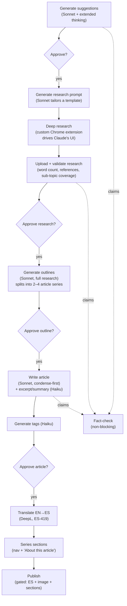
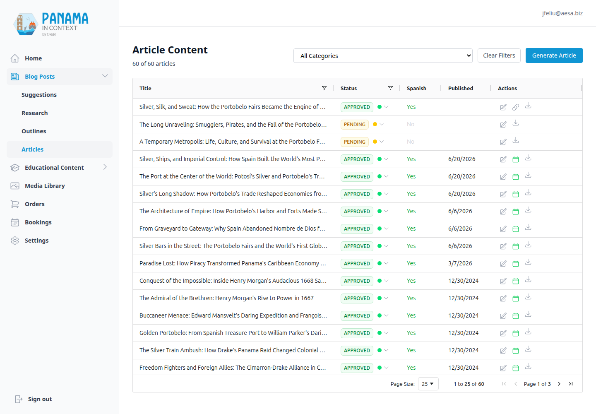

# Blog & Content Pipeline

[← Back to overview](README.md)

The blog looks simple from the front: bilingual, ~2,000‑word articles about Panama's history, sometimes grouped into series. The interesting part is the factory behind it. I don't write these articles by hand and I don't let an LLM publish them unsupervised. Instead there's a pipeline where each stage is a discrete, gated step, and I (the editor) approve the work as it moves from a one‑line idea to a published, translated series.

## The pipeline, end to end

The whole thing is *research‑first*: nothing gets written until a real deep‑research document exists and has been approved. That single decision is what keeps the quality up — the model is summarizing and structuring vetted research, not free‑associating from its training data.

A few stages deserve a closer look.

**Suggestions** are generated by Sonnet with extended thinking, deduped against existing titles so I don't get the same idea twice.

**The research prompt** is itself generated — Sonnet tailors a template (reference line, context, research focus, requirements) targeting a 5,000–8,000‑word research document. From there a purpose‑built Chrome extension runs the loop unattended: it fetches the prompt from the API, sets up and sends the deep research in Claude's UI, polls until the run completes, and uploads the finished document back through the API — where the validation below takes over. Deep research has no API, so the extension treats the browser as the runtime; it's written up as its own project. There's also a `/research-prompt` skill that does this straight against the production database and drops the prompt into `ai_generated_content/research_prompts/`.

**Fact‑checking runs alongside, not in the way.** Suggestions, research documents, and finished articles all get their claims extracted and verified, but none of it gates an approval — a pending claim never holds up the pipeline. It starts at the very first suggestion on purpose: catching a wrong premise at the one‑line‑idea stage is far cheaper than catching it after a 6,000‑word research run. The [fact‑checking pipeline](06-fact-checking-pipeline.md) page covers how the claims are verified.

**Validation on upload** is stricter than you'd expect. The uploaded research has to pass a word‑count floor (~4,000 words) and contain a references section; Haiku checks that it actually covers at least two of the suggestion's sub‑topics; and if the references section is missing, Haiku *generates* one rather than failing the upload. Re‑uploading over an already‑approved document returns a `409` unless you force it — a guard against silently clobbering work.

**Outlining gets the full research document, deliberately uncondensed.** This is the one place I *don't* condense, because the outline stage decides whether a topic is one article or a 2–4‑article series, and that decision needs the complete fact set. Once outlines are approved, the system creates the `Article` rows and wires up the series parent/child relationships.

**Writing condenses first.** Long research makes LLMs ignore length and structure constraints, so before the Sonnet writing call, research over ~2,500 words is condensed by an *outline‑keyed* Haiku pass — it keeps exact dates, names, and figures but trims to ~1,800 words focused on that specific article's outline. This was the fix for a real failure mode: feed a model 6,000 words and ask for 2,000 with seven sections, and you get neither.

## Model routing

The split between models is a cost decision as much as a quality one:

- **Sonnet** does the reasoning‑heavy, fidelity‑critical work — suggestions, the research prompt, outlining, the condensation pass, and the article body.
- **Haiku** does the cheap, bounded work — excerpts, summaries, tagging, sub‑topic coverage checks, and the references autofix.

All of it goes through one unified Anthropic client (see [Architecture, Data & Operations](10-architecture-data-and-operations.md)) so model IDs are pinned in exactly one place.

## Taxonomies, categories & series

The content model is three levels deep: **Taxonomy** (7 of them) → **Category** → **Article**. Articles can also link to each other as a **series** via a self‑referential `series_parent_id` + `series_order`, and a series traces back to the research suggestion it came from.

Two quirks worth knowing:

- **Slugs are computed, not stored.** An article's slug (and its Spanish `slug_es`) is derived at runtime from the English title. There's no slug column to keep in sync.
- **Taxonomy 5 ("Notable Figures") is excluded everywhere.** It holds biography articles with known quality issues, so there's a hardcoded `EXCLUDED_TAXONOMY_ID = 5` filtered out of the article list, category, and search endpoints. On read, links *to* those excluded bios are also scrubbed out of article bodies.

## Status workflow

Every pipeline entity — suggestions, research, articles, tags — shares one status vocabulary, `ContentStatus { PENDING, APPROVED, REJECTED }`, backed by a Postgres enum type. Articles additionally carry a separate `outline_status` (same three values) so the outline can be approved independently of the article. Transitions are validated centrally and stamp an `approved_at` / `approved_by` audit pair.

The whole pipeline is dotted with **idempotency guards**: writing refuses if content already exists, translating refuses if the Spanish field is already populated, outline generation refuses if articles already exist, and series‑section generation refuses to run twice (it checks for its own marker). Re‑running a stage is safe; it just no‑ops or 409s instead of producing duplicates.

## Bilingual content & translation

English is the source of truth; Spanish is DeepL‑translated into `ES-419` (Latin‑American Spanish). The non‑obvious part is translating *markdown* without wrecking it. The translation service does a round trip: markdown → HTML (so DeepL sees real document structure), protect `<code>`/`<pre>` with a `notranslate` marker, translate with `tag_handling="html"`, then HTML → markdown again. Code blocks and inline code survive intact. Every translation is logged with a character count and the detected source language, and failures are captured to Sentry.

## Search

Search is honest about what it is: an `ILIKE` query over title, content, and excerpt, filtered to approved articles and excluding the bio taxonomy, with title matches boosted ahead of body matches and a ±100‑character highlight snippet returned around the first hit. It's not Elasticsearch, and for a few hundred articles it doesn't need to be. The article‑list endpoint has its own search path that matches across both the English and Spanish columns.

## Fact‑checking the factory

A pipeline that generates historical facts at scale needs more than editorial review, so every level of it is now backed by a claims‑level verification layer: a suggestion's premise is checkable before any research money is spent, an approved research document's hundreds of claims are verified externally (through a free deep‑research loop with a knowledge base that compounds across documents), and every freshly written article is automatically *grounded* against the research it came from — catching the writer or the condensation pass drifting beyond the vetted facts. The results surface right in these admin grids as per‑row status badges, approving anything with unresolved or flagged claims asks for explicit confirmation, and inaccurate claims can be fixed in place through a preview‑and‑apply correction flow. It's a big enough system to deserve [its own page](06-fact-checking-pipeline.md).

## Driving it from the admin

All of this is operated from the admin dashboard's "Blog Posts" section — Suggestions, Research, Outlines, and Articles — each a focused page. The Articles grid is where an article gets its TipTap edit, its tags, its Spanish translation, a feature image, series sections, and finally a gated publish.

Publishing is the strictest gate in the system: an article can't go live unless it's `APPROVED`, has a Spanish translation, has a feature image, and — if it's part of a series — has its series navigation sections generated. Those four conditions are checked server‑side, so there's no way to publish a half‑finished article by clicking the wrong button.

---

[← Frontend & Design System](01-frontend-and-design-system.md) · [Back to overview](README.md) · Next: [Tours, Bookings & the Order/Pricing System →](03-tours-bookings-and-orders.md)
