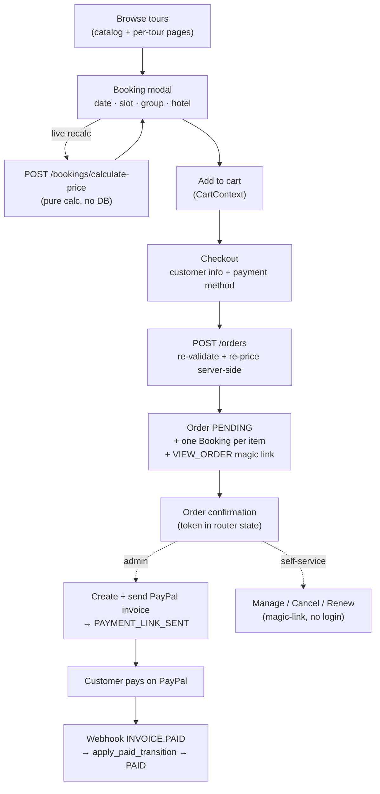
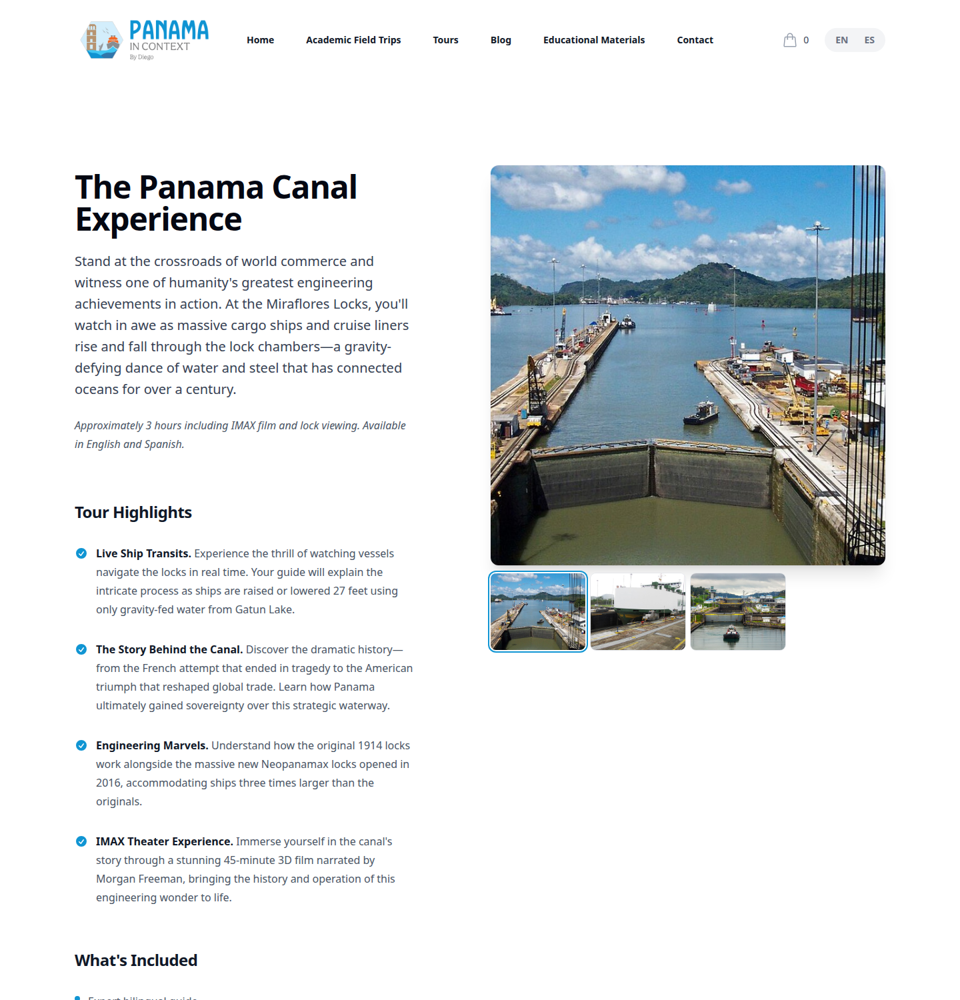
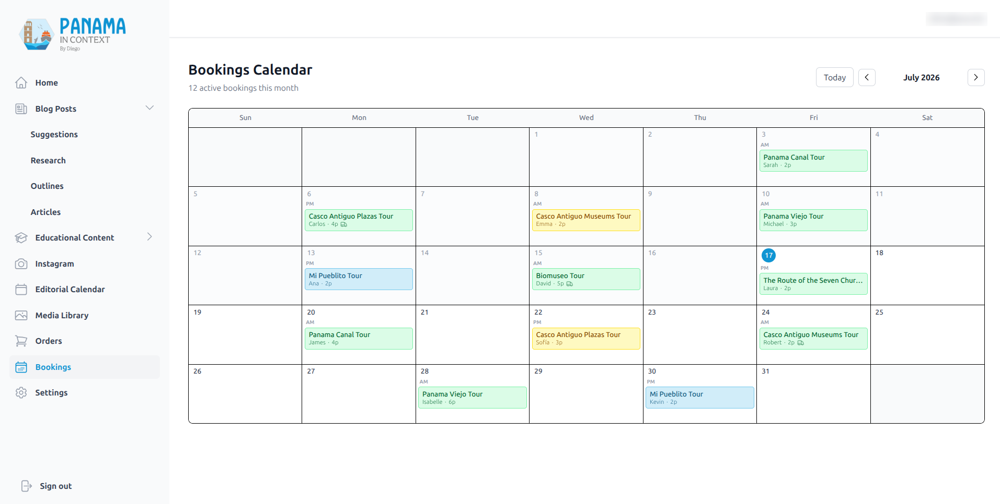

# Tours, Bookings & the Order/Pricing System

[← Back to overview](README.md)

This is the part of the platform that takes money, so it's the part I hardened the hardest. A tourist browses tours, configures one (date, group, hotel pickup), adds it to a cart, checks out, and pays through a PayPal invoice. Then they can manage that order — view, cancel, or renew the payment — without ever creating an account. Behind all of it is a server‑side pricing engine that never trusts a number the browser sends.

## The end‑to‑end flow

The key architectural decision: **no database state exists until checkout.** Browsing and configuring a tour is pure calculation — the booking modal recomputes the price on every change by calling a stateless `calculate-price` endpoint, and the cart lives entirely in React context. Only when the customer submits checkout does the system create an `Order` and its `Booking` rows.

And when it does, **it re‑prices everything server‑side.** The `create_order` endpoint re‑validates each tour, re‑checks slot availability for private tours, and recomputes the price from scratch — the client's price is never trusted, only displayed. The computed totals are then snapshotted onto each booking, so a later change to the rate config can't retroactively alter an existing order.

## The pricing engine

This is the piece I'm quietly proud of. Private‑tour pricing isn't a flat number — it's computed from a configurable model, so the business can tune rates without a code change. `grand_total = service − senior_discount + tickets + transport`, where:

- **Service** is a base fee plus a *per‑position hourly ladder* multiplied by the tour's duration. The ladder degrades with group size — the first guest is billed at one hourly rate, the next couple at a lower rate, and so on down to a floor — because a guide's marginal effort per extra person decreases. Children under five are free and don't even occupy a billable position.
- **Senior discount** knocks a configurable percentage off the per‑person service cost for each senior in the group.
- **Tickets** are summed per attraction on the tour, priced by *age category × residency* (residents and tourists pay different gate prices in Panama), handling mixed groups correctly.
- **Transport** is tiered by group size: small groups (1–4) price off a zone matrix (hotel zone → tour zone, round‑trip doubling), while larger groups use flat hourly rates. If the hotel isn't in the database or there's no matching rate, the booking is flagged as needing a manual quote rather than guessing.

Open‑group "fixed‑price" tours skip all of that and use simple per‑head prices. Everything is fed by a `PricingConfig` key/value table (the rate ladder, senior percentage, flat transport rates, plus operational knobs like reservation validity and payment‑link lifetime) and a set of zone/attraction/transport rate tables. The pricing config is editable from the admin Settings page.

▶ **Demo video:** [Booking a tour — configuring date, group, and hotel pickup, with the price recalculating on every change](https://feliudev.nyc3.cdn.digitaloceanspaces.com/projects/panama-in-context/videos/booking-flow.mp4)

## Orders vs. bookings

The data model separates the two cleanly:

- An **Order** is one cart checkout — the customer, the payment, and the lifecycle. It has a `reference` like `ORD-XXXXX`, a status, a payment method, PayPal invoice fields, a reservation expiry, and both a pre‑discount subtotal and a post‑discount grand total.
- A **Booking** is one tour, on one date, for one group — and an order can have several. It has its own `reference` (`PIC-XXXXX`), the schedule, the participant breakdown, and the per‑booking price snapshot.
- A **BookingStatusLog** is a polymorphic audit trail covering both order‑ and booking‑level transitions, and it carries the PayPal event ID with a `UNIQUE` constraint — which is the database backstop for webhook idempotency.

Order and bookings move in lockstep through `OrderStatus` (`PENDING → PAYMENT_LINK_SENT → PAID`, or `CANCELLED` / `EXPIRED`).

▶ **Demo video:** [Cart and checkout — reviewing the cart, entering customer details, and placing the order](https://feliudev.nyc3.cdn.digitaloceanspaces.com/projects/panama-in-context/videos/cart-checkout.mp4)

## Payment: PayPal invoices, not a checkout button

One thing that surprises people: there's **no embedded "Pay with PayPal" button.** The model is PayPal's Invoicing API v2, server‑to‑server. After an order comes in, the admin creates and sends a PayPal invoice from the dashboard; the customer pays on PayPal's hosted invoice page; and PayPal fires a webhook back. It fits how this business actually operates (Diego reviews and confirms bookings) and keeps card data entirely off our servers.

The webhook path is idempotent in three layers, because payment webhooks get redelivered and you must never double‑apply one:

1. An early dedup check on the PayPal event ID.
2. A row‑level lock on the order while transitioning.
3. A single shared "mark paid" transition guarded against re‑application, used by both the webhook and the admin's manual "mark paid" action.

Signature verification *fails closed* — a missing webhook ID is a rejection, not a silent accept — and the app refuses to even boot in production if PayPal is configured without a webhook ID.

## Magic‑link self‑service

Customers manage their orders without an account. At checkout the system mints a single `VIEW_ORDER` magic‑link token (lifetime = the reservation validity, default 7 days). That one token is the credential for viewing, cancelling, and renewing the order. The security details matter:

- The token travels in the URL **fragment** (`#token=…`) or React router state — **never** the query string — so it stays out of server access logs and `Referer` headers.
- API calls send it as an `Authorization: Bearer` header.
- It's validated to be unexpired, unused, and matching the order.
- Terminal actions (cancel) consume the token; non‑terminal ones (renew) leave it valid — because a customer who renews still needs to come back later.

Cancellation flips the order and its bookings to `CANCELLED` and marks the link used. Renewal cancels any stale PayPal invoice and notifies the admin to re‑issue one, with anti‑spam logic so a customer mashing "renew" doesn't pester the admin repeatedly.

## Slot‑race hardening

Two customers can try to book the same private tour for the same slot at the same time. A partial unique index on `(tour_date, time_slot)` — scoped to active statuses, and excluding fixed‑price tours that allow multiple bookings per slot — means the loser of that race gets a clean `409` at commit time rather than a double‑booking. The availability pre‑check also treats unexpired pending reservations as holds, so a slot someone is mid‑checkout on shows as taken.

## The admin side

Diego runs the operation from two admin pages: **Orders** (create/send/cancel invoices, mark paid, reschedule) and **Bookings**, a month calendar of confirmed trips.

There's careful handling for the ugly edge case where a PayPal side effect succeeds but the local database commit fails — the "orphan" case. Those are rolled back, tagged in Sentry, and surfaced as errors rather than left as silent drift between our records and PayPal's. Email failures, by contrast, are deliberately *non‑fatal*: a booking is never lost because a confirmation email didn't send — the failure is recorded on the row and the order still completes.

---

[← Blog & Content Pipeline](02-blog-and-content-pipeline.md) · [Back to overview](README.md) · Next: [The Educational Deliverables Pipeline →](04-educational-deliverables-pipeline.md)
