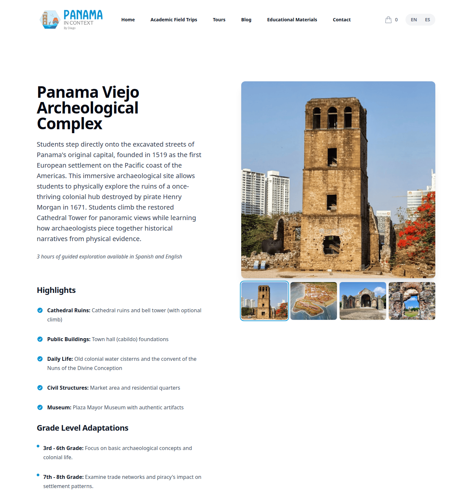
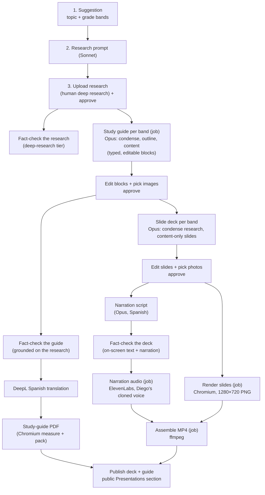
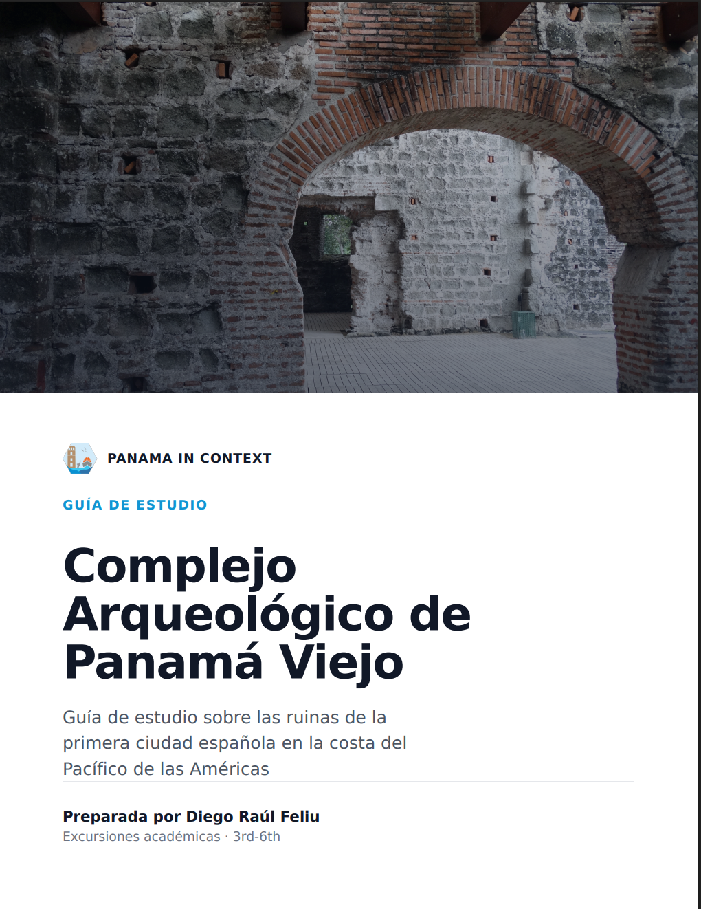
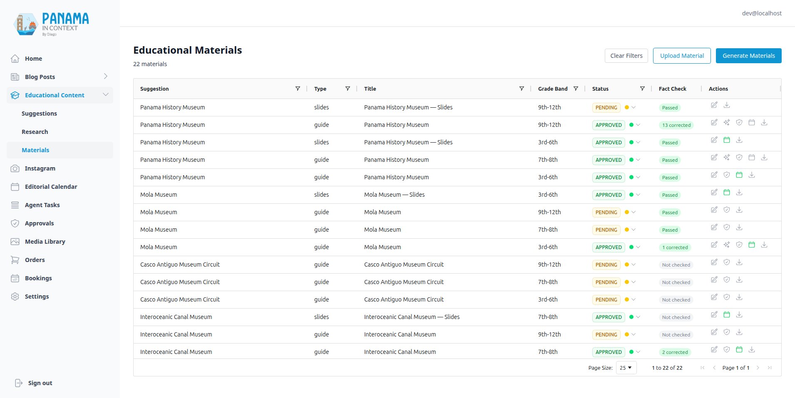
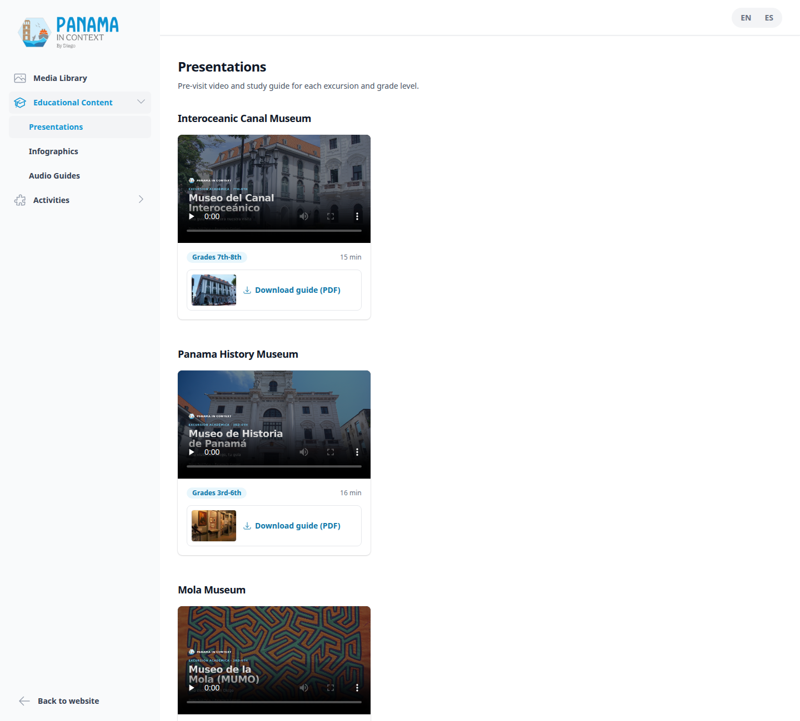

# The Educational Deliverables Pipeline

[← Back to overview](README.md)

This is the system I care about most. The premise is simple to state and hard to deliver: for **every academic excursion × grade band**, produce the two things the website promises teachers and the business historically never shipped:

1. A **pre-visit presentation**: a slide deck narrated in Diego's *cloned Spanish voice*, published as an MP4 a teacher can project in class a few days before the trip (it replaces a live Zoom call that was hard to schedule). We **self-host** it: the MP4 lives on our own object storage and plays inline on the public page, with no YouTube in the loop.
2. A **grade-adapted study-guide PDF** the teacher can download and hand out.

The taxonomy behind that promise grew over the summer. There are **ten canonical excursions** spread over **six public excursion pages**, and they owe **24 deliverable pairs**. Most excursions cover three grade bands (3rd-6th, 7th-8th, 9th-12th); Miraflores covers a single 4th-8th band; the inter-religious journey is two excursions (Abrahamic and Eastern traditions) that share one public page and each owe a 9th-12th video and guide. The museum circuit taught me something about modeling: teachers pick *which* museums they visit, so deliverables are per museum (Museo del Canal, Museo de Historia, Museo de la Mola), not per circuit combination, all under one public page. A canonical taxonomy module (`app.core.excursions`) is the single source of truth that reconciles the public site's page keys, the admin pipeline's keys and the grade-band ids; everything downstream, including the public delivery surface and the coverage report, groups on it.

The content has to be genuinely different per band. A 3rd-grader and an 11th-grader visiting Panamá Viejo should not get the same study guide.

## Why this is hard (and why I built it from scratch)

The naïve version is "ask an LLM for a slideshow." That falls apart fast: the content has to be grade-appropriate, the narration has to sound like one specific person, the slides have to be on-brand and in Spanish, the facts have to survive a fact-check, and a human has to be able to *edit* and reject each artifact before it reaches a classroom. So instead of one big generation call, it's a **pipeline of discrete admin endpoints**: each produces one artifact and hands off to the next, and between the expensive stages sit explicit human **edit, pick and approve** checkpoints. There's no external SaaS (no Gamma, no template service) anywhere in it.

## The pipeline, stage by stage

Each arrow is a **gate**, and there are two kinds. The approval gates are 400s: the research prompt needs an approved suggestion; study guides need approved research; a slide deck needs an approved guide; narration needs an approved deck (the script is written against the *final* slides); assembling the video needs every slide to have both a rendered frame and narration audio; publishing needs an APPROVED material. The fact-check gates are 409s, and they get their own section below. Two of the approval gates are full **editing surfaces**, not just approve buttons: a human curates the guide's blocks and the deck's slides (and picks the real photos) before anything renders. The operator still moves every piece of work forward by hand; the background jobs described below run a step, they never decide to start the next one.

### The content engine (research to guides and decks)

The first half is the same research-first philosophy as the [blog pipeline](02-blog-and-content-pipeline.md), specialized for the classroom. Every generation call in it runs on **Opus 5.5 at effort high**, including the condense step that used to be a cheap Haiku pass. Deciding what to keep from a long research document is a judgement task, and at a handful of guides per excursion the cost difference is small.

- **Study guides are typed JSON blocks**, not a wall of markdown. A guide is a list of blocks: `cover`, `section`, `paragraph`, `bullets`, `ordered_list`, `quote`, `map`, `timeline`, `image`, `callout` (Key Terms, "Did you know?", reflection boxes) and `mc_question` (one block per multiple-choice question, deliberately with *no* answer field: it's a printed student handout, not a teacher key). They're generated *per grade band* in three passes (condense, outline, write), and the grade differentiation is real: each band gets a different analytical **focus** fed into its condense step, and a scaled **review ladder** (3rd-6th get 4 two-choice questions and 1 reflection prompt; 9th-12th get 8 four-choice questions and 3). Excursion titles are pinned from the canonical taxonomy, so the model never invents a guide's name. Each band commits independently, and a re-run (reachable from the admin while any band lacks an approved guide) only regenerates the bands without an approved guide.
- **Slide decks are generated from the *research*, not the study guide**, and in two stages. The guide turned out to be a summary of a summary; sourcing decks from it starved them to about 7 minutes of narration. So deck generation re-condenses the research into a slides-specific briefing (persisted on the row), emits **16 to 22 content-only slides** (template, title, on-screen lines and a *placeholder* image query; no narration, no photos yet), and only *after* a human has edited and approved the deck does a **separate narration stage** write Diego's script over the final slides and that same briefing, under a word budget tuned for a 15 to 17 minute video.
- **Slides are authored natively in Spanish**, not translated. Only the *study guide* goes through DeepL (it's English-authored, following the blog pattern). The slide body and narration are generated directly in Spanish, because the narration has to read naturally in Diego's voice, and a translated script sounds translated.
- **Each slide and each block is a real database row or structured object**, not a blob of markdown. An `EduSlide` carries its template, title, body, picked photo and narration script; a guide carries its blocks as JSON. Every downstream stage (edit, render, audio, PDF, fact-check) has a per-unit home, and every edit is re-validated through a strict normalizer: a UI bug can't silently drop a block, it 422s naming the offender.

**Token caps are thinking headroom first.** With adaptive thinking on, `max_tokens` has to cover the reasoning and the JSON, and I learned the sizes from production: the slides call truncated at 12,000 tokens planning a 22-slide arc, and the first two Opus runs of a museum guide truncated the outline at 12,000 both times. The fix was always more headroom (outline 32k, slides 40k, guide content and narration 64k, each with a comment recording the measurement behind it), never disarming the guard: the LLM client refuses a truncated response instead of letting a lenient parser paper over half-written JSON, and I want that to stay loud.

### Fact-check gates

The edu pipeline is fact-checked at two levels, with the same claim machinery as the blog (see [the fact-checking pipeline](06-fact-checking-pipeline.md)). The research goes through the external deep-research tier. Then each **material** is grounded against its full research: a guide's prose is walked block by block, and a deck is grounded on its on-screen text **and** its narration, because the narration is what Diego says out loud. A video can't be fact-checked directly (the endpoint refuses and points at the deck): checking the deck is how the video gets checked. Corrections are written back to the slide row or guide block a claim came from, never to the derived markdown preview, and any edit or regeneration of a material's text invalidates its claims.

Unlike the blog, where a warning is enough, these gates are **hard 409s** in the backend, in two tiers:

| Step | Blocked by |
|---|---|
| Internal: translate the guide, render the PDF, synthesize narration audio, assemble the video | `INACCURATE` |
| Public: publish | `INACCURATE`, `NEEDS_DEEP_RESEARCH`, `DISPUTED` |

An `INACCURATE` claim is a known error, and no step is worth taking on content that carries one, least of all paying ElevenLabs to say it in Diego's voice. Open questions only block publishing, because the deep-research queue can take hours. `CORRECTED` passes, and so does a never-checked material after an explicit confirm in the admin. There is no override flag in the backend, because an override flag is just a block that everyone learns to bypass. In production the guides and decks have been grounded on about 640 claims, 23 of them corrected before anything went out.

### The render-and-assemble engine (blocks and slides to PDF and MP4)

**Slide rendering** turns each `EduSlide` into a 1280×720 PNG. It maps the slide onto one of nine Jinja2 templates that mirror the brand slide kit, inlines the brand CSS and logos (base64), and screenshots it with a headless Chromium driven by Playwright. One browser instance is reused across the whole deck. An `autofit.js` pass shrinks each content box to fit the canvas so nothing clips off the bottom. The **photo on each slide is human-picked**, not auto-matched: generation only leaves an `image_query` placeholder, and in the admin editor a person chooses the actual image from the [media library](05-media-library-and-acquisition.md) (the picker is pre-seeded with that query) or imports one from a link. If a slot is left unpicked, the slide falls back to a clean brand-color template. For school material, a person decides which photo of a place actually shows that place. Here's the finished presentation those rendered slides assemble into, the Panamá Viejo deck for 3rd-6th grade:

**Narration audio** synthesizes each slide's script through ElevenLabs in Diego's cloned voice (`eleven_multilingual_v2`). Each slide's MP3 is cached on disk keyed by `(material, position)`, so a mid-deck failure on slide 14 doesn't re-pay for slides 1 to 13 on retry, and a 24-hour TTL sweep reclaims abandoned runs so `/tmp` doesn't grow forever.

**Video assembly** with ffmpeg builds one clip per slide (a still image held for the length of its narration plus a half-second pause, then a hard cut) and concatenates them losslessly. What makes the concat free is that every clip is encoded with identical parameters (`libx264 -tune stillimage`, AAC 192k, 30 fps), so the final join is a stream copy rather than a re-encode.

**The study-guide PDF** is the part I rewrote most. Block-based guides render into fixed 816×1056 US Letter pages from the design kit's study-guide templates, in three passes: each block becomes an HTML fragment, a headless-Chromium **measuring pass** records every fragment's real height at the content width, and a pure, greedy **packing pass** fills pages, splitting lists at item boundaries and starting a continuation header when a section runs over. Only then does Chromium print the final document. Measuring first is what lets a tall photo frame or a long timeline paginate correctly instead of being clipped by CSS page breaks. Guide PDFs are **not watermarked**: the brand appears as the logo on the cover and closing pages, with a quiet footer (guide title and page number) on interior pages. Here's a real one:

Spanish, branded, grade-banded (note the "3rd-6th" tag), with key terms, review questions and reflection prompts. This is the artifact a teacher actually downloads.

## Long steps run as background jobs

Guide generation, slide rendering, narration audio and video assembly used to be blocking requests, and they failed in the most confusing way possible: a full deck's video assembly takes 15 to 20 minutes of ffmpeg, so the browser got a 504 at exactly 300 seconds while the work finished server-side. My first stopgap raised a proxy timeout to 1,200 seconds, on a location that production browsers turned out never to use, which is a good reminder to check which vhost a request actually goes through.

Now those four steps validate in the request (a 404, 400, 422 or the fact-check 409 still comes back at once), create a job row, run as a background task and return `202` with the job id; the admin polls and shows progress ("Rendering frames... 5/22", the current band for guides). Two rules make it safe to click twice. An **identical** request (same type, same parameters) joins the running job, so reloading the page and clicking again resumes polling instead of failing. **Any other** edu job on the same deck or research is a 409, because a re-render racing the video mux would ship an inconsistent MP4. A job older than an hour stops blocking, so a crashed worker can't wedge a deck. The runner commits after every slide, so each finished frame and MP3 is durable as it lands and the database connection goes back to the pool between slides instead of being held through minutes of Chromium, ElevenLabs and ffmpeg. It is a plain synchronous function on purpose, because Playwright's sync API can't run inside an event loop. The shorter steps (slides, narration, translation, PDF) still run in the request.

## Fixing one slide without redoing the deck

Every deck step (slide content, narration, render, audio) accepts an optional set of slide positions. The admin's regenerate dialog offers three scopes: all slides, only what changed (derived from which artifacts are missing, since saving an edited slide clears whichever of its frame and audio the edit made stale), or a typed range like `3-6, 12`. Regenerating a subset sends the whole deck to the model as context but rewrites only the targeted slides in place, keeping each row's id, photo pick, narration and audio and clearing only the now-stale frame. The contract is strict: the model's reply must cover exactly the requested positions or nothing is saved. Fixing one wrong date on slide 9 used to mean regenerating, re-narrating, re-synthesizing and re-reviewing all 22 slides; now it costs one slide.

## Storage model

Text lives in **Postgres as typed structure**: a guide's `content_blocks` and `content_blocks_es` (JSON), each slide's row, and the deck's persisted research briefing, with flat markdown kept as a *projection* regenerated from the blocks on every edit, so the human-editable structure is always the source of truth. The rendered binaries (PNG frames, MP3 narration, the MP4, the PDFs) live in **DO Spaces** at **fixed keys that each render overwrites in place**, such as `materials/video/{research}/{band}.mp4` and `materials/guide/{research}/{band}_{lang}.pdf`. Stable URLs pay off: the public academic-excursions page links the Miraflores video and guide as sample deliverables, and a re-render keeps those links valid. The cost is browser caching, solved in the admin rather than in storage: "Open PDF" and "Open video" links carry a per-load `?v=` cache-buster.

The `EduMaterial` table is a small discriminated union: a row is either *generated* (linked to edu research) or *uploaded* (a NotebookLM artifact linked to blog research), enforced by a check constraint, with a natural key on `(research, type, grade_band)` that makes every upsert idempotent. Publication is a **separate `published_at` timestamp, not a status value**, mirroring the blog: a material is public only when it is APPROVED *and* `published_at` is set and in the past. That way approval and going live stay independent decisions.

## Publishing, and what's live

The admin materials grid shows guides and decks per grade band; video rows are hidden, because the MP4 is reached, regenerated and published through its deck.

Publishing is a **calendar icon in the grid's Actions cell**, exactly like the blog. You publish the **deck**, not the video: the deck is what an operator curates, so publishing it is what surfaces its sibling video on the public page (the API finds the video by research and grade band, and uses the first rendered slide frame as the poster). A deck with no assembled video is simply left off. The guide is published the same way, and its cover photo becomes the card's thumbnail.

The public side is a no-login `GET /api/v1/public-edu/deliverables`, grouped by canonical excursion and grade band, rendered by the **Presentations** section of the `/materiales-educativos` portal: each band is a card with an inline video, a duration chip and a "Download guide (PDF)" tile. The whole portal is open to every teacher; the email gate that used to sit in front of its media library is gone (see [Forms & Mailing List](13-forms-mailing-and-educator-access.md)).

As of October 2026, **5 of the 24 pairs are published**: Panamá Viejo 3rd-6th, Miraflores 4th-8th, Museo del Canal 7th-8th, Museo de Historia 3rd-6th and Museo de la Mola 3rd-6th, with videos running 13 to 16 minutes. The pipeline is finished; what's left is the work itself: fact-checking the remaining research, then generating, reviewing and publishing the other 19 pairs.

## Why it's built this way

A few decisions I'd defend:

- **Human edit-and-gate at every stage, with facts checked before money moves.** This is school material with the brand's name on it. The cost of a bad artifact in a classroom is far higher than the cost of a click, so the checkpoints are editors, not just approve buttons, and a known-false claim stops the pipeline before ElevenLabs is paid to say it.
- **No external SaaS in the render or hosting path.** Brand CSS, logos and icons are bundled into the backend image, one Chromium serves the slide renderer and the PDF exporter, and the finished files are self-hosted rather than handed to YouTube.
- **Idempotent and resumable, per band and per slide.** Bands commit independently, audio is cached per slide, jobs join instead of duplicating, and a fix to one slide costs one slide. When you're paying per ElevenLabs character and per Opus token, "retry from scratch" is not an acceptable failure mode.

---

[← Tours, Bookings & the Order/Pricing System](03-tours-bookings-and-orders.md) · [Back to overview](README.md) · Next: [Media Library & Acquisition →](05-media-library-and-acquisition.md)
