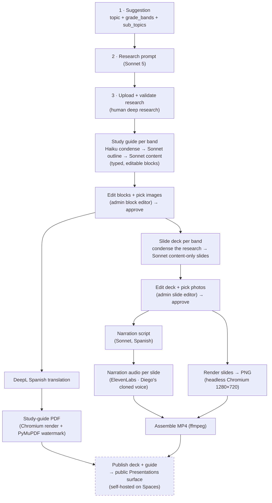
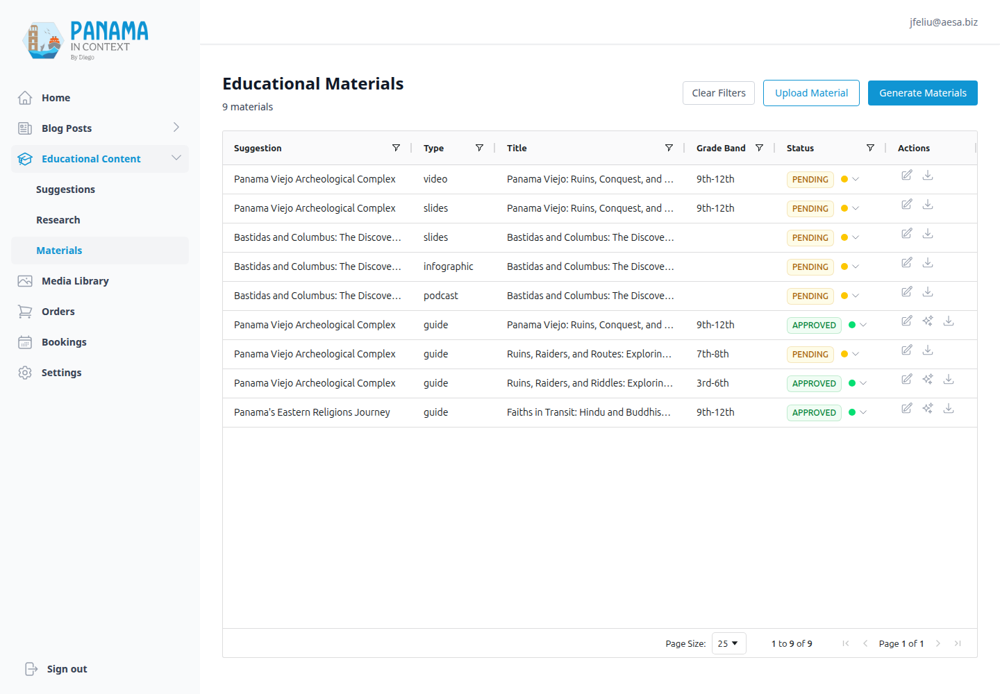

# The Educational Deliverables Pipeline

[← Back to overview](README.md)

This is the system I care about most, and the one I was actively building over the weekend this was written. The premise is simple to state and hard to deliver: for **every academic excursion × grade band**, produce the two things the website promises teachers but the business historically never shipped —

1. A **pre‑visit presentation** — a slide deck narrated in the guide's *cloned Spanish voice*, published as an MP4 a teacher can project in class a few days before the trip (this replaces a friction‑heavy live Zoom). We **self‑host** it — the MP4 lives on our own object storage and plays inline on the public page; there's no YouTube in the loop.
2. A **grade‑adapted study‑guide PDF** the teacher can download and hand out.

There are 15 of these deliverable pairs (most excursions cover three grade bands; Miraflores is 4th–6th only; the inter‑religious journey is 9th–12th only and is actually *two* excursions — Abrahamic and Eastern traditions — that share one public page but each owe their own video and guide). That last split is why the excursion count looks different depending on what you're counting: there are **six public excursion pages, but seven canonical excursions** in the taxonomy. The content has to be genuinely different per grade band — a 3rd‑grader and an 11th‑grader visiting Panamá Viejo should not get the same study guide. A canonical taxonomy module (`app.core.excursions`) is the single source of truth that reconciles the public site's excursion pages, the admin pipeline's keys, and the grade‑band ids — everything downstream, including the public delivery surface, groups on it.

## Why this is hard (and why I built it from scratch)

The naïve version is "ask an LLM for a slideshow." That falls apart fast: the content has to be pedagogically real and grade‑appropriate, the narration has to sound like one specific person, the slides have to be on‑brand, the whole thing has to come out in Spanish, and a human has to be able to *edit* and reject each artifact before it reaches a classroom. So instead of one big generation call, it's a **pipeline of discrete admin endpoints** — each produces one artifact and hands off to the next, and between the expensive stages sit explicit human **edit / pick / approve** checkpoints. There's no external SaaS (no Gamma, no template service) anywhere in it.

## The pipeline, stage by stage

Each arrow is a **review gate**. Generating the research prompt requires an approved suggestion; generating study guides requires approved research; generating a slide deck requires an approved guide; generating narration requires an approved deck; assembling the video requires every slide to have both a rendered image and narration audio; publishing requires an APPROVED material. And two of those gates are now full **editing surfaces**, not just approve buttons — a human curates the guide's blocks and the deck's slides (and picks the real photos) before anything renders. The whole thing is operator‑orchestrated — there's no background job runner deciding to move work forward, because for brand‑facing school material I want a person looking at each artifact.

### The content engine (research → guides + decks)

The first half is the same research‑first philosophy as the [blog pipeline](02-blog-and-content-pipeline.md), specialized for the classroom. This is also the part I most recently reworked — the content stopped being opaque markdown and became **typed, editable structure**, and all the Sonnet stages moved to **Sonnet 5** (adaptive thinking, high effort):

- **Study guides are now typed JSON blocks**, not a wall of markdown. A guide is a list of blocks — `cover`, `section`, `paragraph`, `bullets`, `ordered_list`, `quote`, `map`, `timeline`, `image`, `callout` (Key‑Terms / "Did you know?" / reflection boxes), and `mc_question` (one block per multiple‑choice question, deliberately with *no* answer field — it's a printed student handout, not a teacher key). They're still generated *per grade band* with the three‑phase pass — Haiku condenses the research, Sonnet outlines, Sonnet writes — and the grade differentiation is real: each band gets a different analytical **focus** fed into its condense step, and a scaled **review ladder** (3rd–6th get 4 two‑choice questions + 1 reflection prompt; 9th–12th get 8 four‑choice questions + 3). Excursion titles are pinned from the canonical taxonomy and written over programmatically — the LLM never gets to invent a guide's name. Each band commits independently, so one failing doesn't lose the others, and a re‑run only regenerates what's missing.
- **Slide decks are generated from the *research*, not the study guide** — and in two stages. The guide turned out to be a summary of a summary; sourcing decks from it starved them to ~7 minutes of narration. So deck generation re‑condenses the research to a slides‑specific briefing (persisted on the row), emits **16–22 content‑only slides** (template, title, on‑screen lines, and a *placeholder* image query — no narration, no photos yet), and only *after* a human has edited and approved the deck does a **separate narration stage** write Diego's script over the final slides, walking every on‑screen line under a word budget tuned for 15+ minutes of video.
- **Slides are authored natively in Spanish**, not translated. Only the *study guide* goes through DeepL (it's English‑authored, following the blog pattern). The slide body and narration are generated directly in Spanish, because the narration has to read naturally in Diego's voice — a translated script sounds translated.
- **Each slide and each block is a real database row / structured object**, not a blob of markdown. An `EduSlide` carries its template, title, body, a picked photo, and the narration script; a guide carries its blocks as JSON. So every downstream stage (edit, render, audio, PDF) has a per‑unit home, and both the guide and the deck expose a `PUT …/content` (or `…/slides`) endpoint that re‑validates every edit through a strict normalizer — a UI bug can't silently drop a block, it 422s naming the offender.

### The render‑and‑assemble engine (blocks + slides → PDF + MP4)

This is the half I built over the weekend, and the part I find most fun.

**Slide rendering** turns each `EduSlide` into a 1280×720 PNG. It maps the slide onto one of nine Jinja2 templates that mirror the brand slide kit, inlines the brand CSS and logos (base64), and screenshots it with a headless Chromium driven by Playwright. One browser instance is reused across the whole deck. An `autofit.js` pass shrinks each content box to fit the canvas so nothing clips off the bottom. The **photo on each slide is human‑picked**, not auto‑matched: generation only leaves an `image_query` *placeholder*, and in the admin editor a person chooses the actual image from the [media library](05-media-library-and-acquisition.md) (the picker is pre‑seeded with that query) — or pastes a web URL to import one — which stamps a `media_path` the renderer embeds. If a slot is left unpicked, the slide falls back to a clean brand‑color template. (The old search‑term auto‑matcher was deleted — for school material, a person decides what photo of a place actually shows that place.) Here's the finished presentation those rendered slides assemble into — the Panamá Viejo deck, 3rd–6th grade band:

**Narration audio** synthesizes each slide's script through ElevenLabs in Diego's cloned voice (`eleven_multilingual_v2`). The piece I'm happiest with here is the resilience: each slide's MP3 is cached on disk keyed by `(material, position)`, so a mid‑deck failure on slide 14 doesn't re‑pay for slides 1–13 on retry, and a 24‑hour TTL sweep reclaims abandoned runs so `/tmp` doesn't grow forever. (This pattern is ported from a sister project's interview‑podcast pipeline.)

**Video assembly** with ffmpeg builds one clip per slide — a still image held for the length of its narration plus a half‑second pause, then a hard cut — and concatenates them losslessly. The trick that makes the concat free is that every clip is encoded with identical parameters (`libx264 -tune stillimage`, AAC 192k, 30fps), so the final join can be a stream copy rather than a re‑encode. The result is an MP4 stored in DO Spaces.

**The study‑guide PDF** renders the (Spanish) markdown into a branded HTML document, prints it to PDF with Chromium, and stamps a watermark on every page with PyMuPDF. Here's a real one:

Spanish, branded, watermarked, grade‑banded (note the "3rd‑6th" tag), with a vocabulary table, reflection questions, and an on‑site observation guide. This is the artifact a teacher actually downloads.

## Storage model

Text lives in **Postgres as typed structure** — a guide's `content_blocks` / `content_blocks_es` (JSON), each slide's row, and the deck's persisted research briefing — with flat markdown (`content`, `content_es`) kept as a *projection* regenerated from the blocks on every edit, so the human‑editable structure is always the source of truth. The rendered binaries — PNG frames, MP3 narration, the MP4, the PDF — live in **DO Spaces** with the CDN URL stored back on the row. The `EduMaterial` table is a small discriminated union: a row is either *generated* (linked to edu research) or *uploaded* (linked to blog research), enforced by a check constraint, with a natural key on `(research, type, grade_band)` that makes every upsert idempotent. Publication is a **separate `published_at` timestamp, not a status value** — mirroring the blog's `Article.published_at`: a material is public only when it is APPROVED *and* `published_at` is set and in the past (a future value schedules it, NULL hides it). That way approval and going‑live stay independent decisions.

## What's shipped, and what I'm still building

Here's the honest state of it. The admin materials grid shows the artifact types — `guide`, `slides`, `video` — per grade band, and the whole render‑to‑publish path is now driveable from the UI:

**Shipped and working (verified):** the whole pipeline, end to end, is now operable from the dashboard — no more curl‑only stages. Since the earlier draft of this page, a weekend's worth of "still to build" became "shipped":

- **The admin editing surfaces landed (was #327's editor work).** Guides and decks each open a **card‑per‑block / card‑per‑slide editor** in the drawer — reorder, add, delete, edit typed fields, and (for `image`/`map`/`cover` blocks and slide photo slots) **pick the real image** from the media library or import one from a URL. Every save re‑validates through the strict normalizer. The deck editor carries the full **pipeline as buttons** — Approve → Generate narration → Generate audio → Render slides → Assemble video — each disabled with a reason until its prerequisites are met, with Frame ✓ / audio ✓ chips and the assembled video linked from the header.
- **Self‑hosting won over YouTube (#325 deferred, not done).** The hosting decision *flipped*: instead of uploading to Diego's YouTube channel, the MP4 is served as a **direct DO Spaces URL** (public‑read, no download‑blocking) and plays inline. At ~50–150 MB a video against Spaces' included 1 TiB transfer, the bandwidth is negligible and self‑hosting keeps us off a third party. The YouTube Data API path is shelved unless there's a reason to revisit it.
- **The public delivery surface is live (#326).** A public, no‑login `GET /api/v1/public-edu/deliverables` lists *published* deliverables grouped by the canonical excursion × grade band (`app.core.excursions`), and the **Presentations** section of the materials portal renders them — each band a card with an inline `<video controlslist="nodownload">`, a duration chip, and the study‑guide **cover thumbnail + "Download guide (PDF)"** tile. It handles every variant (video + PDF, video‑only, PDF‑only). The chrome is bilingual even though the deliverables themselves are Spanish. The first real one is live: **Panamá Viejo, 3rd–6th**.
- **The publish workflow (#327).** Publishing is a **calendar icon in the grid's Actions cell**, exactly like the blog — gray to publish, green to unpublish. The twist: you publish the **slides deck**, not the video. The deck is the thing an operator curates, so publishing it is what surfaces its sibling assembled video on the public page (the API resolves the video by `research_id` + `grade_band` and uses the first rendered slide frame as the poster); the guide is published the same way. A `video` row is never published directly.
- **The materials portal is a dashboard shell now (#309/#310).** The public `/materiales-educativos` area was reworked from a flat three‑tab page into a standalone, app‑like **dashboard shell** — a persistent left sidebar (Media Library · Educational Content → Presentations / Infographics / Audio Guides · Activities) with content in a right pane, mirroring the admin dashboard, sitting *outside* the public Navbar/Footer. The [media library](05-media-library-and-acquisition.md) was re‑housed and polished into it; the educator email gate now wraps only the Media Library section, so browsing the portal (and the public Presentations) is friction‑free.
- **Tangential but shipped:** the NotebookLM watermark is now stripped from generated infographics before our own tag goes on (#312), and the Sonnet content stages all run on **Sonnet 5**.

**Still to build:**

- **Per‑artifact review ladders (rest of #327).** The publish gate and the deck's approve gate are in; a finer‑grained PENDING → review → APPROVED status *per rendered artifact* (so Diego signs off on the audio and the video independently, with inline players) is still partly design intent.
- **Standalone (non‑field‑trip) materials mode (#341)** — generating a deck/guide that isn't tied to one of the seven canonical excursions.
- **Backgrounding the long stages (#346).** Three‑band generation and narration are multi‑minute calls that trip the proxy's timeout even though they succeed server‑side; the stopgap bumped the `/api` timeout to 1200 s, but the real fix is a background job runner (the one place I *do* want async — for the compute, not the decision).
- **Slides pipeline v2 (#311).** A longer‑horizon idea to surface the narrated decks as an in‑app slideshow with synchronized audio, not just an exported MP4.

## Why it's built this way

A few decisions I'd defend:

- **Human edit‑and‑gate at every stage.** This is school material with the brand's name on it. The cost of a bad auto‑published artifact is far higher than the cost of a click — so the checkpoints aren't just approve buttons, they're editors. A person curates the guide's blocks, rewrites a slide, and picks the actual photo of the actual place before anything renders.
- **No external SaaS in the render or hosting path.** Brand CSS, logos, and Heroicons are bundled into the backend image, and Chromium is provisioned in the Dockerfile and shared between the slide renderer and the PDF exporter. The pipeline has no runtime dependency on a design tool I don't control — and the finished MP4 and PDF are self‑hosted on our own object storage rather than handed to YouTube.
- **Idempotent, resumable, per‑band.** Every expensive stage can be re‑run safely and resumes rather than restarts. When you're paying per ElevenLabs character and per Sonnet token, "retry from scratch" is not an acceptable failure mode.

---

[← Tours, Bookings & the Order/Pricing System](03-tours-bookings-and-orders.md) · [Back to overview](README.md) · Next: [Media Library & Acquisition →](05-media-library-and-acquisition.md)
