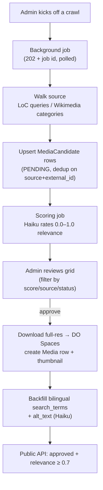
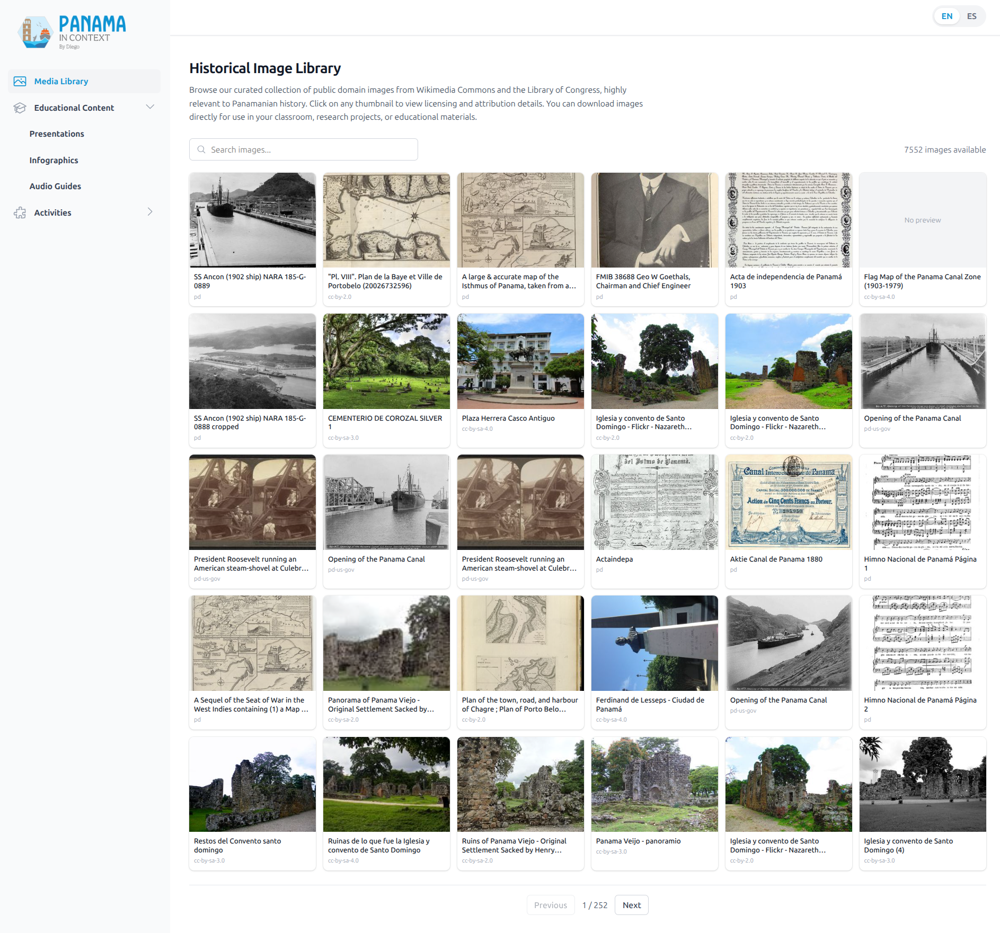
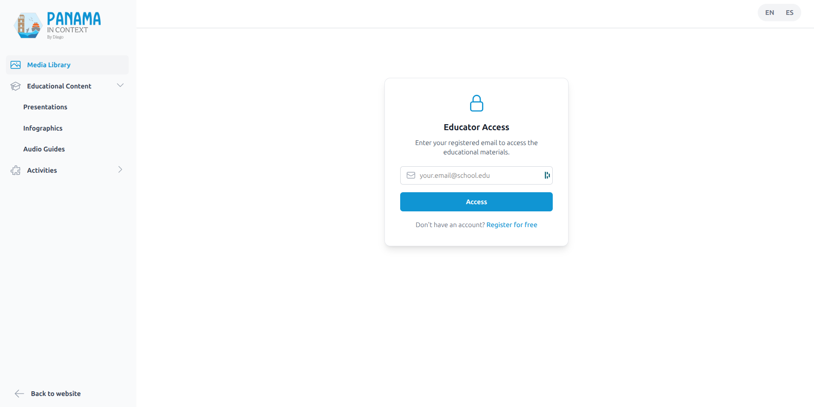

# Media Library & Acquisition

[← Back to overview](README.md)

A history project needs a lot of historical imagery, and I didn't want to hand‑source it. So the media library is fed by a crawler: it walks the Library of Congress and Wikimedia Commons, scores every image it finds for relevance with Haiku, and lets me promote the good ones into a clean, searchable, bilingual catalog. That catalog then does double duty — it's a gated public resource for educators *and* the catalog a human **picks from** when illustrating the guides and slide decks in the [deliverables pipeline](04-educational-deliverables-pipeline.md).

## The acquisition flow

The design principle is **two cheap phases, not one expensive one.** Crawling is dumb: it just upserts everything it finds, with no LLM in the loop. A separate scoring pass sends each candidate's title/description/categories to Haiku, which returns a 0.0–1.0 relevance score against a rubric (0.9–1.0 = iconic Panama imagery). Keeping the LLM cost off the crawl means I can re‑crawl freely and re‑score independently.

**The sources:**

- **Library of Congress** — a set of curated keyword queries against LoC collections, preferring IIIF full‑resolution URLs. The best download URL is resolved lazily, only when I actually approve an image.
- **Wikimedia Commons** — seeded from category names, recursively discovering subcategories (bounded depth) and batch‑fetching image metadata and licensing.

Both upserts dedupe on `(source, external_id)` and merge category/tag metadata into existing rows on re‑crawl.

**Approval** is the moment a candidate becomes a real asset: the full‑resolution image is downloaded and uploaded to DO Spaces, a thumbnail is generated, and a `Media` row is created and linked back to the candidate. A later Haiku pass backfills 10–20 **bilingual (ES + EN) search keywords** and English alt‑text, so the public search box hits one text column in either language.

## Data model

- **`MediaCandidate`** is the provenance and review record — where it came from, its license, its relevance score and notes, and its review status (`PENDING / APPROVED / REJECTED`). Discovered, not yet published.
- **`Media`** is the published catalog row — the Spaces CDN URL, a thumbnail, source, license, and the bilingual `search_terms`. There's no status column; existence in `media` *is* "published." When a candidate is approved, it points at the `Media` row that was created from it.
- **`CrawlJob`** tracks an async crawl/score run — type, status, progress counters, final stats, errors. Its state lives in the database rather than process memory, which matters because the status poll might hit a different worker than the one running the job.

## Crawls run off the request path

An early version ran crawls inline and tied up a request for minutes. Now the admin endpoint creates a `CrawlJob`, schedules the actual crawl as a background task, and returns `202` with a job ID; the frontend polls for progress. The background runner opens its *own* database session (the request's is long gone) and commits progress counters as it goes. A guard refuses to start a second crawl of the same type while one is in flight — with a one‑hour staleness window so a crashed worker can't block kick‑offs forever.

## The hardened HTTP client

Every outbound fetch — crawler requests and image downloads alike — goes through a single hardened HTTP client, because crawl candidate URLs are attacker‑influenceable and an image fetcher is a classic SSRF vector. The protections, all in one place:

- **SSRF validation in the transport layer**, so it re‑checks every redirect hop: HTTPS‑only, a host blocklist, and rejection of any host that resolves to a private, loopback, link‑local, or reserved IP (including the cloud metadata address `169.254.169.254`).
- **IP pinning** — it pins the validated IP into the actual connection (rewriting to an IP literal while preserving the `Host` header and TLS SNI), closing the resolve‑then‑connect TOCTOU window where DNS could change between the check and the connect.
- **Pooled clients** per service, so there's no TLS handshake per request.
- **Tenacity retry** with exponential backoff — but only on transient errors (5xx, 429, transport failures), never on 4xx, and *never* on an SSRF rejection.
- **A per‑process rate limiter** so I'm a polite citizen of LoC and Wikimedia (a few seconds between requests).

## Object storage & watermarking

Images live in DigitalOcean Spaces (S3‑compatible, via boto3). The download path is paranoid in ways that matter for user‑supplied URLs: it streams with a size cap, derives the content type from the *decoded image bytes* rather than trusting the upstream `Content-Type` header, and rejects SVG outright to block stored XSS.

Watermarking lives here too, though it belongs to the educational‑materials export path rather than acquisition: a small "panamaincontext.com" tag stamped bottom‑right on infographics (Pillow) and on every page of a slides/guide PDF (PyMuPDF). It's mandatory — a watermark failure aborts the upload rather than shipping an unbranded asset.

## Picking images into guides and slides

The catalog's other consumer is the [deliverables pipeline](04-educational-deliverables-pipeline.md), and here the design rule is *the machine never assigns a photo*. Generation only emits an `image_query` **placeholder**; when an operator edits a study guide's `image`/`cover` blocks or a slide deck's photo slots, they open a **media‑picker modal** pre‑seeded with that query and choose the actual image by eye. The pick stamps a `media_path` onto the block or slide that the renderer embeds — nothing ships a photo a human didn't approve.

Two changes made that picker actually usable:

- **Tokenized, any‑order search.** The catalog search used to be a single `ILIKE '%<whole query>%'`, so "Casco Antiguo wall" found nothing unless that exact substring lived in one field. It now splits the query into words and ANDs each against the concatenated searchable fields (`title | caption | search_terms`) — so words can match in any order and across different fields, and an LLM's English `image_query` can find a Spanish‑titled photo through its bilingual search terms.
- **Import an image from the web.** When the crawled catalog has no good photo, the picker offers an "…or paste an image URL" row backed by `POST /media-library/media/import-url`. It fetches through the **same hardened HTTP client** described above (private‑IP blocking, 20 MB cap, content type derived from the decoded bytes, SVG rejected), **re‑hosts the image on our own Spaces** with a generated thumbnail, and creates a `Media` row tagged `source=LOCAL` — so a guide or slide PDF never depends on a third‑party host staying up. Re‑importing the same URL returns the existing row instead of duplicating it.

That's the escape hatch I wanted: the crawler covers the bulk, and for the one slide that needs a specific photo the catalog doesn't have, I can bring my own without leaving the picker — and it lands in the same governed, self‑hosted catalog as everything else.

## The gated public library

The public side lives in the **Media Library section** of the `/materiales-educativos` [dashboard shell](01-frontend-and-design-system.md), behind an **educator access gate** (covered in [Forms, Mailing & Educator Access](09-forms-mailing-and-educator-access.md)) — the gate wraps this section specifically, while the rest of the shell browses freely. The public API joins `Media` to its candidate and only surfaces rows that are **approved and scored ≥ 0.7**, excluding article feature images. It supports debounced bilingual search, a paginated thumbnail grid, and downloads.

One small but important download detail: because the request needs an `Authorization` header (the educator token), a plain `<a href>` download won't work — the browser can't attach the header. So the client fetches the file as a blob and triggers the download from memory.

---

[← The Educational Deliverables Pipeline](04-educational-deliverables-pipeline.md) · [Back to overview](README.md) · Next: [The Fact‑Checking Pipeline →](06-fact-checking-pipeline.md)
