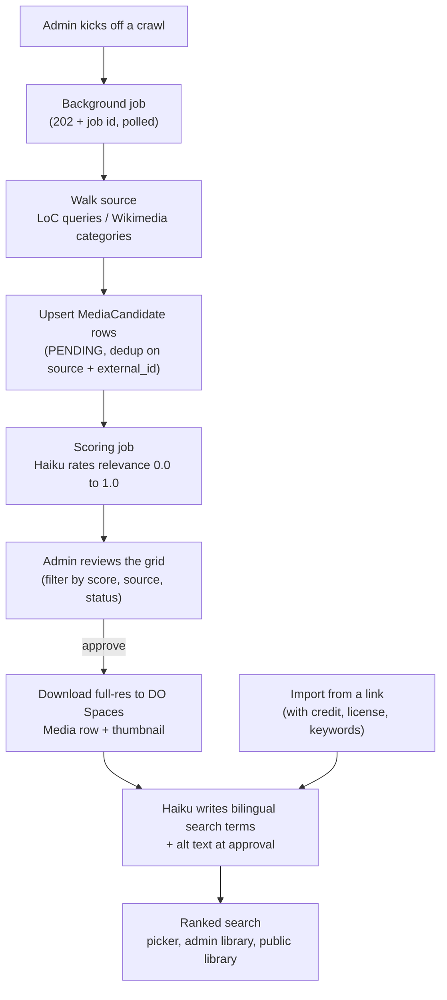

# Media Library & Acquisition

[← Back to overview](README.md)

A history project needs a lot of historical imagery, and I didn't want to hand-source it. So the media library is fed by a crawler: it walks the Library of Congress and Wikimedia Commons, scores every image it finds for relevance with Haiku, and lets me promote the good ones into a clean, searchable, bilingual catalog. That catalog does double duty: it's an open public resource for teachers, *and* the catalog a human **picks from** when illustrating the guides and slide decks in the [deliverables pipeline](04-educational-deliverables-pipeline.md).

## The acquisition flow

The design principle is **two cheap phases, not one expensive one.** Crawling is dumb: it just upserts everything it finds, with no LLM in the loop. A separate scoring pass sends each candidate's title, description and categories to Haiku in batches of 30, and Haiku returns a 0.0 to 1.0 relevance score against a rubric for the site's subject matter (0.9 to 1.0 is iconic Panama imagery). Keeping the LLM cost off the crawl means I can re-crawl freely and re-score independently.

**The sources:**

- **Library of Congress**: a set of curated keyword queries against LoC collections, preferring IIIF full-resolution URLs. The best download URL is resolved lazily, only when I actually approve an image.
- **Wikimedia Commons**: seeded from category names, recursively discovering subcategories (bounded depth) and batch-fetching image metadata and licensing.

Both upserts dedupe on `(source, external_id)` and merge category and tag metadata into existing rows on re-crawl.

**Approval** is the moment a candidate becomes a real asset: the full-resolution image is downloaded and uploaded to DO Spaces, a thumbnail is generated, licence and attribution are copied over, and a `Media` row is created and linked back to the candidate. In the same request, after the row is committed, Haiku writes 10 to 20 **bilingual (ES + EN) search keywords** and an English alt text, so an image is findable in either language the moment it exists. That used to be a backfill script run after the fact; the script survives only as a fallback for rows whose best-effort generation failed.

## Data model

- **`MediaCandidate`** is the provenance and review record: source, license, relevance score and notes, and review status (`PENDING / APPROVED / REJECTED`).
- **`Media`** is the catalog row: the Spaces CDN URL, a thumbnail, source, license, credit and the bilingual `search_terms`. There's no status column; existence in `media` *is* "published." Imported images (`source = LOCAL`) and generated article feature images live here too, with no candidate behind them.
- **`CrawlJob`** tracks an async run (type, status, progress, stats, errors) in the database rather than process memory, because the status poll might hit a different worker. The table outgrew its name: fact-checking, article narration and the long edu steps all run on it now.

Crawls run off the request path: the endpoint creates a `CrawlJob`, schedules the crawl as a background task and returns `202`; the runner opens its *own* session and commits progress as it goes. A guard refuses a second crawl of the same type while one is in flight, with a one-hour staleness window so a crashed worker can't block kick-offs forever.

## Search that forgives

The picker, the admin library grid and the public library share one search helper, and it went through two versions. The first was a tokenized AND of `ILIKE`s, which failed the picker's real input: a long, LLM-written English `image_query` had to match *every* word somewhere, so it usually matched nothing.

The current version is ranked full-text search over **stored, generated `tsvector` columns** on `media` and `media_candidates`, GIN-indexed:

- **Words are OR-ed and ranked**, so a long query ranks results instead of emptying them. Weights put the title first; alt text, caption, search terms, tags and source categories second; the candidate's description third; the credit last. Words that are stopwords in *either* English or Spanish are dropped, so `del` and `de` don't match every bilingual row.
- **Accents and plurals fold.** One `english` configuration runs over an `unaccent` wrapper, so "Colón" matches "colon" and "workers" matches "worker". Generated columns only accept IMMUTABLE functions, and Postgres's own `unaccent` isn't declared that way, so the column is built on small IMMUTABLE wrapper functions in the `public` schema.
- **Typos get a second chance.** Only when full-text search finds *nothing*, each query word of three or more characters is matched by trigram similarity (threshold 0.6), so "Culebrra" still finds the Culebra Cut. There's deliberately no trigram index: the fallback only runs on a miss.

Building the vector at query time measured about 0.7 s per pass over 7.7k rows; the stored columns bring a ranked page down to roughly 40 ms. One subtlety: the columns are excluded from the ORM mapper entirely. Deferring them isn't enough, because a deferred column still appears in the `select(...).subquery()` the list endpoints use for counts, so every default page load would have failed in the window between a deploy and the migration.

## The hardened HTTP client

Every crawler request and every image download goes through a single hardened HTTP client, because crawl candidate URLs are attacker-influenceable and an image fetcher is a classic SSRF vector. The protections, all in one place:

- **SSRF validation in the transport layer**, so it re-checks every redirect hop: HTTPS only, a host blocklist, and rejection of any host that resolves to a private, loopback, link-local or reserved IP (including the cloud metadata address `169.254.169.254`).
- **IP pinning**: it pins the validated IP into the actual connection (rewriting to an IP literal while preserving the `Host` header and TLS SNI), closing the resolve-then-connect window where DNS could change between the check and the connect.
- **Connect failover, still pinned.** Pinning had a cost I didn't see at first: it switched off the operating system's habit of trying the next address when one doesn't answer, so a single dead DNS record on a multi-homed host turned into a hard connection refusal on a URL any browser loads fine. The transport now walks up to three of the already-validated addresses (IPv4 first) and moves on only on connect-phase errors. It never re-resolves, so the security property holds.
- **Pooled clients, retries and politeness**: one client per service, exponential backoff only on transient errors (5xx, 429, transport failures) and *never* on an SSRF rejection (that error deliberately isn't a transport error, so the retry policy can't sweep it up), and a per-process rate limiter (3 seconds between LoC requests, 1 second for Wikimedia).

One fetch sits outside this client, and I'd rather say so: an admin-only image proxy with a fixed host allowlist.

## Object storage & watermarking

Images live in DigitalOcean Spaces (S3-compatible, via boto3). The download path is paranoid in ways that matter for user-supplied URLs: it streams with a 20 MB cap, derives the content type from the *decoded image bytes* rather than trusting the upstream `Content-Type` header, and rejects SVG outright to block stored XSS.

Watermarking lives here too, for materials uploaded from NotebookLM (infographics and slide PDFs): the "Made with NotebookLM" mark is erased from infographics, then a small "panamaincontext.com" tag goes on bottom-right (Pillow for images, PyMuPDF for each PDF page). Both steps fail closed: a failure aborts the upload rather than shipping an unbranded file. Generated study guides are not watermarked; they carry the logo on the cover and closing pages instead.

## Picking images into guides and slides

The catalog's other consumer is the [deliverables pipeline](04-educational-deliverables-pipeline.md), and there the design rule is *the machine never assigns a photo*. Generation only emits an `image_query` **placeholder**; when an operator edits a study guide's image blocks or a slide's photo slot, they open a **media picker** pre-seeded with that query and choose the actual image by eye. The pick stamps a `media_path` onto the block or slide, and the renderer embeds it. Nothing ships a photo a human didn't choose.

When the crawled catalog has no good photo, I can bring my own without leaving the picker: pasting an image URL opens the same metadata form as the library page's **"Add from link"** button. The import takes the image URL plus the metadata that makes it a proper catalog entry: title, description, credit, source page, license, license URL, keywords and alt text. It fetches through the **same hardened HTTP client**, **re-hosts the image on our own Spaces** with a generated thumbnail, and creates a `Media` row tagged `source=LOCAL`, so a guide or slide never depends on a third-party host staying up. The editor's keywords are merged with Haiku's generated terms (operator terms first) into `search_terms`, never into the article tag vocabulary, and re-importing the same URL returns the existing row. Imported images are editable afterwards from an **Imported** tab; changing the title, description or credit regenerates the search terms with the current ones carried forward.

## The public library

The public side is the **Media Library section** of the `/materiales-educativos` [portal](01-frontend-and-design-system.md), and it's open to everyone. It used to sit behind an educator email gate; I removed it on both sides (backend dependency and frontend wall) because it added friction for exactly the people the library is for, and the public filter already bounds what anyone can see. That filter joins `Media` to its candidate and only surfaces rows that are **approved and scored 0.7 or higher**, excluding article feature images. Because it's an inner join on the candidate, imported and generated images never appear publicly, whatever their other attributes. In October 2026 that's **7,552 images**, with the same ranked bilingual search, a paginated thumbnail grid and downloads.

One small download detail survived the gate's removal, for a different reason. The files live on another origin (the CDN, proxied by the API), and browsers ignore a plain `<a download>` across origins, so the link would navigate to the image instead of saving it. The client fetches the file as a blob and triggers the download from memory.

---

[← The Educational Deliverables Pipeline](04-educational-deliverables-pipeline.md) · [Back to overview](README.md) · Next: [The Fact-Checking Pipeline →](06-fact-checking-pipeline.md)
