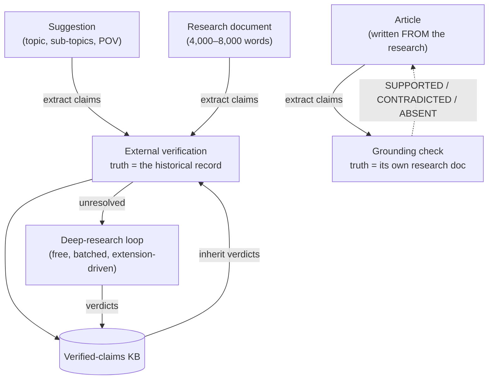

# The Fact‑Checking Pipeline

[← Back to overview](README.md)

The content factory in the [blog pipeline](02-blog-and-content-pipeline.md) has a human approving every stage, and that's real protection against *bad writing*. It's much weaker protection against *confidently wrong facts*. A research document about Panamá Viejo can contain three hundred discrete factual claims — dates, names, casualty figures, treaty years — and no editor reviews three hundred claims by eye. For an educational publication whose whole promise is historical accuracy, "the model probably didn't hallucinate" isn't a standard. So I built a verification layer that runs at every level of the pipeline, and its core design decision is this: **claims are database rows, not vibes.**

## Claims as data

The foundation is a Haiku extraction pass that pulls **atomic factual claims** out of any pipeline text — events, people and their roles, dates, places, quantities — each typed (`EVENT / PERSON / DATE / PLACE / NUMBER`) and rewritten as a self‑contained sentence (no pronouns, no "the event"; every claim must stand alone because it will be judged in isolation later). Long inputs are chunked to ~1,500 words first, because past ~2,500 words models drift off format instructions — the same lesson that shaped the condense‑first article writer. And the output format is plain `CLAIM: TYPE | sentence` lines, not JSON: asking an LLM for JSON containing prose is a known‑fragile shape in this codebase (unescaped quotes and newlines), and this pipeline relearned that lesson enough times that every LLM contract in it is a line format with a strict regex parser.

Each claim persists in a `fact_check_claims` table — subject (`SUGGESTION / RESEARCH / ARTICLE`), the claim text and type, a verdict, an optional correction and citation, and *how* it was checked (`checked_via`) — with the vocabularies enum‑backed and `CHECK`‑constrained per the [house convention](10-architecture-data-and-operations.md). That one table is what makes everything downstream possible: badges, drill‑ins, batching, corrections, and a knowledge base that compounds.

## Three levels, two kinds of truth

The pipeline verifies at all three content levels, but not the same way — because the *ground truth* differs:

**Suggestions and research documents get external verification.** Their claims are assertions about the world, so they're checked against sources outside the system. Research docs are the heavyweight case — hundreds of claims each — and suggestions are the cheap early warning: catching a wrong premise at the one‑line‑idea stage is much cheaper than catching it after a 6,000‑word research run.

**Articles get grounded, not re‑verified.** An article is *derived* content — it was written from an approved research document, and that document **is** its ground truth. So the article tier extracts the article's claims and has Sonnet judge each one strictly against the research (`SUPPORTED / CONTRADICTED / ABSENT`, mapped to verified/inaccurate/unverifiable), with outside knowledge explicitly forbidden. Its job isn't to re‑litigate history — that happened upstream — it's to catch the writer, or the condensation pass, drifting beyond the research. It runs automatically: the moment an article is written, a grounding job is enqueued in the background (and its failure is deliberately non‑fatal to the write). Verify external truth once, at the research level; check derived content against its source.

## Conservative by construction

Every verdict path in the system degrades toward the punt, never toward the pass. A malformed or missing verdict line becomes `UNVERIFIABLE` (grounding) or `NEEDS_DEEP_RESEARCH` (external) — never `VERIFIED`. A `VERIFIED` or `INACCURATE` from the web‑search tier **without a source URL** is downgraded on the spot, because the prompt makes citations mandatory for definitive verdicts and an uncited pass is worth nothing. Deep‑research verdicts are validated the same way on upload — definitive verdicts without citations are skipped, verdicts for claims that are no longer pending (a stale document from before a re‑run) are skipped, and verdicts outside the batch that was actually asked about are skipped. The parsers assume the model got the format wrong until proven otherwise, and the schema assumes the human uploaded the wrong file.

## The web‑search tier, and its bill

The first external tier was Sonnet plus Anthropic's server‑side web‑search tool: claims in batches of eight, a hard `max_uses` cap on searches per call (each search re‑processes the growing conversation, so per‑call cost scales with uses — the prompt tells the model to cover related claims with one broader query), `pause_turn` resumption for long tool loops, and a prompt that insists on preferring `NEEDS_DEEP_RESEARCH` over guessing, since much of the reputable academic literature on Panama simply isn't reachable by web search.

It worked. It was also, once I ran it on real research documents, **the wrong economics**: about **$7 per 150‑claim run — roughly $11 per full research document, at 45+ minutes each — and it still punted a third of its claims** to deeper research anyway. With a 44‑document back‑catalog to verify, that path costs about $500 to fact‑check content that cost about $2 to generate. The verification layer would have been 250× the price of the thing it was verifying.

## The pivot: deep‑research‑first

The fix came from noticing where the *free* capacity was. Claude's deep‑research mode — the same one that produces the research documents in the first place — runs on the operator plan at no marginal cost, and it's *better* at exactly what the web‑search tier was worst at: primary and scholarly secondary sources. So the default flipped. A fact‑check run on a suggestion or research doc now does **extraction + knowledge‑base matching only** (two Haiku passes — pennies, a couple of minutes) and sends every unresolved claim straight to the `NEEDS_DEEP_RESEARCH` queue. The web‑search tier survives in full — code, tests, and all — but as an **API‑only escape hatch** (`?mode=web_search`); there's no button for it.

The queue drains through a deliberately strict loop:

1. A `generate-prompt` endpoint compiles the oldest pending claims — at most 25, because a deep‑research run degrades beyond that — into a verification prompt. Claims are numbered by their **database primary key**, never by list position, which is what makes the round trip unambiguous.
2. The prompt goes into Claude's deep‑research UI; the run produces a verdicts document with a required `## Verdicts` section of `VERDICT: <id> | <verdict> | <note> | <citations>` lines.
3. A `verdicts` upload endpoint parses the document, applies all the conservative validation above, writes the verdicts back to the claim rows, and feeds the definitive ones into the knowledge base.

The prompt template lives in two places — the backend endpoint and an operator skill — and a test asserts the two are **byte‑identical**, because a contract that exists twice is a contract that drifts. And exposing the whole loop as plain API endpoints paid off exactly as intended: a companion browser extension now drives it end‑to‑end — it pulls the next batch's prompt from the API, runs the deep research on claude.ai, and uploads the resulting verdicts document itself. The human's job shrank from batch → paste → download → upload to "start the drain and read the results."

▶ **Demo video:** [The companion extension draining the deep-research queue — it pulls a batch of pending claims, runs the deep research on claude.ai, and uploads the verdicts document, unattended](https://feliudev.nyc3.cdn.digitaloceanspaces.com/projects/panama-in-context/videos/fact-check-deep-research.mp4)

One migration‑path detail I'm fond of: subjects half‑checked by the old capped web‑search tier (some claims resolved, some still `PENDING`) aren't re‑extracted or wiped — the pending rows are KB‑matched and then flipped to `NEEDS_DEEP_RESEARCH` **in place**, preserving every verdict already paid for.

## The verified‑claims knowledge base

Panama's history doesn't change between documents, so the system shouldn't pay to verify "Panamá Viejo was founded in 1519" twice. Every resolved external verdict (verified, inaccurate, or disputed — with its correction and citation) is upserted into a `verified_claims` KB keyed on the normalized claim text, latest verification winning. Before any new run spends anything, its extracted claims are matched against the KB in two stages: an exact normalized‑text match (free, deterministic), then a word‑overlap candidate search confirmed by Haiku — which is explicitly told to prefer `NONE`, because *a wrong match silently propagates a verdict to a different fact, while a missed match merely costs one re‑verification*. A returned KB id is only accepted if it was among that specific claim's own candidates, so a hallucinated id can't smuggle a verdict in. Matched claims inherit the stored verdict, correction, and citation with `checked_via = KB_MATCH`.

The KB is what makes the 44‑document backlog tractable: it compounds. Early documents seed it; later documents inherit more and more of their claims and need fewer deep‑research batches.

## Corrections: fixing the content, not just flagging it

A red "inaccurate" badge that a human has to act on manually is half a feature. So `INACCURATE` claims that carry a correction get a **preview → apply** flow: Sonnet proposes *targeted FIND/REPLACE edits* against the actual content (never a full‑document rewrite — cheap, auditable, and diffable), with claims chunked across calls so the edit list can't hit the output‑token ceiling — and a chunk that overflows anyway is bisected and retried rather than truncated. The operator sees an old‑red/new‑green diff per claim, and applying re‑validates everything server‑side. An edit only applies if its FIND snippet occurs **exactly once** in the content; for translated articles, a claim's English and Spanish edits are simulated on a scratch copy and applied all‑or‑nothing, so content is never left half‑corrected while still flagged. Applied claims move to a terminal **`CORRECTED`** verdict — a green state, since the content is now right.

▶ **Demo video:** [Fixing flagged claims — reviewing the per-claim old-red / new-green diffs and applying the FIND/REPLACE edits back to the research document](https://feliudev.nyc3.cdn.digitaloceanspaces.com/projects/panama-in-context/videos/fact-check-corrections.mp4)

The subtle rule is what *doesn't* change: **the KB keeps the claim as `INACCURATE`.** The claim is still wrong *in the world* — `CORRECTED` describes our content, not the historical record — so a future document repeating the same mistake still inherits the flag and its stored correction.

## Jobs, badges, and the operator view

Research‑sized runs outlive any sane request timeout, so every fact‑check executes as a **background job** on the same jobs infrastructure the [media crawler](05-media-library-and-acquisition.md) built — `202` plus a job id, progress polled from the database, and a one‑active‑job‑per‑subject guard (a re‑run wholesale‑replaces the subject's claim rows, so two overlapping runs would corrupt each other).

In the admin, the Suggestions, Research, and Articles grids each carry a fact‑check **status badge** per row — *Not checked*, *N flagged* (red — inaccurate), *N disputed* (orange — sources genuinely disagree, a different problem than being wrong), *N open* (amber — still queued for deep research), *N corrected*, or *Passed* — backed by one aggregated summary endpoint. Clicking a badge opens the claims modal: every claim with its verdict, correction, and citation, and the "Fix inaccuracies" button that starts the corrections preview. And the gates connect: approving a suggestion or research document that has flagged or unresolved claims triggers an explicit *"approve without a clean fact‑check?"* confirmation — the operator can overrule the machine, but never without being told.

---

[← Media Library & Acquisition](05-media-library-and-acquisition.md) · [Back to overview](README.md) · Next: [The Instagram Pipeline & Editorial Calendar →](07-instagram-pipeline.md)
