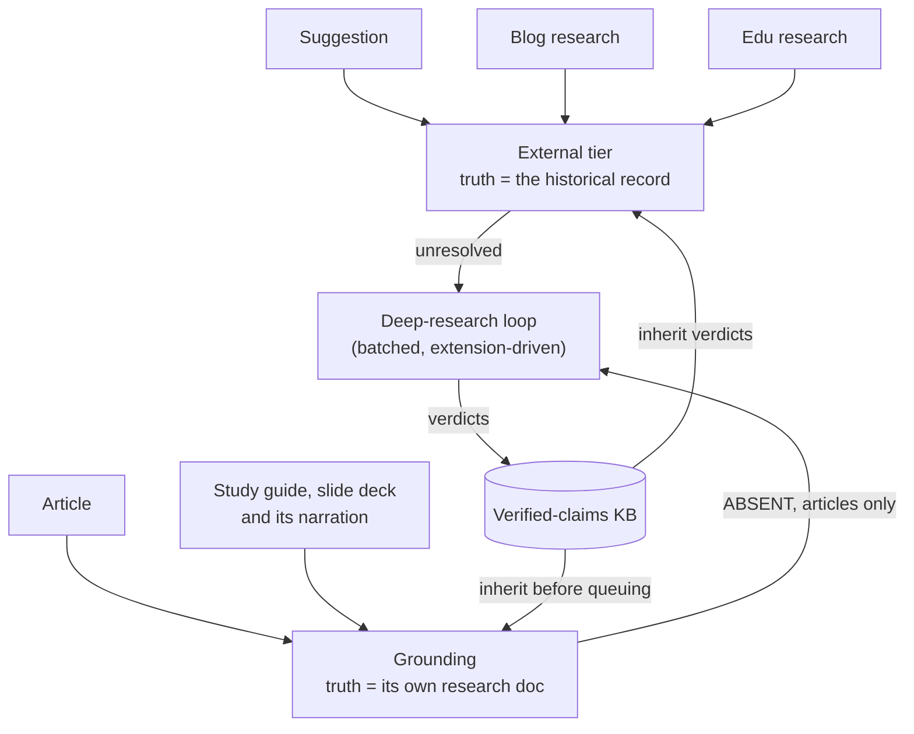

# The Fact-Checking Pipeline

[← Back to overview](README.md)

The [blog pipeline](02-blog-and-content-pipeline.md) and the [classroom pipeline](04-educational-deliverables-pipeline.md) both have review gates, and those protect well against *bad writing*. They protect much less against *confidently wrong facts*. A research document about Panamá Viejo can contain three hundred discrete factual claims (dates, names, casualty figures, treaty years), and no editor reviews three hundred claims by eye. For an educational publication whose whole promise is historical accuracy, "the model probably didn't hallucinate" isn't a standard. So I built a verification layer that runs at every level of both pipelines, and its core design decision is this: **claims are database rows, not vibes.**

## Claims as data

The foundation is a Haiku extraction pass that pulls **atomic factual claims** out of any pipeline text: events, people, dates, places, quantities. Each is typed (`EVENT / PERSON / DATE / PLACE / NUMBER`) and rewritten as a self-contained sentence (no pronouns, no "the event"), because it will be judged in isolation later. Long inputs are chunked to about 1,500 words first, since past roughly 2,500 words models drift off format instructions. The output is plain `CLAIM: TYPE | sentence` lines, not JSON: JSON containing prose is a known-fragile shape (unescaped quotes and newlines), and this pipeline relearned that often enough that every LLM contract in it is a line format with a strict regex parser.

Each claim persists in a `fact_check_claims` table: the subject it came from, the claim text and type, a verdict, an optional correction and citation, and *how* it was checked (`checked_via`), with the vocabularies enum-backed and `CHECK`-constrained per the [house convention](14-architecture-data-and-operations.md). There are five subjects now: `SUGGESTION`, `RESEARCH` and `ARTICLE` from the blog, `EDU_RESEARCH` and `EDU_MATERIAL` from the classroom. That one table makes everything downstream possible: badges, batching, corrections, hard gates, and a knowledge base that compounds. As of October 2026 it holds 13,762 claims.

## Three levels, two kinds of truth

The pipeline verifies every level of content, but not the same way, because the *ground truth* differs:

**Suggestions and research documents get external verification.** Their claims are assertions about the world, so they're checked against sources outside the system. Research documents are the heavyweight case, hundreds of claims each; suggestions are the cheap early warning, since a wrong premise costs far less to catch at the one-line-idea stage than after a 6,000-word research run. Edu research goes through the same tier.

**Derived content gets grounded, not re-verified.** An article was written from an approved research document, and that document **is** its ground truth. So Sonnet judges each article claim strictly against the research (`SUPPORTED / CONTRADICTED / ABSENT`), with outside knowledge forbidden, to catch the writer or the condensation pass drifting. It runs automatically: writing an article enqueues a grounding job in the background, and its failure is deliberately non-fatal to the write. The research goes to the judge as its own prompt-cached block, so an article grounded in several batches pays full price for it only once.

In July an `ABSENT` claim became `UNVERIFIABLE`, a dead end: the writer had added a fact the research didn't cover, and nobody checked it. Now an article's `ABSENT` claims (and any claim the judge returned no line for) become `NEEDS_DEEP_RESEARCH` and join the external queue. Re-grounding an article doesn't throw away what was already paid for: before queuing a claim, it carries over the article's own earlier deep-research verdict for the same normalized text, then checks the knowledge base.

Study guides and slide decks are grounded against their full edu research, never against the condensed briefing they were generated from (that would ratify whatever the condense pass dropped). A deck is grounded on its on-screen text **and** its narration, and the video is a render of that narration, so checking the deck is how the video gets checked. Edu materials keep `ABSENT` as `UNVERIFIABLE`.

## Conservative by construction

Every verdict path degrades toward the punt, never toward the pass. A malformed verdict line or an unknown label becomes `UNVERIFIABLE` or `NEEDS_DEEP_RESEARCH`, never `VERIFIED`. Deep-research verdicts are validated on upload: `VERIFIED`, `INACCURATE` and `DISPUTED` must carry a citation or the line is skipped and the claim stays queued; verdicts for claims that are no longer pending (a stale document from before a re-run) are skipped; verdicts for claims outside the batch that was actually asked about are skipped. The parsers assume the model got the format wrong until proven otherwise, and the schema assumes the human uploaded the wrong file.

That turned out not to be enough. The first automated deep-research batch ran with its research tools broken: web search and fetch errored for every agent in the run. Instead of punting, the model answered from its own knowledge, emitted well-formed `VERIFIED` and `INACCURATE` lines, and backed them with plausible citations it remembered, admitting all of this only in a bold caveat in the prose, which no parser reads. The lines passed every gate, because a citation requirement can't tell a consulted source from a remembered one. Thirty-two claims were written and 21 verdicts went into the knowledge base, where they would have propagated to every future document repeating those facts. I reverted the batch by hand and changed three things:

- The prompt requires every verdict to rest on sources retrieved and read *during the session*, never on the model's own knowledge.
- If the tools fail, the model must **omit** the verdict line rather than write `UNVERIFIABLE`. A missing line re-queues the claim; any verdict, even `UNVERIFIABLE`, is recorded as a finished check.
- A document whose every verdict is an uncited `UNVERIFIABLE` (the signature of a broken run that ignored that rule) is rejected wholesale: nothing is written and every claim stays queued.

The prompt also now leads with the machine contract (`## Verdicts` first, a worked example, hedged labels like "PARTIALLY VERIFIED" named as rejected) and restates it after the claim list.

## The web-search tier: built, measured, removed

The first external tier was Sonnet plus Anthropic's server-side web-search tool: claims in batches of eight, a cap on searches per call, and a prompt that preferred `NEEDS_DEEP_RESEARCH` over guessing, since much of the scholarly literature on Panama isn't reachable by web search.

It worked. It was also **the wrong economics**: about **$11 per research document at 45+ minutes each, and it still punted a third of its claims** to deeper research anyway. Across a 44-document back catalogue, that is about $500 to fact-check content that cost about $2 to generate: a verification layer 250 times the price of the thing it verifies.

So it ran in production exactly once (193 claims, the measurement above) before I demoted it to an API-only escape hatch. In October I retuned it offline against real claims; it resolved more, but nothing called it (no button, no driver step, no tool), so I deleted it. Its historical verdicts stay in the knowledge base. If the deep-research route ever goes away, the fallback is another vendor's deep-research API, not reviving this tier.

## Deep research first

The fix came from noticing where the *free* capacity was. Claude's deep-research mode, the same one that produces the research documents, runs on the operator plan at no marginal cost, and it's *better* at exactly what the web-search tier was worst at: primary and scholarly secondary sources. So a fact-check on a suggestion or research document does **extraction plus knowledge-base matching only** (Haiku passes, pennies, a couple of minutes) and sends every unresolved claim to the `NEEDS_DEEP_RESEARCH` queue.

The queue drains through a deliberately strict loop:

1. A `generate-prompt` endpoint compiles the oldest pending claims, at most 25 because a deep-research run degrades beyond that, into a verification prompt. Claims are numbered by their **database primary key**, never by list position, which is what makes the round trip unambiguous. A call can also be scoped to one subject, so a single article's claims can be drained when it is the one waiting.
2. The prompt goes into Claude's deep-research UI, and the run produces a verdicts document with a required `## Verdicts` section of `VERDICT: <id> | <verdict> | <note> | <citations>` lines.
3. A verdicts upload parses the document, applies all the validation above, writes the verdicts to the claim rows, and feeds the definitive ones into the knowledge base.

The prompt lives in two places, the backend and an operator skill, and a test asserts they are **byte-identical**, because a contract that exists twice is a contract that drifts. Exposing the loop as plain endpoints paid off: a companion browser extension pulls the next batch's prompt, runs the deep research on claude.ai and uploads the verdicts itself. The human's job shrank from batch, paste, download, upload to "start the drain and read the results."

The queue is empty as I write this. Of the 13,762 claims, about 6,300 were resolved by deep research and none are waiting.

## The verified-claims knowledge base

Panama's history doesn't change between documents, so the system shouldn't pay to verify "Panamá Viejo was founded in 1519" twice. Every resolved external verdict (verified, inaccurate or disputed, with its correction and citation) is upserted into a `verified_claims` table keyed on the normalized claim text. Grounding verdicts never enter it: they are relative to one research document, and feeding them in would promote "consistent with this source" to "true".

Before any run spends anything, its extracted claims are matched against the KB in two stages: an exact normalized-text match (free, deterministic), then a word-overlap candidate search confirmed by Haiku, which is told to prefer `NONE`, because *a wrong match silently propagates a verdict to a different fact, while a missed match merely costs one re-verification*. A returned KB id is only accepted if it was among that claim's own candidates, so a hallucinated id can't smuggle a verdict in. Matched claims inherit the stored verdict, correction and citation with `checked_via = KB_MATCH`.

It compounds as intended: the KB holds 6,461 entries, and 2,337 claims (about one in six) were resolved by it for free. When the [knowledge layer](08-knowledge-layer.md) arrived I tried vector search for the candidates. On a replay of 200 historical claims, word overlap matched 26.5% and vectors 24.5% to 25.5%, with the same verdict agreement, so the switch exists and stays off. The claims do flow the other way: verified article claims and every KB row are indexed as chunks in the knowledge layer, where retrieval can reach individual checked facts.

## Corrections: fixing the content, not just flagging it

A red "inaccurate" badge that a human has to act on manually is half a feature. So `INACCURATE` claims that carry a correction get a **preview, then apply** flow: Sonnet proposes *targeted FIND/REPLACE edits* against the actual content (never a full-document rewrite: cheap, auditable, diffable). Claims are chunked across calls, eight at a time, so the edit list can't hit the output-token ceiling, and a chunk that overflows anyway is bisected and retried rather than truncated. The operator sees an old-red/new-green diff per claim, and applying re-validates everything server-side. An edit only applies if its FIND snippet occurs **exactly once** in the content; a claim's English and Spanish edits apply all or nothing, so content is never left half-corrected while still flagged. Applied claims move to a terminal **`CORRECTED`** verdict, a green state, since the content is now right. When the model reports that the content never actually asserted the inaccuracy, applying resolves the claim as `CORRECTED` without touching a byte.

The write path has its own guard, learned the hard way: a reply that dropped an `END EDIT` marker once spliced raw protocol lines into two research documents and an article in production. The parser now treats the next `EDIT:` or `SKIP:` line as an implicit terminator, and apply rejects any edit containing a protocol marker. 780 claims have been corrected this way.

For edu materials, corrections write to the real container (the guide's JSON blocks that the PDF renders, the slide rows whose narration feeds the voice), never to the derived markdown the grid shows, where they would reach neither the PDF nor the audio. Deck corrections are in Spanish and have to stay speakable.

The subtle rule is what *doesn't* change: **the KB keeps the claim as `INACCURATE`.** The claim is still wrong *in the world*; `CORRECTED` describes our content, not the historical record, so a future document repeating the same mistake still inherits the flag and its stored correction.

## Across the translation boundary

The English article is fact-checked before it is translated, so the remaining risk in the Spanish is the translation itself: a number, date, name or negation that no longer says what the English says. An accuracy step after DeepL compares the two languages paragraph by paragraph with Sonnet and fixes the Spanish only, for meaning, never style. It reuses the grammar check's exactly-once FIND/REPLACE applier and audits every proposed fix. It shipped in October, after the series in production had already passed translation, so it has no production numbers yet.

## Jobs, badges, gates and agents

Research-sized runs outlive any sane request timeout, so every fact-check is a **background job** on the infrastructure the [media crawler](05-media-library-and-acquisition.md) built: `202` plus a job id, progress polled from the database, one active job per subject.

In the admin, five grids (Suggestions, Research, Articles, Edu Research, Edu Materials) carry a fact-check **status badge** per row: *Not checked*, *N flagged* (red, inaccurate), *N disputed* (orange: sources genuinely disagree, a different problem from being wrong), *N open* (amber, still queued for deep research), *N corrected*, or *Passed*. Clicking one opens the claims modal, with the button that starts the corrections preview.

The two pipelines enforce the result differently, on purpose. On the blog, approving a suggestion, research document or article with flagged or unresolved claims triggers an explicit *"approve without a clean fact-check?"* confirmation: the operator can overrule the machine, but never without being told. The classroom pipeline has hard gates instead. An `INACCURATE` claim blocks translating, rendering the PDF, generating the audio and assembling the video, so no money is spent voicing a script known to be wrong; publishing is also blocked by open or disputed claims. Those refusals are 409s with no override flag, because an override flag is a block everyone learns to bypass. Rewriting a material's text invalidates its claims, so a gate never judges new text by an old run's verdicts.

In the [agent-driven blog pipeline](10-agent-driven-pipeline.md) the article's fact-check is a step like any other, and the series waits until that article's queued claims are resolved before applying corrections and moving on. The operator's fact-check skills now work through the [MCP server](11-mcp-server.md) instead of SQL: the verdicts document is submitted through a tool that runs the same validation as the upload endpoint, and a replay of the same document converges instead of writing twice.

---

[← Media Library & Acquisition](05-media-library-and-acquisition.md) · [Back to overview](README.md) · Next: [The Instagram Pipeline & Editorial Calendar →](07-instagram-pipeline.md)
