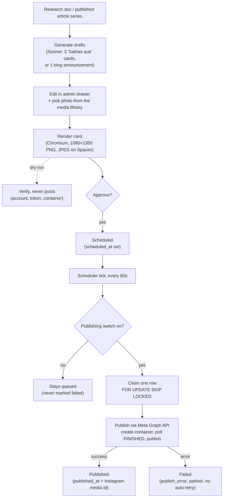
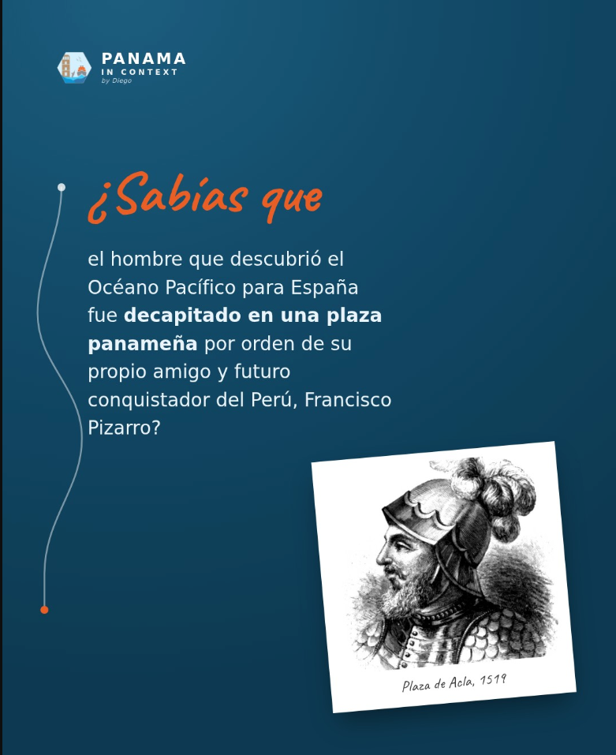
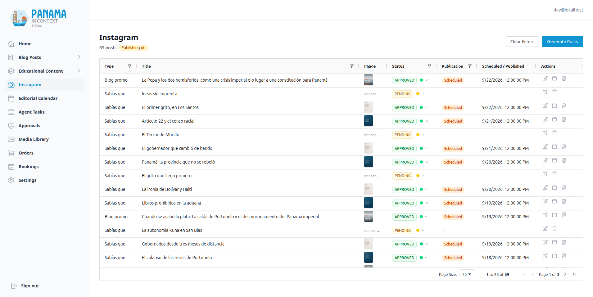
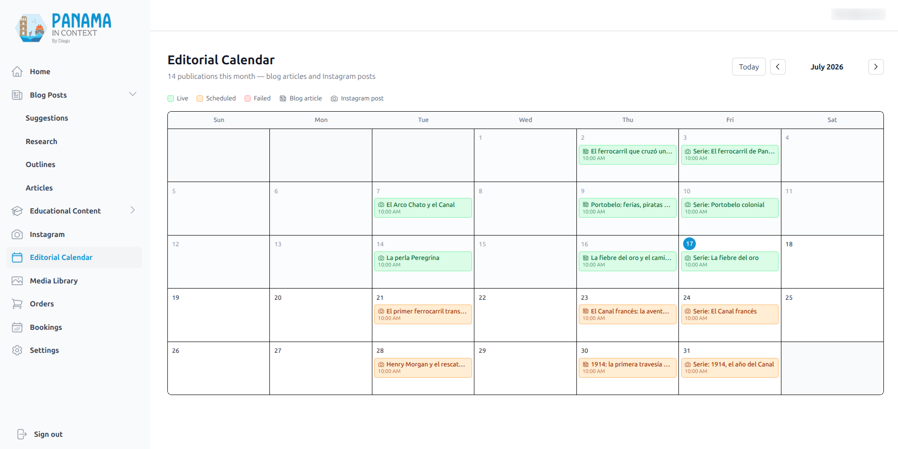

# The Instagram Pipeline & Editorial Calendar

[← Back to overview](README.md)

The brand's most-seen surface isn't the website: it's [@panamaincontextbydiego](https://www.instagram.com/panamaincontextbydiego/), where Diego posts hand-made history cards in Spanish to a couple thousand followers. Every one of those posts was designed, written and posted by hand, while a [content factory](02-blog-and-content-pipeline.md) two tabs away was already producing fact-checked research documents about exactly the topics the account posts about. This page is about closing that loop: a pipeline that turns research documents into feed-native Instagram posts, and an editorial calendar that shows the blog and the Instagram account as one publication schedule.

The pipeline is complete, from generation through rendering, approval, scheduling and the Meta Graph API call. Publishing from production is deliberately held behind a switch, for reasons covered below: 69 posts have been generated and about fifty approved and scheduled, and none has been published.

Two post types, matching what the account actually posts:

- **"¿Sabías que…?"**: a branded fact card with one surprising historical fact, a handwriting headline and a tilted polaroid photo. The operator picks a research document and the pipeline drafts three of them.
- **"Nuevo en el blog"**: an announcement card for a just-published article series, with a full-bleed photo, the series title, "Serie · 5 artículos" and a *link in bio* call to action.

Everything is Spanish-only. The blog is bilingual, but the account isn't, and pretending otherwise would have doubled the data model for an audience that doesn't exist.

End to end, the pipeline looks like this:

## Templates: the feed's visual language, rendered server-side

The design system gained a `ui_kits/social` kit designed against the real feed: two "Sabías que" treatments (a deep-navy card and a warm-gray one with a sepia polaroid), the blog announcement card, and an accent-orange token family the account uses for its handwriting headlines and CTA pills. Like the [slide kit before it](04-educational-deliverables-pipeline.md), the kit is design-time reference: the backend owns its own copies (brand CSS, tokens and the font under `app/ig_assets/`, the layouts as Jinja templates in the renderer) with the copy and images as variables and the brand motifs (the hand-drawn connector line, the lockup, the chip) kept verbatim.

Rendering reuses the slide pipeline's machinery: headless Chromium screenshots the `.post` element at exactly **1080×1350** (Instagram's 4:5 portrait), a shrink-to-fit pass steps the font size down if a fact runs long, and the result lands on Spaces under a timestamped key so re-renders never fight the CDN cache. Two details are specific to Instagram:

- **The fonts are baked in.** The kit loads the Caveat handwriting face from Google Fonts at design time; the backend port embeds the woff2 as a data-URI `@font-face` instead. A server-side render that silently fell back to a system cursive because a fonts CDN hiccuped would be the kind of bug you discover in the feed, three posts too late.
- **PNG in, JPEG out.** Chromium screenshots PNG; the Graph API accepts *only* JPEG, fetched from a public URL. So the renderer converts through Pillow at quality 90 and uploads public-read. The rendered artifact **is** the thing Instagram downloads at publish time, not an intermediate.

## Generation: three drafts, nothing invented

The generation call follows the condense-first, [plain-line-format](06-fact-checking-pipeline.md) pattern the rest of the codebase converged on: research past about 2,500 words is condensed into a briefing that deliberately preserves the *surprising* facts (exact dates, numbers, little-known details, the whole point of a "¿Sabías que…?" card), then one Sonnet call returns three cards in a strict `FIELD:` line contract. Each fact is written to continue the card's fixed heading: it starts lowercase after "¿Sabías que" and ends with "?", with the one or two striking phrases wrapped in `<b>`. The parser never invents content: a malformed block is dropped, and a short batch is the human's cue to regenerate.

That `<b>` is the only markup that survives. The fact column passes through a sanitizer that escapes *everything* and then restores only balanced, bare `<b>…</b>` pairs, for LLM output and admin edits alike, idempotently, on every write. Letting a model author fragments of HTML that a server-side browser will render is exactly one tag wide, and no wider.

The drafts alternate card treatments (navy, gray, navy) so a generated batch doesn't look stamped out, and each carries an `image_query` which, exactly like the [edu slides](04-educational-deliverables-pipeline.md), is only a search hint. The pipeline never picks a photo. The operator opens the draft in the admin drawer, and the same media-library picker used everywhere else (seeded with the hint, import-from-link included) chooses the polaroid.

Announcement posts flip the ratio of machine to database: the LLM writes *only the caption*. The series title, the article count, the "por Diego Raúl Feliu" byline and the background photo all come from the article rows: a series parent knows its children, and its feature image is already sitting in the media table. Template data an LLM could hallucinate but a JOIN cannot is data the LLM shouldn't be asked for.

## Two axes of state: approved is not published

An Instagram post row carries the same `PENDING → APPROVED / REJECTED` editorial status as everything else in the pipeline, and, mirroring the blog and edu materials, publication is a separate, timestamp-driven axis: `scheduled_at` queues it, a claim marker means a worker is publishing it right now, `published_at` plus the returned Instagram media id means it's live, and `publish_error` means the attempt failed. The admin surfaces one derived state (draft, approved, **scheduled**, publishing, published, **failed**), and the home dashboard counts posts with a SQL `CASE` that mirrors the same rule, so the two can't disagree. Scheduling requires an approved *and rendered* post, demoting an approved post cancels its schedule, and a published post becomes read-only: editing a caption the world has already seen would just make the database lie about Instagram.

Announcement posts don't need a hand-picked time. Scheduled without one, a promo goes out the day after its article's publish date at noon Panama time, and the call refuses while the article has no date. If the article is later re-dated, a promo still sitting on the derived time moves with it; unpublishing the article unschedules the promo. A promo can't announce an article that isn't live.

## Publishing, and the scheduler the codebase never needed before

Publishing an image is Meta's two-step dance: create a *media container* from the public JPEG URL plus the caption, poll it to `FINISHED`, then publish it. Containers expire in 24 hours, which is why the pipeline creates them at publish time and never ahead of schedule. Meta's own error message lands in `publish_error` ("The access token expired (code 190)" is actionable; paraphrasing it would only lose information), but nothing else from the exception does: a transport failure is reduced to its type name, because an exception's string can carry the URL it was calling.

The interesting part is *when* publishing happens. Instagram's API has **no native scheduling**, and until this feature neither did this codebase, not really. Blog and edu "scheduling" is passive: a future `published_at` sits in a row, and public queries filter `published_at <= now()`. Nothing ever *acts* at a future time; the clock passing the timestamp is the whole mechanism. Instagram breaks that model: someone has to actually call Meta at 7 PM on Thursday.

So the backend grew its first active scheduler: an asyncio loop started from the FastAPI lifespan that ticks every 60 seconds and publishes due posts. The design constraint I cared about was what happens with more than one worker, or, more realistically, with the old and new containers briefly overlapping during a deploy:

- A tick claims **one row at a time** with `FOR UPDATE SKIP LOCKED`, writes a claim marker, and **commits before the network call**. A concurrent ticker skips both the row lock and, after the commit, the marker. The slow part, talking to Meta, happens outside any database lock.
- **A failed post is parked, never auto-retried.** The due-row query excludes anything with a `publish_error`; retrying is an operator gesture (re-schedule, or publish now), and both clear the error explicitly. Retry storms against a rate-limited social API aren't mitigated here: they're structurally impossible.
- A sweep pass parks any claim older than fifteen minutes ("publish interrupted, re-schedule to retry"), so a worker that died mid-publish can't strand a post in limbo forever.

There is one residual window I chose to document rather than engineer away: a crash after Instagram accepts the post but before the commit lands parks the row as failed even though the post is live. It's rare, it's visible (a "failed" post that's plainly on the feed), and the reconciliation is one manual click. A two-phase commit against Meta's API is not a trade I'd make for it.

## Safe by default: credentials are not consent

In July the publisher was gated on credentials alone: without them, publish buttons answered 503 and the scheduler did nothing, while everything upstream worked. That let the pipeline ship before the Meta app and its token existed, and I wrote then that going live was two environment variables and a restart. It was the wrong default. Posting to the brand's account is a decision, so a token appearing in the environment must never be enough to post. Publishing now has a second, explicit switch, off by default:

- **Publish-now answers 409** while the switch is off (503 still means "no credentials"), before any request to Meta.
- **The scheduler claims nothing.** Due rows stay scheduled, never failed, so there is no wall of red when the switch flips.
- **The publish function itself refuses** before creating a container, so a future caller that forgets the check still can't post.
- The admin shows a "Publishing off" pill and disables publish-now.

Turning it on is an operator decision, never an agent's: the [agent-driven pipeline](10-agent-driven-pipeline.md) plans Instagram steps only behind its own flag, and neither verify nor publish-now is on the agent's allowed call list.

**Verify is the dry run that never posts**, and it works with the switch off. It checks that the token belongs to `panamaincontextbydiego`, is valid, carries the publishing scope and hasn't expired, and, given a rendered post, creates a real media container and polls it to `FINISHED`. It never calls the publish step: the unused container simply expires after 24 hours, the property of Meta's two-step dance that makes a real-credential test possible.

**The token is watched and kept out of logs.** Long-lived tokens last about 60 days and nothing renews them, so the scheduler checks daily and sends a Sentry warning when the token is invalid or has under a week left. Every Graph call sends the token as an `Authorization` header, never a query parameter, because Sentry turns query strings into breadcrumbs; the one endpoint that needs it in the URL is scrubbed.

## The editorial calendar

With two publication streams, articles going live by timestamp and Instagram posts actively published by the scheduler, the missing view was *time*. The admin's editorial calendar is a month grid showing both: every pill is one publication, **orange** if it's queued for a future date, **green** if it's live (a published article on the site, a published post on the feed), **red** if an Instagram publish failed. Newspaper icon for the blog, camera for Instagram; clicking any pill opens that item's edit drawer right there on the calendar.

Implementation-wise it's deliberately boring: a hand-rolled seven-column grid cloned from the bookings calendar, native `Date` arithmetic, no calendar library, and one aggregated endpoint that returns a month's worth of both item types with their derived states. The calendar doesn't own any state; it's a lens over `published_at` and `scheduled_at` columns that already had to exist.

## What it costs, and how it was verified

A three-card batch is at most two model calls, a condense (only for long research) and a generation, for pennies; the render is a local Chromium screenshot. The first end-to-end run, on a real research document about Bastidas and Columbus, produced drafts I'd have been happy to see written by hand ("La fuga de Quibián": the cacique who escaped drowning by politely asking his captors to loosen the ropes), each with a usable caption, hashtags and a photo hint. The human still approves every word and picks every photo. This pipeline, like every other one in the project, exists to move Diego from *author* to *editor*, not out of the loop.

---

[← The Fact-Checking Pipeline](06-fact-checking-pipeline.md) · [Back to overview](README.md) · Next: [The Knowledge Layer →](08-knowledge-layer.md)
