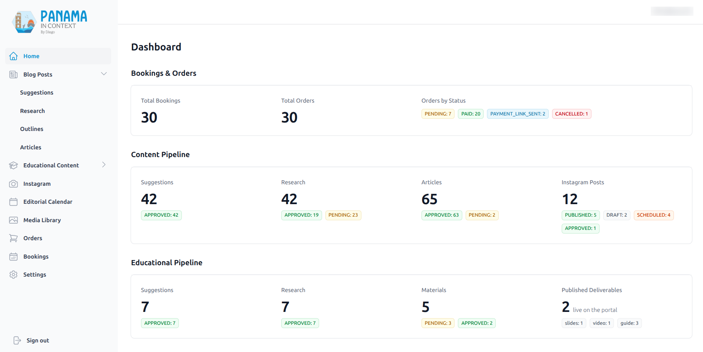
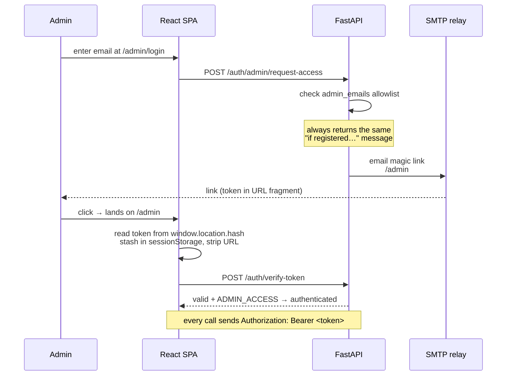
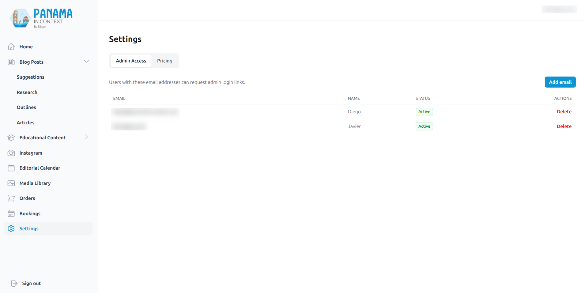

# Admin Dashboard, Auth & CMS

[← Back to overview](README.md)

The admin dashboard is where the whole operation is run — every pipeline in the other pages is *operated* from here. There are no passwords anywhere in the system: admins log in through an emailed magic link, and that single decision shapes the auth model.

## The shell

The admin is a dashboard‑style SPA: a fixed left sidebar with the logo pinned at the top and "Sign out" pinned at the bottom, the admin's email in the top bar, and the active section rendered in the right pane. On desktop the sidebar is always present; on mobile it's a slide‑over. The sidebar groups the work the way the business thinks about it:

- **Home** — booking/order and content‑pipeline stat cards
- **Blog Posts** *(expandable)* — Suggestions, Research, Outlines, Articles
- **Educational Content** *(expandable)* — Suggestions, Research, Materials
- **Instagram** — the [social pipeline](07-instagram-pipeline.md)'s drafts, rendering, and scheduling
- **Editorial Calendar** — blog + Instagram publications as one month view
- **Media Library**
- **Orders**
- **Bookings**
- **Settings**

This shell is also the template for the public educational‑materials portal ([#309](04-educational-deliverables-pipeline.md)): that portal has since been rebuilt into a lighter‑weight version of this same dashboard, so the two now share a visual language. See [the deliverables pipeline](04-educational-deliverables-pipeline.md) for the portal as it shipped.

The whole admin tree is lazy‑loaded behind `Suspense`, which keeps the heavy CMS dependencies (ag‑grid ~500 kB, TipTap ~300 kB) out of the public bundle entirely.

## Magic‑link authentication

The details I care about:

- **The token lives in the URL fragment** (`/admin#token=…`), never the query string. Browsers don't send fragments to servers, so the token never lands in an access log or a `Referer` header. The SPA reads it from the hash on mount, stashes it in `sessionStorage`, and immediately strips it from the URL.
- **Login is anti‑enumeration.** Whether or not the email is on the allowlist, the response is the same "if your email is registered, you'll get a link" — so the form can't be used to discover who has admin access.
- **Tokens are server‑validated on every request.** A FastAPI dependency joins the magic link to the allowlist and checks the token, its `ADMIN_ACCESS` action, expiry (24h), and that the email is still active. The token is read *only* from the `Authorization` header — an earlier `?token=` query fallback was removed once all clients used headers.
- **Logout is real revocation.** It deletes the magic‑link row server‑side, so the 24‑hour token can't be replayed from history or logs after sign‑out — not just a client‑side `sessionStorage` clear.

The admin allowlist itself is managed from the Settings page (the two owner emails, each toggleable):

There's a dev bypass — a static `dev-token` — but it's double‑gated behind both a debug flag *and* an explicit `development` environment, and it logs a warning whenever it's used, so it can't accidentally be live in production.

## The CMS surfaces

Each admin page is a focused tool over one slice of the system:

| Page | What it drives |
|------|----------------|
| **Home** | Dashboard stats — bookings/orders, the blog and educational pipelines by status, Instagram posts by publication state, and how many deliverables are live on the public portal |
| **Suggestions** (blog) | AI‑generate article ideas per category; fact‑check; approve/reject |
| **Research** (blog) | Generate a research prompt, upload research markdown, fact‑check, approve, summarize |
| **Outlines** | Generate article outlines from approved research; approve them |
| **Articles** | TipTap editor, tagging, DeepL translation, feature image, series sections, publish |
| **Edu Suggestions / Research / Materials** | The [educational deliverables pipeline](04-educational-deliverables-pipeline.md) |
| **Instagram** | The [social pipeline](07-instagram-pipeline.md): generate drafts from a research doc, edit in a drawer, pick the photo, render the card, schedule or publish now |
| **Editorial Calendar** | Blog articles + Instagram posts on one month grid — orange scheduled, green live, red failed; a pill opens the item's editor |
| **Media Library** | The [crawl/score/approve](05-media-library-and-acquisition.md) grid |
| **Orders** | PayPal invoices, mark‑paid, reschedule, cancel |
| **Bookings** | Month calendar of confirmed trips |
| **Settings** | Admin‑email allowlist + the pricing config |

The data‑heavy pages (Articles, Materials, Media, Orders) are ag‑grid tables with filtering; the editing‑heavy ones use TipTap. Consequential actions — anything that sends an invoice, publishes, or deletes — are gated behind an explicit confirmation, because this is a single‑operator dashboard and a misclick has real consequences.

The content grids (Suggestions, Research, Articles) also carry a per‑row **fact‑check status badge** — flagged / open / corrected / passed — that drills into a claims modal, and approving an item whose fact‑check isn't clean asks for one more explicit confirmation. The verification layer behind those badges has [its own page](06-fact-checking-pipeline.md).

The Instagram grid follows the same grammar with one extra axis: alongside the editorial status, each row shows a **publication state** (scheduled in orange, published in green — linking to the live post — failed in red with the Graph API's error as the tooltip), and the calendar icon that elsewhere means "publish" here opens a schedule‑or‑publish‑now modal. The same drawer pattern, the same media picker, the same confirmations — a new pipeline shouldn't mean a new UI language. The pipeline itself has [its own page](07-instagram-pipeline.md).

A note on how this moved since: the educational‑materials grid has since gained its full editing surfaces and per‑stage action buttons ([#327](04-educational-deliverables-pipeline.md)) — guides and decks each open a card‑per‑block / card‑per‑slide editor with the render‑to‑publish pipeline wired up as buttons. What's still open is the finer‑grained per‑artifact review ladder (independent sign‑off on the audio and the video, with inline players). The [deliverables pipeline page](04-educational-deliverables-pipeline.md) has the shipped detail.

---

[← The Instagram Pipeline & Editorial Calendar](07-instagram-pipeline.md) · [Back to overview](README.md) · Next: [Forms, Mailing List & Educator Access →](09-forms-mailing-and-educator-access.md)
