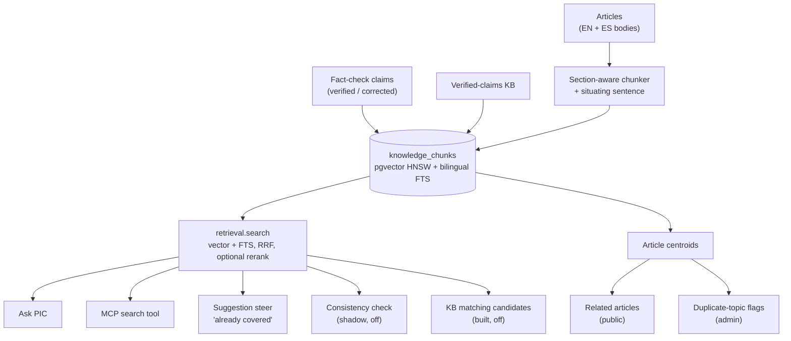

# The Knowledge Layer

[← Back to overview](README.md)

By October the site had more than a hundred long bilingual articles and thousands of fact-checked claims, and the pipeline that produced them had no memory of any of it: a new topic suggestion couldn't tell that the blog already covered the same ground, and an article couldn't point readers at its neighbours. The two things I wanted to build next, a public question-answering page ([Ask PIC](09-ask-pic.md)) and an [MCP server](11-mcp-server.md) for agents, both needed a way to search the corpus by meaning. Instead of bolting a vector search onto each feature, I built one index and one retrieval module, and made every feature a reader of it.

The rule I set before writing any code: nothing ships on the strength of looking right. Every choice on this page was measured against a golden question set and production data, with the results committed as dated files, and several features that worked were left switched off because the numbers said they didn't help.

## One index, many readers

Everything lives in one Postgres table, `knowledge_chunks`, on the same managed database as the rest of the app. pgvector was already available on the cluster, so adding a vector store meant one migration (`CREATE EXTENSION vector`), not a new service. Each row is a chunk of text with its source (`ARTICLE`, `ARTICLE_CLAIM` or `VERIFIED_CLAIM`), its language, a heading path, a `content_hash`, a `vector(1024)` embedding behind an HNSW cosine index, and a stored generated `tsvector` that picks the English or Spanish text-search configuration per row (over an unaccent wrapper, headings weighted above body text) behind a GIN index. As of mid-October the table holds 14,101 rows: 2,665 article chunks (1,291 English, 1,374 Spanish) from 113 articles, 4,975 claims from article fact-checks, and 6,461 verified claims from the knowledge base.

One decision shaped the table more than any other: **visibility is never stored on a chunk.** Articles go public on a schedule (the [blog pipeline](02-blog-and-content-pipeline.md) publishes by date), so a "public" flag written at index time would go stale the moment a publish date passed. The index holds every article with a body, and the query decides at read time: public searches keep only approved articles whose publish date has passed (and never knowledge-base rows); internal searches also see scheduled articles and the KB.

Every Voyage AI call goes through one module, `embeddings.py`, the same chokepoint pattern as the LLM client (batching, retry with backoff, a cost log line per call); an empty API key raises before any I/O, so every embedding feature degrades to off instead of erroring. A guard test walks the AST of every module and fails if anything outside the knowledge package names the table, so a new feature that wants to search has to go through `retrieval.search`.

## Chunking, and the sentence that fixed retrieval

The chunker is section-aware: it strips the series boilerplate, splits on headings while keeping an "A > B" heading path, and packs whole paragraphs into chunks of roughly 300 to 600 estimated tokens with up to 60 tokens of overlap. The embedded text is the article title and heading path in front of the chunk.

That wasn't enough for a class of misses that kept showing up in the eval. A paragraph that says "he arrived on the coast that November" has no name and no year in it, so a question about Balboa in 1510 has nothing to match. The fix is the technique usually called contextual retrieval: one Haiku call per article and language reads the whole article and writes a one-line situating sentence for each chunk that needs one, naming the people, places and dates it is about. The sentence is stored in the chunk's metadata, embedded with the chunk and fed to the reranker, but readers and the answer model never see it. The `content_hash` deliberately excludes it, so matching rows on reindex never depends on LLM output.

I measured it as an ablation on a local copy of production, both arms on the same day. Putting the title and heading in front of the rerank input alone changed nothing. The sentence did: the chunk holding a question's key facts ranked higher (fact-chunk MRR 0.926 to 0.940), every key fact in the reader question set reached the passages the answer model sees (149 to 150 of 150), and one false abstention disappeared. It costs about $0.00015 more per Ask PIC query (the rerank input grows by a quarter), and the one-time reindex of all 113 articles took 226 Haiku calls and about 35 cents. It stayed on.

## An index that keeps itself current

Articles change constantly: grammar passes, translations, corrections from the [fact-checker](06-fact-checking-pipeline.md). Every route that writes an article's title or body schedules a reindex after its commit, and a guard test fails if an article-body writer isn't on the reindex list, because that list is exactly what rots when a route is added six weeks later.

The indexer matches the chunks it wants against the rows it has by `(language, content_hash)`, not by position, so editing one section re-embeds one chunk and an unchanged article costs no API call at all. It embeds with no database session open (the cluster is shared, and connections are the scarce resource, not RAM or money), then writes in a fresh short session holding the article row `FOR UPDATE`, and reports `superseded` if the body changed mid-run. It never raises; a sweep script (`reindex_knowledge --all`, with a dry run that prints counts and cost) repairs whatever a background run missed. Fact-check claims and knowledge-base verdicts are indexed by the same machinery at the end of each fact-check job, which is what lets a claim be matched against other claims by meaning.

## Retrieval: hybrid, fused, optionally reranked

`retrieval.search` has three modes: vector (cosine distance on the HNSW index), full-text (English and Spanish `websearch_to_tsquery` together), and hybrid, the default, which fuses the two ranked lists with Reciprocal Rank Fusion (k = 60). Reranking the top 50 fused chunks with Voyage's `rerank-2.5` is opt-in. When the query embedding fails, hybrid runs full-text only and says so in a `degraded` field.

The first evaluation compared three embedding models, three modes and rerank on a 56-question golden set (28 English, 28 Spanish, including cross-lingual, multi-article and unanswerable questions). The headline results, article-level, on the 40 answerable questions:

| configuration | recall@1 | recall@5 | MRR |
|---|---|---|---|
| full-text only | 0.075 | 0.075 | 0.075 |
| hybrid, voyage-4 | 0.775 | 0.938 | 0.883 |
| hybrid + rerank, voyage-4 | 0.875 | 0.975 | 0.952 |
| hybrid + rerank, voyage-4-large | 0.875 | 0.975 | 0.952 |

Full-text search alone was nearly useless for natural-language questions, because the web-search query syntax requires every term to match. Rerank was the biggest single gain (about $0.0007 and a third of a second per query), so Ask PIC uses it and plain `search()` doesn't by default. The large embedding model bought nothing once rerank was on, so the index uses `voyage-4`.

## Pipeline memory: what shipped, what didn't

Each use of the index in the pipeline except related articles was built behind a flag, and each was calibrated against production data before it got a decision.

**Related articles (live).** Every public article page shows up to three related articles under the body. The ranking is cosine distance between article centroids (the pgvector `avg()` of each article's chunk embeddings), excluding the article's own series and anything written from the same research document. I picked centroids over "best matching chunk pair" with a read-only comparison over 75 public articles: a slightly higher share of same-category recommendations (0.81 against 0.78), less concentration on a few popular articles (the most-recommended article appeared 19 times against 29), and 53 ms against 508 ms at the median. It uses stored vectors only, so it makes no paid API call; responses are cached per worker for ten minutes and sent with a ten-minute `Cache-Control`.

**Duplicate topics (live).** Before the suggestion generator runs, the category is embedded and the titles of the nearest covered articles are added to the prompt as "Already covered on the site", which steers the model away from repeats. After generation, each suggestion is embedded and compared with article centroids and older suggestions; a match above the threshold gets an amber "Possible duplicate" pill in the admin grid's "Duplicate?" column that opens the article or suggestion it resembles. It is advisory: a false flag costs a glance, not a lost idea. The calibration is the instructive part. My provisional threshold of 0.85 flagged **none** of the 15 seeded near-duplicates (0% recall); the sweep put the threshold at 0.725, with 93% precision and 93% recall on 15 near-duplicates and 15 novel topics.

**Cross-article consistency (built, shadow mode, off).** After an article's fact-check, its claims are matched by vector against other articles' claims and the knowledge base, and batched Sonnet calls label each pair as contradicting, consistent or unrelated. On seeded contradictions (changed dates, figures, names, places) it scored 95% precision and 95% recall. It records findings and gates nothing, and its flag is off in production.

**Knowledge-base matching with vectors (measured, off).** Fact-checking reuses verified verdicts by finding candidates through word overlap and confirming with Haiku. Swapping in vector candidates seemed an obvious upgrade, so I replayed 200 historical claims through both: word overlap hit 26.5%, vectors 25.5% at a 0.5 similarity floor and 24.5% at 0.6, with the same 88% verdict agreement. Vectors would have cut the confirmation cost by up to 40%, but they found no more matches, and the hit rate is the point. The flag is off.

Two more ideas met the same fate on the Ask PIC side (query rewriting, and pairing English and Spanish twins by a content key); they are on the [next page](09-ask-pic.md).

## The bug the eval caught: a starved HNSW pool

The best thing the evaluation harness did was find a production bug that produced no errors at all.

After the situating-sentence reindex, the first answer runs against production (read-only, as every eval run is) showed three answerable questions abstaining that had answered before the reindex, and on the local copy of production, with the same data and the same code, they answered fine. The scores looked like an abstain-floor problem: one question's best rerank score had dropped from 0.83 to 0.48. To separate "the floor is wrong" from "retrieval is wrong", I ran the same retrieval eval twice against production, once normally and once with index scans disabled for the session (`PGOPTIONS='-c enable_indexscan=off -c enable_bitmapscan=off'`), which forces an exact vector scan. With the exact scan, every one of the 190 answerable questions cleared the floor again; on the live index three didn't.

The cause is how pgvector applies filters. An HNSW search returns the `ef_search` nearest entries (50 here) and only *then* applies the query's `WHERE`. Two things were eating those 50 slots. First, 46% of the table is knowledge-base rows that the public filter always drops. Second, the reindex had replaced thousands of rows, leaving 2,711 dead tuples, still in the HNSW graph and sitting right next to their replacements in vector space, exactly around the questions about re-embedded articles; that count was just under the autovacuum trigger for a table this size, so nothing cleaned them up. The candidate pool reaching the reranker held 5 to 27 chunks instead of 50, and sometimes none: in a latency benchmark, 10 of 100 public hybrid searches returned nothing at all.

The fix has three parts:

- **Iterative scan.** The vector stage now sets pgvector 0.8's `hnsw.iterative_scan` to `relaxed_order` in the same transaction-local `SET` as `ef_search`, so the scan keeps walking the graph until the filtered query has its 50 rows, then re-sorts by `(distance, id)` because relaxed order can come back slightly out of order. Support is detected once per process from `pg_extension.extversion`, not with a trial `SET`, because before the extension library loads an unknown `hnsw.*` setting is silently accepted as a placeholder, and after it loads a bad one aborts the caller's transaction.
- **A scan cap with a warning.** pgvector's default `hnsw.max_scan_tuples` (20,000) was only 1.4 times the table, and a scan that hits the cap returns a short pool just as silently. It is now 50,000, which bounds a pathological full walk near half a second (a forced full walk of the 14.1k-row index measured 120 to 145 ms server-side). When the stage returns fewer rows than asked, a cheap capped `COUNT` checks whether more rows match the filter, and only then logs a warning.
- **No pointless writes.** The indexer used to update every kept row of any source that changed, twice. A correction to three knowledge-base claims once rewrote all ~6,460 verified-claim rows and left 13,583 dead tuples. Now a kept row is written only if one of its columns actually differs, and the sweep script vacuums the table itself when a run leaves more than 1,000 dead tuples. The next knowledge-base correction wrote 5 rows in about a second, against about 90 seconds before.

After the change, the live index's abstain-floor table matched the exact scan's at every threshold, Ask PIC answered 190 of 190 answerable questions in both evaluation runs, and empty public searches went from 10 in 100 to none. The cost was about 10 ms at the median on the vector stage. The lesson I wrote into the project's knowledge doc: a filtered approximate-nearest-neighbour search can quietly return less than you asked for, and the only way you'll see it is by comparing it with an exact scan.

## How the evaluation works

All of this rests on a small eval package (`python -m scripts.eval_rag <command>`): retrieval metrics, answer judging, a selection mode that tests passage-picking rules with no model call, and per-model tables for comparing embedding models without touching the real index. It reads production only through sessions it verifies as read-only, and every run commits a dated Markdown and JSON result, which is where every number on this page and the next comes from. The working rules: measure against production data, run each arm twice (the LLM judge moves about three points between identical runs), and keep a change only if it improves the eval. That last rule is why so much here is "built and switched off".

---

[← The Instagram Pipeline & Editorial Calendar](07-instagram-pipeline.md) · [Back to overview](README.md) · Next: [Ask PIC →](09-ask-pic.md)
