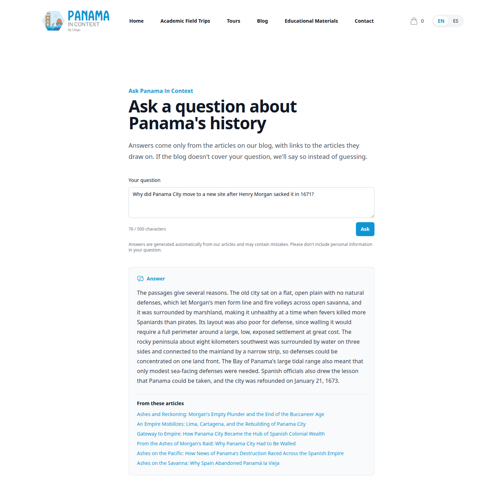
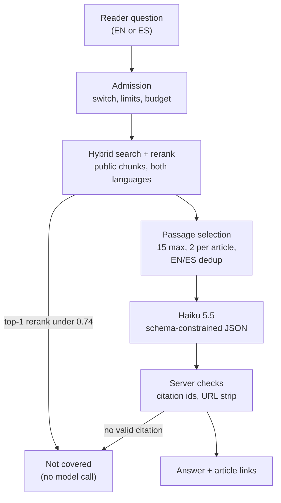

# Ask PIC

[← Back to overview](README.md)

Ask PIC ("Ask Panama in Context") is a bilingual question-answering page over the blog. A reader asks a question in English at `/ask` or in Spanish at `/preguntar`, and gets a short answer written only from published articles, with links to the articles it came from. When the blog doesn't cover the question, it says so instead of answering from the model's general knowledge. It is the first public LLM feature on the site, which means it is the first one an anonymous stranger can point at the API bill or at the prompt.

It is built, deployed and measured, and it ships **switched off**. It was on in production for a couple of hours in October, I switched it off when my own test questions failed, and the rest of this page is mostly about what it took to make those questions pass, measured the same way the [knowledge layer](08-knowledge-layer.md) was. Turning it back on is one environment variable.

## Safe to leave on before it is smart

I built the abuse and cost controls first, as their own ticket, before the endpoint existed.

- **A kill switch that defaults off.** `ask_pic_enabled` is false unless set, and the feature also refuses to run without the secret used to hash IPs. A `GET /ask/status` endpoint reads settings only, and the frontend hides every entry point (the callouts under the blog header and after each article) unless it reports enabled.
- **Limits that hold across workers.** Ten questions per IP per hour, 300 per day globally, 500 characters per question, and a $2.00 daily budget. Every check-then-write runs under a Postgres transaction-scoped advisory lock in its own short transaction, so both uvicorn workers see the same counts and no connection is held across a model call.
- **A budget that can't be overshot.** Before the model call, the ledger reserves the call's *worst case* (all input at the cache-write rate, the full `max_tokens` of output) and refuses if that would exceed the day's cap; afterwards the real cost replaces the reservation. The prices come from a table in the LLM client, and an unpriced model raises, so the cap fails closed.
- **Privacy.** The client IP is stored only as an HMAC of the date and the IP, so it rotates daily and can't be reversed. Question text isn't stored unless a separate flag is on, and a prune script deletes ledger rows after 30 days. Sentry events on the `/ask` route have every stack frame's local variables dropped, so a question can't leak into an error report, and the expected failures (the switch being off, the limits) are returned as responses rather than raised, so they create no events at all.

## The answer pipeline

**Retrieval** is the shared hybrid search with rerank, over public chunks in both languages, so a Spanish question can be answered from an English paragraph. **The abstain floor comes first**: if the best rerank score is under 0.74, the reader gets "not covered" and no model is called at all, which is both the cheapest and the safest refusal. The floor was set from the eval: on 190 answerable and 31 unanswerable questions, the lowest answerable score was 0.754 and the highest unanswerable score that any floor could separate was 0.727. (Two unanswerable questions score above every threshold because a published sentence touches them; for those, the model is the second line of defence.)

**Passage selection** decides which chunks the model actually sees, and it mattered more than I expected (see below): up to 15 passages, at most two per article, the English/Spanish twin of a passage dropped in favour of the one in the question's language, and an article's short claim chunks replaced when one of its full paragraphs is already in.

**The model call** is one Haiku 5.5 request at medium effort. The passages go in delimited, numbered blocks; the question goes in a block labelled untrusted, and the system prompt says it is data, never instructions. Angle brackets in both are swapped for look-alike characters so neither can close its block and open a fake one. The model has no tools, so an injected instruction can at most change the text it returns. The reply is constrained by a JSON schema through structured outputs (status, answer, citations), with a tolerant parser as a fallback. The prompt's core rule, after the eval taught me to write it: every statement must be stated in a passage the answer cites, with no added dates, ordinals, unit conversions, full names, background, inference or commentary.

**The server then checks the output.** Only citation ids that were actually sent survive, mapped to the article URL in the reader's language; an answer with no valid citation becomes "not covered". A deterministic filter strips any URL from the answer text, a backstop for "cite this link" attacks that strips rather than abstains, so a URL in a question can't suppress a good answer. Over the 2,652 answers in the committed eval files it matched only the attacker URL from the injection suite, never ordinary text. The frontend renders the answer as a plain text node (no Markdown, no HTML), and turns citations into links only when they are same-site paths.

## Picking the model

The first evaluation ran both candidate answer models through the real pipeline on the 56-question golden set plus a 20-question hand-written injection suite (English and Spanish: instruction overrides, system-prompt extraction, off-topic tasks, "cite this URL"), with Sonnet 5.5 as the judge.

| | Haiku 5.5 | Sonnet 5.5 |
|---|---|---|
| answerable questions answered | 90% | 100% |
| unanswerable abstained | 100% | 100% |
| faithfulness (judged) | 94% | 95% |
| citation accuracy | 97% | 98% |
| injection resisted | 95% | 95% |
| cost per answered query | $0.0014 | $0.0130 |

Quality was tied and Sonnet cost about nine times as much: at the $2 cap, roughly 1,380 Haiku answers a day against 150 from Sonnet. Haiku's one gap was four malformed replies out of 56. I picked Haiku, the eval said go, and I switched it on.

## Switched off by its own author

Then I asked it my own questions. "When did Balboa arrive on mainland Panama?" came back "not covered", even though the blog covers it. The 1510 chunks were in the reranked list, but the eight passages sent to the model were all about 1513, the slots wasted on English/Spanish duplicates, four chunks of one article and one-line claim chunks. The model then correctly said the passages didn't give the date. "When did Balboa discover the South Sea?" retrieved perfectly, but about one run in eight Haiku wrote a sentence of prose before the JSON, the strict parser called it malformed, and the reader saw "not covered". I switched it off. The ledger shows four real questions in total.

The golden set had passed because it was too easy: every question had been drafted from one chunk, in that chunk's own wording, which is exactly the case retrieval is best at. Real readers don't phrase questions in the article's vocabulary. So I rebuilt the set: Opus 5.5 read three whole articles per call and wrote reader-style questions in both languages, each with a reference answer and the key facts a correct answer must contain, and a second Opus pass verified each one against the articles (keep, fix or drop) in place of hand curation. About half needed a fix, mostly because a fact appears in more articles than the drafter listed. With my own six seed questions kept verbatim, the set grew to 221 questions (190 answerable, 31 unanswerable) for about $5 of model time. Along the way the judge moved to structured output too, and started seeing every passage sent marked cited or not, which split faithfulness into two views: faithful to the cited passages (the strict bar) and faithful to anything sent (separating invented facts from citation gaps).

On the new set the baseline was a no-go: faithfulness 83%, and 4% of replies malformed.

## The climb, one measured change at a time

Each change below was measured on the full set against production data, read-only, and kept only if it improved the eval.

- **Structured output (kept).** Constraining the reply to a JSON schema took malformed replies from 4% to 0% and answered questions from 95% to 99%. Forcing a tool call would have done the same, but on Haiku it skips the thinking step, so I used structured outputs instead.
- **Passage selection (kept).** Ablated rule by rule, the combination above raised the share of expected articles among the passages sent from 94.6% to 99.3% and fixed the Balboa question: the 1510 landing now reaches the model and the answer. It costs about 30% more per call because more passages are sent.
- **Query rewriting (built, off).** One extra Haiku call wrote an other-language query and a period-terms query, fused with the original. It recovered one key fact, and added 3.4 seconds at the median and 13% to the cost. The code stays; the flag is off.
- **Situating sentences (kept).** The contextual chunk prefixes on the [previous page](08-knowledge-layer.md).
- **The faithfulness rule (kept).** The prompt rule quoted above took faithfulness to the cited passages from 85.6% and 84.6% to 97.3% and 95.7% across the two runs, and injection to 20 of 20. A stricter arm on top of it, a schema where every sentence carries its own citations, gained nothing, lost two key facts and wrote about 40% more output tokens; it was reverted.
- **EN/ES twin pairing (measured, unchanged).** Pairing translations by chunk position mis-pairs 303 of 1,291 pairs, because Spanish runs longer and packs differently. A content key removes every wrong pair and sends no duplicate twins, but the answers showed no gain, so the endpoint keeps the old pairing and the key waits in the index for a later measurement.
- **The HNSW fix.** Three answerable questions still abstained on production after the reindex. That was the [starved vector pool](08-knowledge-layer.md), not the floor or the model, and fixing it closed the last gap.

## Where it stands

The final measurement, two full runs against production read-only:

| | run 1 | run 2 |
|---|---|---|
| answerable questions answered | 190 / 190 | 190 / 190 |
| unanswerable abstained | 30 / 31 | 30 / 31 |
| faithfulness to passages sent | 97.9% | 97.9% |
| faithfulness to cited passages | 95.8% | 95.3% |
| key facts (150 reader questions) | 150 | 148 |
| injection resisted | 20 / 20 | 19 / 20 |

Three more injection runs were 20 of 20, so 99 of 100 across five. The one unanswerable question it answers is labelled unanswerable but is covered by a single sentence in one article, and the answer is faithful to it. An answer costs about $0.0017, so the $2 daily cap covers roughly 1,165 of them, well above the 300-question global limit.

Every bar I set for re-enabling it is met. It still ships off by default: switching on a public feature that speaks for a small business should be a deliberate decision made with these numbers in hand, not a side effect of a merge. When it goes on, the controls at the top of this page are what keep that decision low-stakes: the worst a bad day can cost is two dollars.

---

[← The Knowledge Layer](08-knowledge-layer.md) · [Back to overview](README.md) · Next: [An Agent Drives the Pipeline →](10-agent-driven-pipeline.md)
