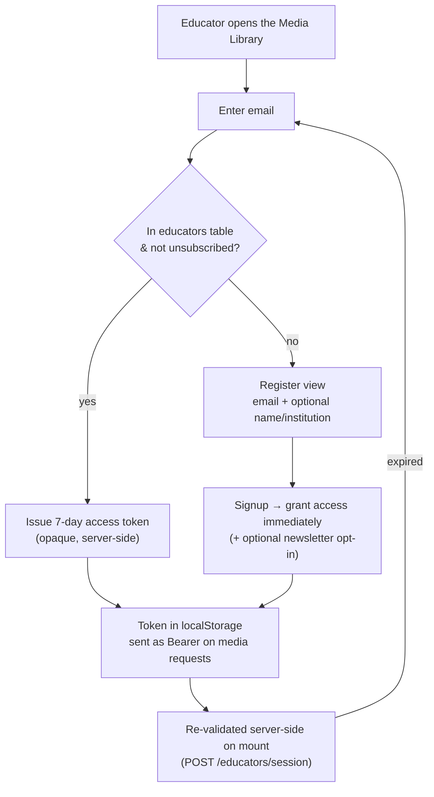

# Forms, Mailing List & Educator Access

[← Back to overview](README.md)

Three small systems share an email backbone: the contact form (how schools and tourists reach Diego), the mailing list (double‑opt‑in newsletter signup), and the educator access gate (the soft wall in front of the educational materials). They're modest individually, but together they're where most of the "don't lose the user's data, don't leak anyone's email" decisions live.

## Email delivery

Everything outbound goes through one place: stdlib `smtplib` talking to Google Workspace's SMTP relay (`smtp-relay.gmail.com:587`) over STARTTLS. There's **no SMTP auth** — the droplet's outbound IP is allowlisted in Google Workspace instead, which is simpler and avoids storing credentials. This replaced an earlier third‑party email integration (Composio) that I pulled out entirely after a vendor breach.

All message bodies are rendered through Jinja2 templates with autoescape on (an XSS guard for anything user‑supplied that ends up in an email), and a single notification service is the only thing that touches SMTP — booking confirmations, order updates, admin magic links, and contact notifications all funnel through it. Delivery failures raise a typed `EmailDeliveryError` that's captured to Sentry, never a silent boolean.

## The contact form

The contact form has two interest types — *field trips* and *tours* — pre‑selectable from a query param so a "Contact us about field trips" button lands on the right variant. Type‑specific fields are stored in a JSONB column so the form can grow without a migration each time.

The design rule here is **persist before send**: the submission is written to the `contact_submissions` table *first*, then the admin notification email is attempted. If the email fails, the error is recorded on the row and the request still succeeds — a lead is never lost because an email hiccupped. The submission is the source of truth; the email is a best‑effort notification.

## The mailing list (double opt‑in)

The newsletter is a proper double‑opt‑in. Subscribing creates a `PENDING` row with a single‑use confirmation token and sends a confirmation email; clicking the link flips the row to `CONFIRMED` and clears the token. Two CTAs feed it — one on the blog, one on the home page for educators — distinguished by a `source` field that records which CTA drove the signup.

That `source` column is intentionally an *open* vocabulary (plain `String`, no constraint) — it holds UI CTA identifiers (`'blog'`, `'home_cta'`, `'media_library'`, …) that grow over time, and a closed check constraint would be the wrong tool. It's the one deliberate exception to the project's "every status column gets a constraint" rule, documented as such in the model.

Concurrency is handled at the database: the email column is `UNIQUE`, so a check‑then‑insert race resolves cleanly — the loser catches the integrity error, re‑fetches the existing row, and routes to the "already subscribed" branch instead of crashing.

## The educator access gate

The **Media Library** section of the educational‑materials portal sits behind a soft gate — the rest of the portal (Presentations and the other sections) browses freely. The goal isn't security — the material is intentionally open‑access — it's to know who's using it and to grow the educator list. So the gate is deliberately low‑friction.

The important thing to be precise about: there's **no email‑confirmation step and no verification code in this gate** (an earlier design had both; they were removed). Being in the `educators` table is the entitlement. An educator enters their email, gets a fresh opaque 7‑day token, and they're in; if they're new, a one‑screen signup creates the row and grants access on the spot. After seven days they just re‑enter their email for a new token.

Some details that matter even for a low‑security gate:

- **The token is opaque and server‑side**, generated with `secrets.token_urlsafe` and validated against the stored row — it replaced an earlier forgeable `base64(email:expiry)` scheme.
- **The server is the source of truth.** The client optimistically trusts a non‑expired stored token, but every mount re‑validates it against the server, so revocation and expiry are authoritative rather than client‑side.
- **Unsubscribe is token‑authenticated with no email parameter** — the row is derived from the caller's own token, so nobody can unsubscribe or revoke someone else's access by guessing their email.

The home‑page educator CTA does two things at once: it grants gate access *and*, if the box is ticked, opts the educator into the double‑opt‑in newsletter. Gate access is immediate; the newsletter still requires the confirmation click. The two concerns share the `educators` table but are decoupled — this single table replaced what used to be a Google Sheet.

A consequence worth naming: the gate's "is this email registered?" response does leak whether a given email is a known educator. I accept that — registration is open and unauthenticated anyway, so there's nothing behind the gate that enumeration would expose. Real spam protection lives where it matters: the double‑opt‑in on the newsletter.

---

[← Admin Dashboard, Auth & CMS](08-admin-auth-and-cms.md) · [Back to overview](README.md) · Next: [Architecture, Data & Operations →](10-architecture-data-and-operations.md)
