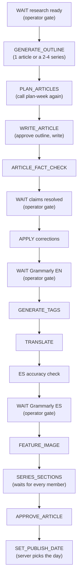
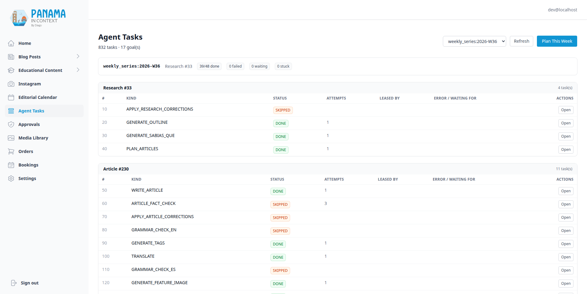

# An Agent Drives the Pipeline

[← Back to overview](README.md)

Through July, every stage of the [blog pipeline](02-blog-and-content-pipeline.md) was a button I clicked in the admin: generate the outline, approve it, write, fact-check, apply corrections, tag, translate, add the series sections, approve, publish. Each button was a well-tested endpoint, and I was the scheduler. That was the slowest part of the system.

Now an agent drives it. Once a day, a driver in my [managed-agents orchestrator](https://feliu.dev/projects/managed-agents/from-janitor-to-publisher) works one article series forward, unattended, from approved research to a scheduled publish date. This page is the Panama in Context side: the task graph the driver executes, the protocol it speaks, the narrow credential it holds, and the places where the graph stops and waits for me.

## A task graph, not a smarter agent

The obvious design was an LLM agent with tools: give it the admin API and a goal and let it work out the order. I didn't build that, because the order is not a judgement call. Outlines come before articles, translation before the Spanish proofread, series sections only when every member is translated. The endpoints' preconditions already encode that order, and asking a model to rediscover it on every run would add cost and nondeterminism and fix nothing.

So the models work inside the stages, and the orchestration is plain data: Panama in Context plans the work as rows in its own database, and the driver is a loop with no model in it. Claim a task, run the HTTP calls it says to run, report, repeat. Everything the driver knows about the pipeline arrives with its claim, so the pipeline logic is tested here, next to the code it calls.

## `agent_tasks` and `plan-week`

One row per step, grouped under a goal key that names a series (`daily_series:2026-09-12`). A row has a `kind` (25 of them, a closed vocabulary behind a CHECK constraint), a polymorphic subject (research, article or Instagram post), a `status`, a `depends_on` integer array, a `position`, JSONB `payload` and `result`, and lease fields. A unique constraint on `(goal_key, kind, subject_type, subject_id)` is what makes planning safe to repeat.

The planner, `plan_week`, is an insert-only ensure pass. Each call computes the graph the current database state permits and inserts only the missing rows; it never touches an existing one. Two calls back to back create nothing the second time, and two concurrent calls are settled by the unique constraint: the loser gets an integrity error, retries, and converges. It takes the next APPROVED research that has no articles yet, and answers 404 when the backlog is empty.

The interesting problem is fan-out. Per-article tasks can't exist before the outline runs, because the outline stage decides whether a research document becomes one article or a series of two to four, and creates their rows. The answer is a row, not a callback: the planner emits a `PLAN_ARTICLES` task that depends on the outline, and executing it means calling `plan-week` again. By then the articles exist, so the same pass adds their chains. A three-article series ends up as 45 rows.

Everything from `WRITE_ARTICLE` down repeats for each article. The one fan-in is `GENERATE_SERIES_SECTIONS`, which also depends on every member's translation and Spanish proofread, because the "About this Article" and "Continue Reading" blocks it writes link every member in both languages.

## Claim, run, report

The driver uses three endpoints. `GET /next` sweeps expired leases, claims the lowest `(position, id)` READY row with `SELECT ... FOR UPDATE SKIP LOCKED`, takes a 30-minute lease, and returns the task with the rendered HTTP calls that execute it; a 204 means nothing to do, the driver's cue to call `POST /plan-week`. `PATCH /{task_id}` reports `DONE`, `FAILED`, `SKIPPED` or `WAITING`.

The calls come from `KIND_CALLS`, a map from each kind to an ordered list of method, path and body. Most kinds are one call. `WRITE_ARTICLE` is two: approve the outline (outlines are created PENDING and `write` refuses an unapproved one), then write. Polling a background job and preview-then-apply corrections carry a placeholder and a sentence of instructions, deliberately not a little language of their own. A test asserts `KIND_CALLS` covers every kind in the enum.

A DONE or SKIPPED report promotes every PENDING row in the goal whose dependencies are all satisfied. A FAILED report never cascades: under three attempts the task goes back in the pool; at the ceiling it parks with its error and its dependents stay PENDING.

## A token that reaches exactly twenty calls

The driver authenticates with the codebase's first service token, `AGENT_DRIVER_TOKEN`, compared in constant time (empty disables the feature). The first version accepted it on the agent-tasks router only, and the first real drive 401'd on almost every step: the call plans point at endpoints on the dashboard, Instagram and admin routers, which only accepted admin magic-link tokens. Two correct decisions, a narrow service token and call plans that reuse the admin endpoints, had combined into a driver that could claim tasks it wasn't allowed to perform.

The fix is an allowlist next to `KIND_CALLS`: 20 pairs of an HTTP method and an anchored, full-match regex over the request path. Not prefixes, because a prefix for `/articles/[0-9]+` would also grant GET, PUT and DELETE on the article. Not route templates, because `APPROVE_ARTICLE` goes through the generic `PATCH /{entity}/{entity_id}/status`, and the template would also let the driver flip suggestions and research. A test renders every call plan and asserts each one is either on the agent-tasks router or matched by the allowlist, so the two lists can't drift. Anywhere else, a driver token falls through to admin validation and gets a 401 like any unknown token. A 403 would have told the caller its token was real.

## Where the graph waits for me

A fully unattended pipeline was never the goal. Three kinds of work stay with me on purpose: approving research (after fact-checking it), the deep-research pass that settles the claims grounding couldn't (it runs in my browser on claude.ai; see [the fact-checking page](06-fact-checking-pipeline.md)), and the Grammarly proofread in English and Spanish, which the [PIC Companion](https://feliu.dev/projects/pic-companion) extension drives in my browser too.

At first a step that needed me failed three times and parked. Now they are wait kinds. `WAIT_CONDITIONS` maps each one to a read-only condition over its subject that returns nothing when satisfied, or a short sentence saying what it's waiting for. The kind's call plan is a single `GET /wait-check/{kind}/{subject_id}`; when the answer is "not yet", the driver reports `WAITING` with that sentence. A wait refunds the attempt, sets `next_check_at` 20 hours out (the next daily drive), and satisfies nothing downstream. Only wait kinds may report `WAITING`.

There are four gates:

- **Research ready**: no claim on the research is still PENDING or waiting for deep research. It replaced two automated research fact-check steps, because I fact-check research before I approve it anyway.
- **Article claims resolved**: the same test on the article, between its fact-check and the corrections. Claims the research doesn't cover now go to deep research instead of being marked unverifiable, so this gate has teeth.
- **Grammarly EN** and **Grammarly ES**: a `grammar_checked_en_at` / `_es_at` stamp on the article, written by the extension when I apply a proofread.

Readiness is meant to flow the other way too. The admin articles endpoint exposes `ready_for_grammar_en` and `_es`, true only while that article's wait row is READY or WAITING. The extension doesn't read them yet: it still applies its own rule (an approved article with content and no grammar stamp for that language, or any such article when drafts are included in its settings). Driven articles stay drafts until the driver approves them at the end, so the extension offers them only with drafts included, and then it can offer one before its wait is ready. Switching it to the flags is an open follow-up.

That changes the honest description of the pipeline. "A human approves every step" stopped being literally true: the driver approves outlines and articles and picks the publish date. The human gates moved to where the judgement is: which research goes in, which claims are true, and whether the prose reads right in both languages. Anything an agent wants to publish outside this graph goes through the approvals queue on [the MCP page](11-mcp-server.md).

## Converge, don't 400

Two production drives in early September failed on collisions that had nothing to do with content. On 2026-09-01 the driver timed out client-side while `generate-outlines` was still running; the server finished and committed three articles, and the replayed task would have hit the "articles already exist" guard, parked as FAILED, and stranded the series. The next day, `write` had already started a grounding fact-check, so the driver's own `ARTICLE_FACT_CHECK` got "already running" three times and parked; the same drive exposed that series sections were planned behind only their own article, ahead of their siblings' translations.

Each of those 400s and 409s was an endpoint correctly refusing to do work twice, and each was wrong for a caller that replays. The rule since then, for the endpoints a replayed call is likely to hit: an already-satisfied precondition is success. `generate-outlines` returns the existing articles with a 200 and `articles_created: 0`, without calling the model. A second fact-check request gets 202 and the job already in flight, so the plan polls the same job. Series sections returns success with nothing updated when the whole series is already marked, and keeps its 400 only for a half-marked series, which really is an error. The sequencing bug was a planner fix: the article chain is now planned in two passes, so the sections step depends on every member's translation. The same rule later shaped every MCP write tool.

## Cadence, back-pressure and the publish date

The cadence is a flag. By default a goal is one series per ISO week; `weekly_plan_daily_cadence` switches the goal key to `daily_series:YYYY-MM-DD`, so each day's drive starts a fresh series from the research backlog. Production runs daily.

Daily cadence starts series faster than my share of the work drains them, so the planner has back-pressure: a new goal starts only while fewer than two goals (`weekly_plan_max_in_flight`) are unfinished, and any row that isn't DONE or SKIPPED holds the slot. At the cap, `plan-week` answers 200 with `at_capacity: true`, not an error, so the driver ends its session normally instead of emailing me a problem. Expanding an existing goal is never capped; that would deadlock the goals holding the slots.

The publish date used to be fixed at plan time, and with operator waits in the graph it was often in the past when the step ran. Now `SET_PUBLISH_DATE` calls the publish endpoint with no body, and the server picks the slot when the series is actually finished: 12:00 UTC (7 am in Panama, which has no daylight saving) on the first Panama calendar day, from tomorrow on, that no article outside this series is dated for. An article that already has a date keeps it, and later members reuse the first member's date, so a series shares one day and a replay gets the same answer. There is no locking; the single serial driver is the guard. The publish preconditions (APPROVED, Spanish content, a feature image, series sections) are the same code the admin button runs.

## Flags, and skipped steps that don't skip

Some stages are switched at the planner, not at the endpoints. `weekly_plan_feature_images_enabled` plans the Gemini image step (on in production); `weekly_plan_ig_posts_enabled` plans the Instagram chain (off, because [Instagram publishing](07-instagram-pipeline.md) is held behind its own switch and drafts were piling up in the calendar). A disabled step is still planned, as a SKIPPED row with its reason, so every graph has the same shape and the queue shows why a step didn't run.

SKIPPED satisfies a dependency exactly like DONE, and that produced the subtlest planner bug. For a standalone article, series sections is planned SKIPPED ("not a series"), and with images off so is the image step. `APPROVE_ARTICLE` depended only on those, so it started READY while `WRITE_ARTICLE` was still running. Now a skipped step is a pass-through, not a shortcut: a new row inherits, transitively, the dependencies of every SKIPPED row it depends on, so the stored graph carries the right order and the driver needs no extra rule.

## The queue page

`/admin/agent-tasks` is where I unstick a series without SSH: a goal picker, a summary bar (done of total, failed, stuck leases, waiting), rows grouped by subject with their status and error or "waiting for" sentence, and a "Plan This Week" button. Each row offers `retry` (a FAILED task back in the pool, or "check now" on a WAITING one) and `skip` (mark it SKIPPED and promote what it unblocks), logged with actor and reason. They use their own endpoint because the report endpoint only accepts a leased or ready task, so a late report can never resurrect a finished row. The [MCP server](11-mcp-server.md) offers the same two actions to agents, with stricter rules about which kinds they may touch.

## What it has done

In production the driver has worked 832 tasks across 17 series and written 53 articles (15 series of three, two of four), with 48 Gemini feature images along the way. Those series were planned before the wait gates, the in-flight cap and the run-time publish date existed, so they ran on the older graph: the LLM grammar steps planned SKIPPED and my Grammarly passes done outside it. Running that older shape is what showed me where the gates belonged. The driver's own record of those sessions, including the two kinds of task behind most of its failures, is on the [managed-agents driver page](https://feliu.dev/projects/managed-agents/from-janitor-to-publisher), and the agent that diagnoses a stalled goal is on [the supervisor page](https://feliu.dev/projects/managed-agents/the-supervisor-recommends-the-host-acts).

The part I'd keep if I built this again is the split. The planner and the protocol are boring, deterministic code with tests, and the driver is dumber still. Judgement lives in two places: inside the stages, where a model writes and checks, and at the four gates, where I do.

---

[← Ask PIC](09-ask-pic.md) · [Back to overview](README.md) · Next: [An MCP Server with Approval Gates →](11-mcp-server.md)
