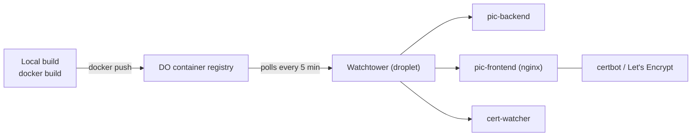

# Architecture, Data & Operations

[← Back to overview](README.md)

This page is the cross‑cutting stuff — the conventions and infrastructure that every other system sits on. None of it is glamorous, but it's the part that lets one person run a real business on this codebase without it rotting. The throughline is the same everywhere: **push correctness into the database and the test suite, not into my own discipline.**

## A note on history

The backend is FastAPI + SQLAlchemy 2.0 (sync) + Pydantic 2 on PostgreSQL 17, but it didn't start there — it's a migration from an older Flask app. That history explains a few things you'd otherwise find odd (some legacy tables, some shared‑schema drift) and a lot of *why* the conventions below are so explicit: when you've migrated a database once, you stop trusting "we'll just remember to do it right."

The app is organized the usual FastAPI way — `api/` routers, `core/` (config, database, observability), `models/`, `schemas/`, `services/`, `prompts/`, `utils/` — with ~20 routers registered under `/api/v1`, grouped by domain.

## Conventions enforced by the database

Three conventions are non‑negotiable, and each is backed by a real constraint plus a test that fails if a new model breaks the pattern.

**1 · Every closed‑vocabulary status/type column is enum‑backed and constrained.** There's a single `enums.py` that is the source of truth for every status vocabulary. A column either reuses one of the three pre‑existing Postgres enum types, or — for everything new — it's a `String(N)` with a named `CHECK` constraint generated from the enum:

```python
class Booking(Base):
    __table_args__ = (status_check("bookings", "status", BookingStatus),)
    status: Mapped[str] = mapped_column(String(20), ...)
```

The named constraint (`ck_bookings_status`) is mirrored in an Alembic migration, so adding a value is a clean drop‑and‑recreate rather than a fragile `ALTER TYPE`. A dedicated test cross‑checks model ↔ enum ↔ migration agreement and that invalid inserts are actually rejected. There's exactly one sanctioned exception — genuinely open vocabularies like the mailing‑list `source` field stay plain `String`, documented in a comment.

**2 · Every datetime is timezone‑aware.** Every `Mapped[datetime]` is declared `DateTime(timezone=True)` (the bare annotation would silently give you a naive `timestamp`), and application code produces UTC with `datetime.now(UTC)` — never the deprecated `utcnow()`. This isn't pedantry: comparing a naive datetime against an aware column raises `TypeError`, so a stray `utcnow()` fails loudly in tests instead of quietly storing the wrong instant.

**3 · String widths are canonical.** Emails are `String(254)` (the RFC max), entity names `String(200)`, tags `String(100)`. Small thing, applied consistently.

## The unified LLM client

Given how much of this platform is LLM‑driven, I refused to let `anthropic` SDK calls sprawl across the services. They all go through one client layer where:

- **Model IDs are pinned in one place** — a Sonnet alias for reasoning work, a dated Haiku snapshot for cheap work. Changing models is a one‑line edit, not a grep.
- **Every call shares one pooled client** and goes through a single `create_message(...)` that auto‑streams above a token threshold, logs per‑call token usage, enforces an in‑process input‑token budget as a runaway backstop, and raises a typed `TruncationError` when a response hits `max_tokens` instead of returning a silently‑truncated string.
- **JSON parsing is centralized** so bad model JSON surfaces as one predictable error.

This is the same philosophy as the [hardened HTTP client](05-media-library-and-acquisition.md): one chokepoint per external dependency, hardened once.

## Migrations

Alembic, with numbered files (`0000_baseline_schema`, `0006_status_check_constraints`, `0010_tz_aware_datetimes`, `0015_edu_video_material`, `0019_fact_check_claims`, …). One scar worth recording: Alembic creates `alembic_version.version_num` as `varchar(32)`, and a 34‑character revision slug overflowed it — which silently stranded production at an old migration until I added an interstitial migration to widen the column first. It's the kind of bug you only meet once, and it's why migrations now get sanity‑checked against production state before I trust an issue is "deployed."

## Infrastructure & deployment



The whole thing runs in Docker on a single DigitalOcean droplet. Three production images — backend (uvicorn), frontend (an nginx serving the built SPA), and a cert‑watcher sidecar. The deploy flow is deliberately boring: build the image locally, push it to the DO container registry, and **Watchtower** on the droplet notices and restarts the container within ~5 minutes. There's no manual server step and no CI deploy job — pushing the image *is* the deploy.

Locally, `docker-compose` brings up the frontend (Vite HMR), backend, a Postgres, and MinIO standing in for DO Spaces, so the full stack runs offline.

## CI

GitHub Actions on every push/PR to `main`, three jobs:

- **secrets‑scan** — gitleaks over the working tree.
- **backend** — `ruff check`, `ruff format --check`, then `pytest` with coverage. (Coverage is reported, not gated — I'd rather know the number than fail builds on it.)
- **frontend** — eslint + a production build, which catches the type/import errors that would otherwise only show up at runtime.

## Observability

Sentry is wired into the backend, the frontend, *and* a standalone cert‑watcher sidecar. The cert‑watcher is the one I'd point to: it probes the TLS endpoints daily, reports certificate expiry to Sentry graded by days‑left, and checks in to a Sentry **cron monitor** — so if the watcher itself stops running, the *absence* of a check‑in pages me. That's the difference between monitoring and hoping.

The Sentry config across all three is privacy‑first: PII off by default, plus a `before_send` scrubber that strips request bodies, cookies, query strings, sensitive headers, and user data — and, on the frontend, redacts magic‑link tokens out of URLs before any event leaves the browser.

## Testing

Tests run against a **real PostgreSQL** via testcontainers — a throwaway `postgres:17-alpine` spun up for the session — because the whole point of the enum/constraint conventions above is that they're enforced by the database, and SQLite wouldn't enforce them. The schema is built from the model metadata, so model‑level `CheckConstraint`s are live in tests. Each test commits for real and resets between tests with a `TRUNCATE … RESTART IDENTITY CASCADE`, which dodges a class of subtle bugs that the older "wrap everything in a rollback" approach hid.

There's a canonical runner (`scripts/run-tests.sh`) that spins a throwaway container mounting the current worktree plus the Docker socket (for testcontainers) and publishes no ports — so I can run the full suite from an isolated git worktree without colliding with the live local stack. That last detail exists because I routinely run several working copies of this repo at once, and tests that fight over a port or a database are tests I'd stop running.

---

[← Forms, Mailing List & Educator Access](09-forms-mailing-and-educator-access.md) · [Back to overview](README.md)
