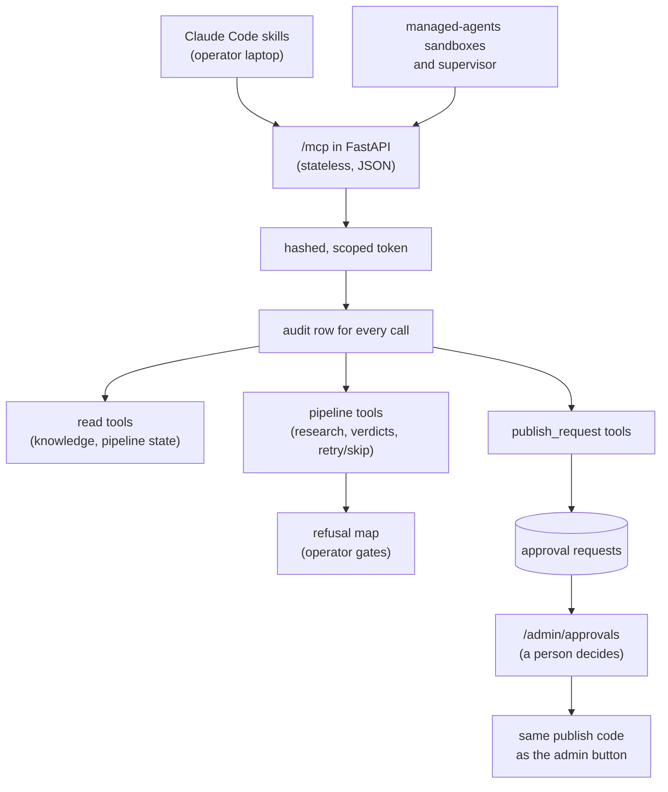
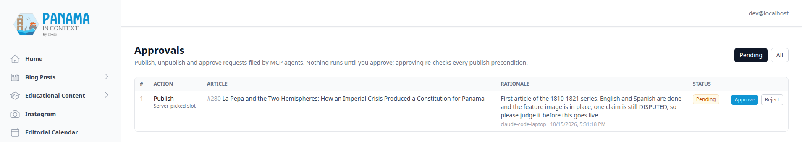

# An MCP Server with Approval Gates

[← Back to overview](README.md)

The [driver](10-agent-driven-pipeline.md) is deterministic on purpose: it claims a task, runs the HTTP calls Panama in Context hands it, and reports back. It has no model in it, and it shouldn't. But not every agent that touches this system is doing scripted work. My own Claude Code skills processed research and fact-check verdicts by running raw SQL against the production database, written into their prompts. Agents in my managed-agents sandboxes triaged Sentry errors with no idea what production actually held. And when a series stalled, a person had to open the admin and work out why.

Those are judgement-shaped jobs, and they are what an MCP server is for. The original plan was to move the driver onto MCP too. I decided against it before writing any code: putting a model in front of a deterministic loop would add cost and nondeterminism and fix nothing. So the server serves exactly three kinds of consumer (my skills, the managed-agents sandboxes, and a [pipeline supervisor](https://feliu.dev/projects/managed-agents/the-supervisor-recommends-the-host-acts) that diagnoses stalled goals), and the driver keeps its plain HTTP protocol.

The design question for the server was not which tools to expose. It was what an agent holding a production credential must never be able to do, and how to make that true in code rather than in a prompt.

## Inside the app, not beside it

The server is the official MCP Python SDK (2.x, `MCPServer`) running inside the FastAPI process, so every tool calls the existing service functions directly: no HTTP hop, no second implementation. It uses Streamable HTTP with `stateless_http` and `json_response`, which means every request gets one JSON body, with no server-sent events and no session id. Either uvicorn worker can answer any request, and the shared nginx edge, which also fronts feliu.dev and other apps, needed no change at all.

It is mounted as two exact routes outside `/api/v1`: `/mcp` itself and `/.well-known/oauth-protected-resource/mcp`, the RFC 9728 metadata URL, which has to sit at the host root. A Starlette `Mount` would have put the metadata under `/mcp/` and redirected bare `/mcp`. A host-header allowlist answers anything that isn't `api.panamaincontext.com` or localhost with a 421. One trap was caught by tests: constructing `MCPServer` calls `logging.basicConfig`, which would have undone the app's own logging configuration, so construction is wrapped to put the root logger back.

## Tokens with scopes, stored as hashes

Panama in Context is a resource server only; there is no authorization server and no OAuth flow. A CLI mints a token, prints the plaintext `pic_mcp_...` value once, and stores only its SHA-256 hash in `mcp_tokens`, with a unique name, a scopes array guarded by a CHECK constraint, `last_used_at` and `revoked_at`. Rows are never deleted, so a revoked token keeps its history.

There are three scopes, and none implies another:

| Scope | Grants |
|---|---|
| `read` | knowledge search, articles, claims, pipeline state |
| `pipeline` | research intake, the deep-research fact-check loop, task retry and skip |
| `publish_request` | *requesting* a publish, unpublish or approval, never executing one |

Any valid token can list the tools; each tool requires exactly one scope, and the scope check is applied by `pic_tool`, the helper every tool is registered through. MCP tokens are not accepted on `/api/v1`, and admin or driver tokens are not MCP tokens. In practice I keep a read-only token for interactive sessions and export the `read,pipeline` one only for skill runs, because any session, and every subagent it spawns, can call production writes with whatever token it inherits.

## Every call is audited, refused ones too

The same `pic_tool` helper wraps every tool in an audit layer, and the order matters: the audit sits *outside* the scope check, so a call refused for a missing scope is still recorded, as `DENIED`. Each call writes a `mcp_tool_calls` row with the token's id and name, the tool, its required scope, the redacted arguments, the outcome (`OK`, `ERROR` or `DENIED`), the error's class and the duration. A test walks the tool registry and fails on any tool that is unscoped or unaudited.

The audit log must not become the leak. Strings over 200 characters are stored as their length and SHA-256, so a research document passed to a tool leaves a fingerprint, not a copy. Keys that look like credentials are dropped at any depth, matched by whole word so `max_tokens` survives. Only the error's class is stored, never its message, which can quote arguments. A failed audit write is logged and sent to Sentry but never changes the tool's result. The one gap is by construction: a call the SDK rejects before the function runs (an unknown tool, invalid arguments) leaves no row.

## Sixteen tools

Six `read` tools give agents the [knowledge layer](08-knowledge-layer.md) and the pipeline's state without database access. `search_knowledge` runs hybrid retrieval over approved articles and the verified-claims knowledge base, never drafts; `get_article` looks one up by id or slug, drafts included, with its claims and tasks; `find_related` ranks by stored centroids with no embedding call; `check_claim` answers "has Panama in Context already established this?", returning inaccurate and disputed matches too; `pipeline_status` and `explain_stuck_goal` read `agent_tasks` and suggest a retry, skip or wait without performing it. Every result is capped at 20,000 characters, and searches degrade to full text, saying so, when the embedding API is unavailable. Each tool opens its own short database session and never holds it across an external call, because the pool is two plus three connections per worker on a cluster shared with three other apps.

Five `pipeline` tools carry the operator's write loops: `get_deep_research_batch` and `submit_fact_check_verdicts` (the [fact-checking](06-fact-checking-pipeline.md) loop), `submit_research`, and `retry_agent_task` / `skip_agent_task`. Each calls the same function object as its HTTP twin, which a test asserts, so there is one implementation of every rule. And each converges on replay, the [driver's lesson](10-agent-driven-pipeline.md) applied from the start: resubmitting a verdict document writes nothing and returns `replayed: true`; an identical research body returns the existing row; a different one is a conflict unless the caller passes `replace`, and approved research is never overwritten from MCP. Retry and skip require a reason, which lands in `agent_task_actions` with the actor `mcp:<token name>`.

Four `publish_request` tools, plus a `ping`, complete the sixteen.

## Approval gates

An agent can never publish, unpublish or approve an article. `request_publish`, `request_unpublish` and `request_article_approval` insert a row into `mcp_approval_requests` with the agent's rationale and return its id; `get_approval_status` reports on it. Asking again while a request is pending returns the same row, backed by a partial unique index, and a request that would change nothing is refused.

A person decides on `/admin/approvals`. To make "approve" mean exactly what the publish button means, I first moved the publish, unpublish and status-transition rules out of the route handlers into a shared `article_publishing` module, so the routes and the approval executor call the same functions. Approving a request locks its row, runs the action in a savepoint, and records `EXECUTED`, or `FAILED` with the same error text the button would have shown: the preconditions are checked when I decide, not when the agent asked. Two admins approving at once run it once. The admin endpoints accept only the admin's own token; neither an MCP token nor the driver's can reach them. A test calls every registered tool with an all-scopes token against draft, ready and live articles and asserts that nothing changes.

## Scopes were not enough: the refusal map

The write tools shipped, and then I found two ways a `pipeline` token could publish anyway, without touching a publish tool.

The first: `skip_agent_task` on a wait gate. SKIPPED satisfies dependents exactly like DONE, so skipping "Grammarly ES" or "claims resolved" would let the driver walk the article on to `APPROVE_ARTICLE` and `SET_PUBLISH_DATE` with no person involved. The fix is `MCP_REFUSED_TASK_ACTIONS`: skip is refused on the four wait gates, and both retry and skip are refused on the publish-path kinds (approve and date an article, approve and schedule an Instagram post), which over MCP must go through an approval request. Retrying a wait gate stays allowed, since it only re-checks the condition.

The second was subtler. The claims gate holds until an article has no unresolved claims, and an article with no claims at all has none, so skipping the *fact-check* hollowed the gate out. Skip is now refused on the fact-check and corrections steps as well, 14 kinds in all. The pre-PR review of that fix found a third hole: skipping a PENDING row further down a chain, behind a failed fact-check, promoted everything after it. Now any skip of a PENDING task with an unfinished dependency in its goal is refused too.

A refusal is a tool error that names the kind and says the operator can do it from the Agent Tasks queue; it writes nothing and is audited. The lesson I took from it: scopes are coarse. They say what kind of action a token may take, not which actions are safe in this graph, and the graph's rules had to be written down where the tools enforce them. The admin queue is unchanged, so I can still do all of it myself.

## Before and after

My fact-check skills were the first real client. I rewrote `/fact-check-prompt`, `/fact-check-process` and `/research-process` onto the tools (keeping the SQL as a documented fallback), configured the server in the repo's `.mcp.json` with the token read from the environment, and measured one deep-research verdict cycle each way in production on 2026-10-12, excluding the deep-research run itself:

| | Before (SQL skills) | After (MCP tools) |
|---|---|---|
| Steps in the skill procedure | 17 | 10 |
| Prod SQL statements in the prompts | 5 | 0 |
| SQL statements executed for the batch | 29 | 0 |
| Wall time, generate prompt | 43.8 s | 30.3 s |
| Wall time, process verdicts | 46.1 s | 147.7 s |
| Wall time, total | 89.9 s | 178.0 s |
| Claims written | 13 of 13 | 11 of 11 |

The MCP path is shorter and safer: no SQL in any prompt, seven fewer steps, every write typed, audited and replay-safe. It was also twice as slow, and the reason is worth more than the headline. Submitting verdicts re-indexes the claims into the knowledge layer, and the tool did that inside the call: 113 seconds of embedding requests. Claude Code gives up on an HTTP MCP request after 60 seconds by default, so the client timed out while the server finished and committed, and the skill confirmed the write from the backend log instead of resubmitting. The SQL path's 46 seconds includes no re-index at all; it still had to be run by hand afterwards.

The same timeout produced a false alarm. The run notes first reported the verdict submit as unaudited, a hole in the "every call is audited" promise. It wasn't: the audit row is stamped when the call ends, and that call ended after the measurement window closed. The follow-up moved the re-index off the request onto a background thread, so a submit now returns as soon as the verdicts commit, and made a cancelled async tool write its audit row too. I haven't re-measured the cycle since that fix, so the 147.7 seconds stands as the measured number, with its cause known and removed.

## Who uses it

My skills run on it, and the deep-research verdict cycle above was the first one completed through MCP in production. The managed-agents sandboxes hold a read-only token, and the supervisor uses the read tools to diagnose stalled goals. Its first diagnosis, in an acceptance dry run against a goal the orchestrator's log showed as stalled, called `explain_stuck_goal` and `pipeline_status`, found every task already done or skipped, and correctly recommended doing nothing. When the supervisor does recommend a retry, the managed-agents host carries it out with a separate pipeline token and a client that can call that one tool, under limits in its own code; that half of the design is on the [supervisor page](https://feliu.dev/projects/managed-agents/the-supervisor-recommends-the-host-acts).

Usage is still small, and the numbers say so: four active tokens, nine audited calls, all `OK`, read calls answering in tens of milliseconds, and no approval request filed in production yet. The approvals page above shows one filed locally through the tool. What's in production is the shape I wanted before agents got busier: a scoped, audited, replay-safe door where the dangerous actions are requests, and a person still holds the publish button.

---

[← An Agent Drives the Pipeline](10-agent-driven-pipeline.md) · [Back to overview](README.md) · Next: [Admin Dashboard, Auth & CMS →](12-admin-auth-and-cms.md)
