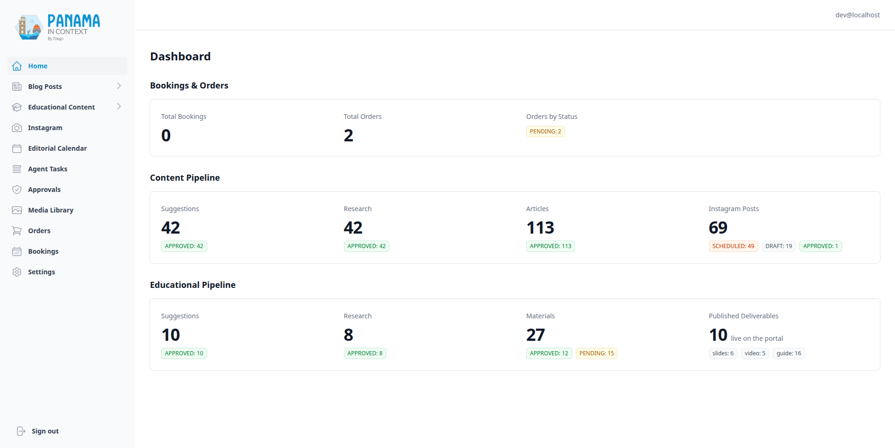
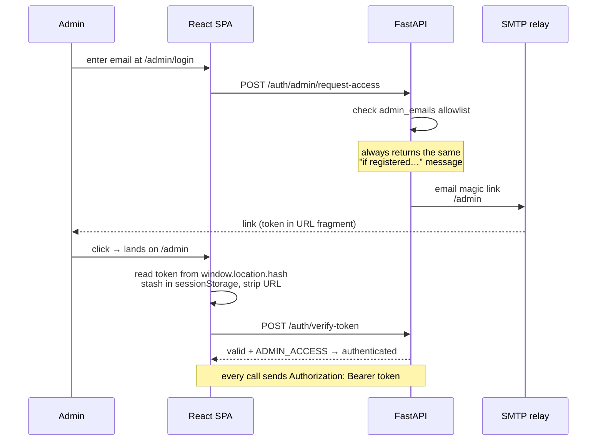

# Admin Dashboard, Auth & CMS

[← Back to overview](README.md)

The admin dashboard is where the operation is run: every pipeline on the other pages is operated, reviewed or unstuck from here. There are still no passwords anywhere in the system, but there are now three kinds of credential, because two of the callers are not people. Admins log in through an emailed magic link. The agent that drives the blog pipeline ([page 10](10-agent-driven-pipeline.md)) carries one long-lived service token that only works on the exact calls it makes. Agents that need judgement talk to the [MCP server](11-mcp-server.md) with hashed, scoped tokens that cannot publish anything. Each credential is narrower than the one before it.

## The shell

The admin is a dashboard-style SPA: a fixed left sidebar with the logo pinned at the top and "Sign out" at the bottom, the admin's email in the top bar, and the active section in the right pane. On desktop the sidebar is always there; on mobile it's a slide-over. The sidebar groups the work the way the business thinks about it:

- **Home**: stat cards for bookings and orders, the blog pipeline (plus Instagram posts by publication state), and the educational pipeline, including how many deliverables are live on the public site
- **Blog Posts** *(expandable)*: Suggestions, Research, Outlines, Articles
- **Educational Content** *(expandable)*: Suggestions, Research, Materials
- **Instagram**: the [social pipeline](07-instagram-pipeline.md)'s drafts, rendering and scheduling
- **Editorial Calendar**: blog and Instagram publications in one month view
- **Agent Tasks**: the driver's task graph for each article series, with retry and skip ([page 10](10-agent-driven-pipeline.md))
- **Approvals**: publish, unpublish and approve requests that agents filed over MCP, waiting for a person ([page 11](11-mcp-server.md))
- **Media Library**
- **Orders**
- **Bookings**
- **Settings**

The public educational-materials section reuses a lighter version of this shell, so the two share a visual language ([page 4](04-educational-deliverables-pipeline.md) has the public side).

The whole admin tree is lazy-loaded behind `Suspense`, which keeps the heavy CMS dependencies (ag-grid about 500 kB, TipTap about 300 kB) out of the public bundle entirely. It also shows a sticky banner when a newer bundle has been deployed, because a tab left open across a deploy, running old code against a new backend, once kicked off a full re-narration nobody asked for.

## Magic links for people

The details I care about:

- **The token lives in the URL fragment** (`/admin#token=…`), never the query string. Browsers don't send fragments to servers, so the token never lands in an access log or a `Referer` header. The SPA reads it from the hash on mount, stashes it in `sessionStorage` and immediately strips it from the URL.
- **Login is anti-enumeration.** Whether or not the email is on the allowlist, the response is the same "if your email is registered, you'll get a link", so the form can't be used to discover who has admin access.
- **Tokens are server-validated on every request.** A FastAPI dependency joins the magic link to the allowlist and checks the token, its `ADMIN_ACCESS` action, its expiry and that the email is still active. The token is read *only* from the `Authorization` header; an earlier `?token=` query fallback was removed once every client used headers.
- **Links last seven days.** They used to last 24 hours, which kept expiring in the middle of long content-generation sessions, so in October I raised it to a week. `sessionStorage` still dies with the tab; re-clicking the emailed link signs back in for the rest of the week. The trade-off is a wider replay window, which is why the next point matters more now.
- **Logout is real revocation.** It deletes the magic-link row server-side, so a token can't be replayed from history or logs after sign-out.

The admin allowlist itself is managed from the Settings page (the two owner emails, each toggleable):

There's a dev bypass, a static `dev-token`, but it's double-gated behind both a debug flag *and* an explicit `development` environment, and it logs a warning and leaves a Sentry breadcrumb every time it's used, so it can't quietly be live in production.

## A service token for the driver

The driver runs unattended for weeks, so a seven-day link can't serve it. It gets one static bearer token from the environment, compared in constant time. The agent-tasks router (the driver's own claim-and-report protocol) accepts it; everywhere else it works only on an allowlist of 20 exact method and path pairs, the calls the planner can emit, written as anchored regexes over concrete paths. Not prefixes, because a prefix on `/articles/{id}` would grant GET, PUT and DELETE, and not route templates, because approving an article goes through a generic status endpoint that would also flip suggestions and research. A test checks every call the planner can render against the allowlist, so the two can't drift. Off that surface the driver token gets the same 401 as a random string, with deliberately no 403 that would confirm it is a valid token.

## Scoped tokens for agents over MCP

MCP tokens start with `pic_mcp_`, are stored only as SHA-256 hashes (a CLI prints the plaintext once), can be revoked, and carry any of three independent scopes: `read`, `pipeline`, `publish_request`. They aren't accepted on `/api/v1`, and admin and driver tokens aren't accepted on `/mcp`. Every tool call is audited against the token's name, refused calls included. None of the scopes can publish: `publish_request` only files a request with a rationale, which lands on the Approvals page for a person to decide, and approving runs it through the same code as the Publish button. [Page 11](11-mcp-server.md) has the full design.

## The CMS surfaces

Each admin page is a focused tool over one slice of the system:

| Page | What it drives |
|------|----------------|
| **Home** | Dashboard stats: bookings and orders, the blog and educational pipelines by status, Instagram posts by publication state, and how many deliverables are live on the public site |
| **Suggestions** (blog) | AI-generate article ideas per category; a "possible duplicate" pill from [semantic duplicate detection](08-knowledge-layer.md); fact-check; approve or reject |
| **Research** (blog) | Generate a research prompt, upload research markdown, fact-check, approve, summarize |
| **Outlines** | Generate article outlines from approved research; approve them |
| **Articles** | TipTap editor with EN and ES tabs, tagging, DeepL translation, one-click Gemini feature image, narration, series sections, publish; plus Grammar, Narration and Consistency columns (below) |
| **Edu Suggestions / Research / Materials** | The [educational deliverables pipeline](04-educational-deliverables-pipeline.md) |
| **Instagram** | The [social pipeline](07-instagram-pipeline.md): generate drafts from a research doc, edit in a drawer, pick the photo, render the card, schedule |
| **Editorial Calendar** | Blog articles and Instagram posts on one month grid; a pill opens the item's editor |
| **Agent Tasks** | One series goal at a time: its tasks grouped by subject in order, counts for done, failed, stuck and waiting, a 30-second refresh, "Plan This Week", and Retry (Check now on a wait) or Skip per task |
| **Approvals** | Pending agent requests with their rationale; approve executes, reject records the decision |
| **Media Library** | The [crawl, score and approve](05-media-library-and-acquisition.md) grid, plus an Imported tab, import from a link with title, credit and license, and editing of imported media |
| **Orders** | PayPal invoices, the manually confirmed payment methods, mark paid, cancel |
| **Bookings** | Month calendar of bookings, with reschedule and cancel |
| **Settings** | Admin-email allowlist and the pricing config |

The data-heavy pages (Articles, Materials, Orders) are ag-grid tables with filtering; the editing-heavy ones use TipTap. Consequential actions (anything that sends an invoice, publishes or deletes, and skipping an agent task) sit behind an explicit confirmation, because this is a single-operator dashboard and a misclick has real consequences.

The content grids (Suggestions, Research, Articles) carry a per-row **fact-check status badge** that drills into a claims modal, and approving an item whose fact-check isn't clean asks for one more explicit confirmation. It warns; it never blocks. The verification layer behind those badges has [its own page](06-fact-checking-pipeline.md).

The Articles grid grew three more columns of pills. **Grammar** shows EN ✓ and ES ✓ once each language has been through the Grammarly pass, plus an amber "N to review" when the meaning check could not vouch for a fix ([page 2](02-blog-and-content-pipeline.md)). **Narration** shows "N to listen" when the voice check left high-pitch paragraphs for a human ear. **Consistency** counts claims that may contradict another article or the verified-claims knowledge base ([page 8](08-knowledge-layer.md)); that check runs in shadow mode, so it informs and never gates publishing.

The Instagram grid follows the same grammar with one extra axis: alongside the editorial status, each row shows a **publication state** (scheduled in orange, published in green with a link to the post, failed in red with the Graph API's error as the tooltip), and a "Publishing off" pill sits in the header while the publishing switch is off. The same drawer pattern, the same media picker, the same confirmations: a new pipeline shouldn't mean a new UI language.

---

[← An MCP Server with Approval Gates](11-mcp-server.md) · [Back to overview](README.md) · Next: [Forms & Mailing List →](13-forms-mailing-and-educator-access.md)
