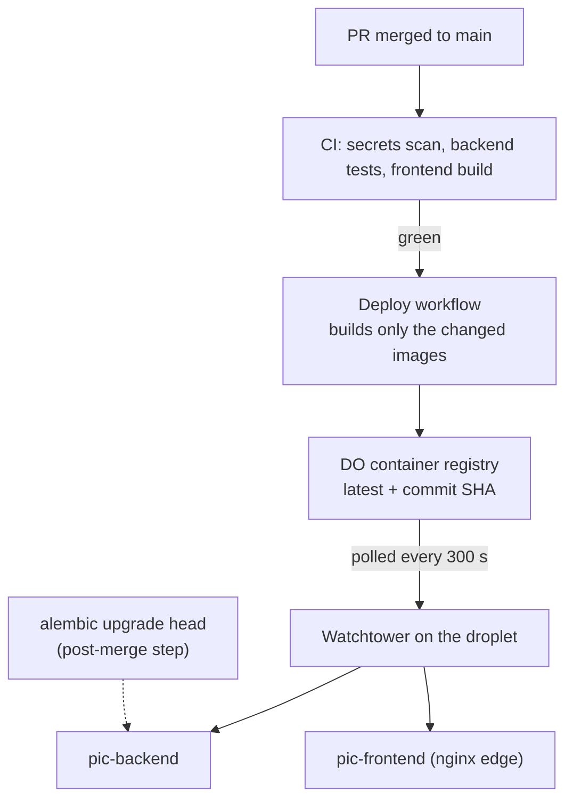

# Architecture, Data & Operations

[← Back to overview](README.md)

This page is the cross-cutting part: the conventions and infrastructure every other system sits on. None of it is glamorous, but it's what lets one person run a real business on this codebase without it rotting, now with agents writing most of the code. The throughline is the same everywhere: **push correctness into the database and the test suite, not into my own discipline** (or an agent's).

## A note on history

The backend is FastAPI, SQLAlchemy 2.0 (sync) and Pydantic 2 on PostgreSQL 17 with pgvector, but it didn't start there: it's a migration from an older Flask app. That history explains a few things you'd otherwise find odd (some legacy tables, some shared-schema drift) and a lot of *why* the conventions below are so explicit. When you've migrated a database once, you stop trusting "we'll just remember to do it right."

The app is organized the usual FastAPI way (`api/`, `core/`, `models/`, `schemas/`, `services/`, `prompts/`, `utils/`), with 25 routers under `/api/v1`, an MCP server mounted outside it at `/mcp` ([page 11](11-mcp-server.md)), and an in-process Instagram scheduler started from the app's lifespan.

## Conventions enforced by the database

Three conventions are non-negotiable, and the first is backed by a real constraint plus tests that fail if a new model breaks the pattern.

**1 · Every closed-vocabulary status or type column is enum-backed and constrained.** A single `enums.py` is the source of truth for every status vocabulary. A column either reuses one of the three pre-existing Postgres enum types or, for everything new, it's a `String(N)` with a named `CHECK` constraint generated from the enum:

```python
class Booking(Base):
    __table_args__ = (status_check("bookings", "status", BookingStatus),)
    status: Mapped[str] = mapped_column(String(20), ...)
```

The named constraint (`ck_bookings_status`) is mirrored in an Alembic migration, so adding a value is a clean drop-and-recreate rather than a fragile `ALTER TYPE`. One test checks that model, enum and constraint agree and that invalid inserts are rejected; a second runs each constraint's newest migration against a recording stand-in for Alembic and compares the values it would write with the enum. Genuinely open vocabularies, like the mailing-list `source` field, stay plain `String`, documented in a comment.

**2 · Every datetime is timezone-aware.** Every `Mapped[datetime]` is declared `DateTime(timezone=True)` (the bare annotation would silently give you a naive `timestamp`), and application code produces UTC with `datetime.now(UTC)`, never the deprecated `utcnow()`. Comparing a naive datetime with an aware column raises `TypeError`, so a stray `utcnow()` fails loudly in tests instead of quietly storing the wrong instant.

**3 · String widths are canonical.** New email columns are `String(254)` (the RFC maximum), entity names `String(200)`, tags `String(100)`. Small thing, applied to every new column.

## The unified LLM client

Every Anthropic call goes through one module and one function, `create_message`. What that layer owns:

- **Three model ids, in one place.** Opus 5.5 writes (blog outlines and articles, the educational guides, slides and narration), Sonnet 5.5 reviews and does the structured work, Haiku 5.5 does the cheap work. They're bare ids with no dated snapshots; changing a model is a one-line edit, not a grep.
- **Adaptive thinking, with effort as the only control.** All three models think whether or not you ask, and thinking tokens count toward `max_tokens`, so call sites carry real headroom and read responses through a `first_text()` helper that skips thinking blocks instead of trusting `content[0]`.
- **Typed failures.** A response cut off at `max_tokens` raises `TruncationError`; a refusal raises `RefusalError` once the server-side fallback that Sonnet and Opus calls opt into has also declined; an in-process token backstop stops a runaway loop before it spends real money.
- **Visible costs.** Every call logs its token usage under a feature label, and a per-model price table turns tokens into dollars; Ask PIC's daily spending cap reads it and refuses to run for an unpriced model.
- **Measured opt-ins.** Prompt caching is available per call site; I measured the blog pipeline and left it uncached, because the calls that share a research document run more than five minutes apart. Ask PIC uses schema-constrained JSON output because Haiku occasionally wrote prose before its JSON.

The other vendors get their own seams (Voyage embeddings in one module, Gemini images in another, crawler traffic through the [hardened HTTP client](05-media-library-and-acquisition.md)): one chokepoint per external dependency, hardened once.

## Migrations

Alembic, with numbered files: 53 of them, from `0000_baseline_schema` to `0051_mcp_approval_requests`. One scar worth recording: Alembic creates `alembic_version.version_num` as `varchar(32)`, and a 34-character revision slug overflowed it, which stranded production at an old migration until I added an interstitial migration to widen the column first. That's why migrations get checked against production state before anyone trusts an issue is "deployed". Deploys don't run them: applying migrations is a separate post-merge step.

## Infrastructure & deployment



Merging a PR is the deploy. A green CI run on `main` triggers a workflow that diffs the merge commit, builds only the image whose code changed, and pushes it tagged `latest` and with the commit SHA; Watchtower on the droplet polls every 300 seconds and recreates the container. A red `main` never deploys, back-to-back deploys queue rather than cancel so `latest` can't end up half-updated, and the shared 5 GB registry keeps only the two newest SHA tags per image (the current one plus a rollback target). Base images come from AWS's public mirror of the Docker official images, because Docker Hub's anonymous rate limits were failing builds. One scar: on 2026-09-05 three PRs merged within 30 seconds, CI cancelled the first two runs, and the surviving merge touched neither service, so two real changes never built. CI runs on `main` are no longer cancelled.

Everything runs in Docker on one shared DigitalOcean droplet. PIC's frontend container is its only public entry point: the nginx inside terminates TLS (Let's Encrypt through a certbot sidecar), serves panamaincontext.com, and reverse-proxies the five other sites that share the droplet, feliu.dev among them. Upstreams are resolved at request time through Docker's DNS, because when they were resolved once at startup, a routine container recreate on a new IP made every request to that site a 502 until nginx was reloaded. The cost of sharing is that a broken nginx config takes six sites down, not one. Locally, `docker-compose` brings up the frontend, the backend, a pgvector Postgres and MinIO standing in for DO Spaces, so the full stack runs offline.

## The shared database budget

The database is a managed PostgreSQL 17 cluster (1 vCPU, 2 GB, 50 connections) shared by four consumers: this app, feliu.dev, the loyalty app and the managed-agents orchestrator. Connections are the scarce resource. The backend runs two uvicorn workers, each with a pool of 2 plus 3 overflow, so PIC never holds more than 10. The measured budget sits in a comment next to the engine, with a note that changing the pool is a human capacity call, and keeping that comment current turned out to matter: for weeks after the cluster was upsized it still described the old 22-connection ceiling, and unattended triage agents kept declining to raise the pool because they were obeying the stale number.

Anything slower than a request runs as a job row plus a FastAPI background task: the endpoint returns 202 and a job id, the client polls, the runner opens its own session. That pattern hid a leak. On current FastAPI, a `yield` dependency's cleanup runs only after the background tasks finish, so every reindex, fact-check or narration job kept the request's pooled connection idle in a transaction for its whole run, one of five slots per worker. The fix was small: `get_db` now queues closing the request session as the first background task.

## CI and observability

GitHub Actions runs three jobs on every push and PR to `main`, and all three must pass before auto-merge: a **secrets scan** (gitleaks), the **backend** (`ruff check`, `ruff format --check`, `pytest` with coverage, which is reported rather than gated and sits at 93%), and the **frontend** (ESLint and a production build).

Sentry is wired into the backend, the frontend *and* a standalone cert-watcher sidecar. The cert-watcher probes the TLS endpoints daily, reports certificate expiry graded by days left, and checks in to a Sentry **cron monitor**, so if the watcher itself stops running, the *absence* of a check-in pages me. That's the difference between monitoring and hoping. The setup is privacy-first: default PII off, a `before_send` scrubber for request bodies, cookies, query strings, sensitive headers and user context, credential redaction in breadcrumbs and frontend URLs, and no stack-frame locals at all for Ask PIC and `/mcp`, whose payloads are reader questions and whole documents.

Logging had a quieter bug: until July nothing configured it, so every `logger.info` in the app fell through to Python's last-resort handler, which prints only warnings, and the token-usage lines I thought I had never reached production logs. The app now installs a root handler at WARNING and raises only its own namespace, so its lines reach `docker logs` while the HTTP, SDK and AWS libraries stay quiet.

## Testing

Tests run against a **real PostgreSQL** via testcontainers, because the whole point of the conventions above is that the database enforces them, and SQLite wouldn't. The image is `pgvector/pgvector:pg17` locally; CI builds its own equivalent (Postgres 17 plus pgvector) from the AWS mirror. The schema is built from the model metadata after the setup creates the `vector` extension and the helper functions the search columns need, so `CheckConstraint`s are live in tests. Each test commits for real and the tables are reset with a `TRUNCATE … RESTART IDENTITY CASCADE`, which avoids bugs the older "wrap everything in a rollback" approach hid. CI runs the full suite, 2,941 tests at the time of writing, in a little over three minutes.

The canonical runner (`scripts/run-tests.sh`) starts a throwaway container that mounts the current worktree and the Docker socket and publishes no ports, so the suite runs from any git worktree without colliding with the local stack. Running agents through it added two guards: it exits with an error when the mounted code directories are empty (in a sandbox whose Docker daemon couldn't see the workspace, pytest once ran against nothing), and its image is keyed by a hash of the requirements and the Dockerfile, so a new dependency rebuilds it and concurrent worktrees never retag an image another run is using. The suite also can't send email any more; [page 13](13-forms-mailing-and-educator-access.md) has that story.

## How it is built now

Since the first version of this write-up went live in July, 234 pull requests have merged, nearly all of them written by agents. A ticket goes to an implementation agent working in its own git worktree; a fresh-context review has to pass the diff against the ticket before a PR can open; GitHub auto-merges once the three CI checks are green; the merge deploys itself; and the shipping agent confirms the running container has the pushed image, checks the health endpoint and applies any merged migrations. What I keep is the judgement: what to build, the review gates, and capacity calls like the connection pool.

The agents' memory is a `CLAUDE.md` kept under 40,000 characters. It has been split twice for outgrowing that, so it now holds short cross-cutting rules and points to 25 topic files under `docs/claude/`, and unattended audit runs re-check its citations against the code and add what they learn.

---

[← Forms & Mailing List](13-forms-mailing-and-educator-access.md) · [Back to overview](README.md)
