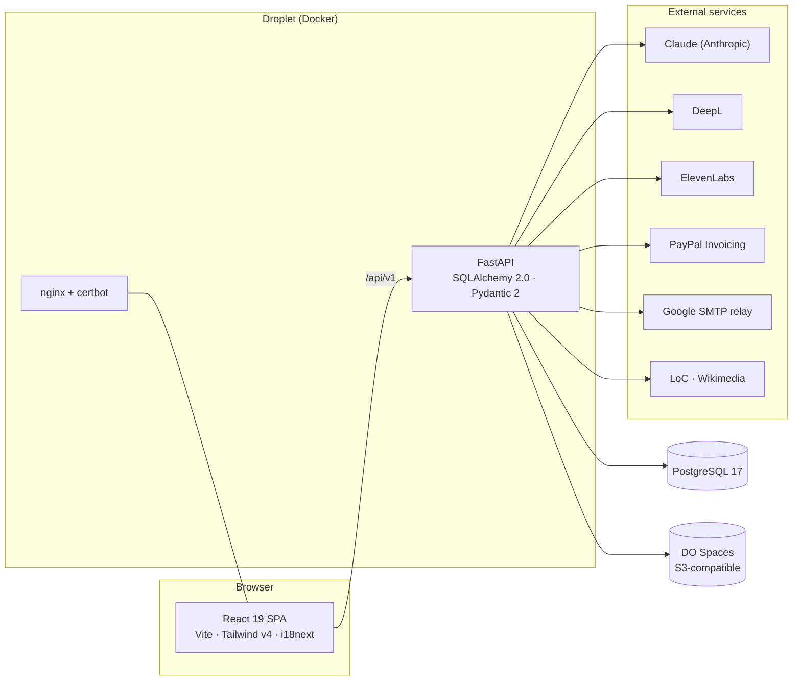

# Panama In Context

> A bilingual educational‑tourism platform for Panama — academic field trips, private guided tours, and a long‑form history blog — with an AI‑assisted content factory bolted onto the back.

This is the project I keep coming back to. On the surface it's a marketing website for a small Panama‑based business: a school can book a curriculum‑aligned field trip, a family can book a private guided tour, and anyone can read a 2,000‑word article about why Panamá Viejo was sacked in 1671. Underneath, it's the system I'm most proud of — a content pipeline that turns a one‑line topic suggestion into a published, bilingual article, or into a Spanish‑narrated MP4 and a printable study guide, with a human approving every step.

I built and run the whole thing solo: React frontend, FastAPI backend, the data model, the LLM orchestration, the infrastructure, and the operational tooling. These pages are my attempt to write down how it actually works.

---

## What it does

The business has three faces, and the platform serves all three from one codebase:

- **Academic field trips** — schools book guided historical excursions (Casco Antiguo, Panamá Viejo, the Biomuseo, the Miraflores locks). The promise is a *methodology*, not just a walk: a pre‑visit presentation, an on‑site observation guide, and a post‑visit study guide, each adapted to the grade band.
- **Guided tours** — private, custom‑priced tours for tourists, families, and corporate visitors, with a real shopping‑cart‑and‑checkout flow behind them.
- **History blog** — long‑form, bilingual (Spanish/English) articles about Panama's history, produced through a research‑first AI pipeline and reviewed before they ever go live.

Everything is **Spanish‑first and English‑second**. The audience is Panamanian classrooms and Latin‑American visitors, so Spanish is the default language and English is the fallback — including the URLs.

---

## Feature highlights

A few things I think are worth a developer's attention:

- **An AI content factory with a human in the loop at every gate.** Articles and educational materials are both produced by the same shape of pipeline — *suggest → research → generate → review → translate → publish* — where each stage is an explicit endpoint and nothing reaches the public until a person approves it. I lean on Claude (Sonnet for reasoning, Haiku for cheap work) and DeepL for translation.
- **A claims‑level fact‑checking layer.** Every suggestion, research document, and article can be decomposed into atomic factual claims — real database rows with verdicts, citations, and corrections. Articles are *grounded* against the research they came from; research claims are verified externally through a free deep‑research loop backed by a self‑compounding verified‑claims knowledge base; and inaccurate claims get a preview‑and‑apply correction flow that fixes the content itself. Built after the first design's real bill came in at 250× the content it was checking.
- **A from‑scratch narrated‑video pipeline.** I render branded HTML slides to PNG with headless Chromium, synthesize Spanish narration in the guide's *cloned voice* (ElevenLabs), and assemble an MP4 with ffmpeg — no Gamma, no external SaaS. The finished video is **self‑hosted** (no YouTube) and delivered to teachers through a public, per‑excursion‑and‑grade‑band surface, with a human curating and approving every slide before it renders.
- **A social pipeline with its own scheduler.** Research documents also feed the brand's Instagram: "¿Sabías que…?" fact cards and blog announcements are drafted by Sonnet, rendered server‑side from the design system's feed‑native templates, and published through Meta's Graph API by the codebase's first *active* scheduler (crash‑safe `SKIP LOCKED` claims; failed publishes park instead of retrying). An editorial calendar shows the blog and the feed as one publication schedule.
- **A real pricing engine.** Private‑tour prices are computed server‑side from a configurable rate ladder (per‑position hourly rates, senior discounts, per‑attraction tickets by residency, zone‑based transport) — never trusted from the client.
- **A media‑acquisition crawler.** The library is fed by crawling the Library of Congress and Wikimedia Commons, scoring every candidate image for relevance with Haiku, and only promoting the good ones — all behind an SSRF‑hardened HTTP client.
- **Magic‑link everything.** Both admins and customers act without passwords: admins log in via an emailed magic link; customers view, cancel, and renew orders through a single tokenized link. Tokens live in the URL *fragment*, never the query string.

---

## The stack, broadly

| Layer | Technology |
|-------|-----------|
| **Frontend** | React 19, Vite 6, Tailwind CSS **v4**, i18next, react‑router 7, TipTap + ag‑grid (admin only), Sentry |
| **Backend** | FastAPI, SQLAlchemy 2.0 (sync), Pydantic 2, Python 3.12 |
| **Database** | PostgreSQL 17 (DigitalOcean Managed) |
| **AI / content** | Anthropic (Sonnet + Haiku), DeepL (translation), ElevenLabs (TTS) |
| **Media** | Playwright/Chromium (slide + PDF render), ffmpeg (video), Pillow + PyMuPDF (watermarks), boto3 → DO Spaces |
| **Payments** | PayPal Invoicing API v2 (server‑to‑server) |
| **Email** | stdlib `smtplib` → Google Workspace SMTP relay (IP‑allowlisted) |
| **Infra** | Docker, DO container registry, Watchtower auto‑deploy, nginx + Let's Encrypt, GitHub Actions CI, Sentry |

The whole thing is a monorepo: `frontend/` (React), `backend/` (FastAPI), `docker/` (production images), plus operational scripts and an `ai_generated_content/` working area for the research workflow.

---

## How the pieces fit

There's one public website and one admin dashboard, both single‑page apps served from the same React bundle (admin routes are lazy‑loaded so ag‑grid and TipTap never reach a public visitor). The FastAPI backend exposes everything under `/api/v1`, grouped into ~20 routers by domain. PostgreSQL holds the content and the orders; DO Spaces holds the binary artifacts (images, PDFs, audio, video). External services are all reached through hardened, unified client layers rather than scattered SDK calls.

The reason the architecture looks the way it does is that this started life as a Flask app and was migrated to FastAPI, and it's run by one developer for a real, paying business. So you'll see a strong bias toward: explicit human‑review gates, idempotent operations, fail‑closed security defaults, and conventions enforced by the database and the test suite rather than by discipline.

---

## Table of contents

Each system below has its own page. I'd read them in roughly this order, but they stand alone.

1. **[Frontend & Design System](01-frontend-and-design-system.md)** — the React SPA, bilingual routing, the i18n setup, and the brand/design system that keeps the marketing site, the slides, and the PDFs visually consistent.
2. **[Blog & Content Pipeline](02-blog-and-content-pipeline.md)** — how a one‑line topic becomes a published, bilingual, multi‑article series: suggestion → research → outline → write → tag → translate → publish, with taxonomies, series, and search.
3. **[Tours, Bookings & the Order/Pricing System](03-tours-bookings-and-orders.md)** — the shopping‑cart‑to‑checkout flow, the server‑side pricing engine, PayPal invoicing, and the magic‑link self‑service for managing orders.
4. **[The Educational Deliverables Pipeline](04-educational-deliverables-pipeline.md)** — the headline system: turning research into a Spanish‑narrated MP4 and a printable study‑guide PDF, per excursion × grade band. Includes what's shipped and what I'm still building.
5. **[Media Library & Acquisition](05-media-library-and-acquisition.md)** — crawling the Library of Congress and Wikimedia, scoring images with Haiku, the SSRF‑hardened fetch layer, watermarking, and the gated public library.
6. **[The Fact‑Checking Pipeline](06-fact-checking-pipeline.md)** — claims as data: atomic‑claim extraction, grounding articles against their research, the cost pivot from paid web search to a free deep‑research loop, the verified‑claims knowledge base, and one‑click corrections.
7. **[The Instagram Pipeline & Editorial Calendar](07-instagram-pipeline.md)** — research documents becoming feed‑native "¿Sabías que…?" cards: server‑rendered brand templates, a one‑tag HTML sanitizer, Meta's two‑step publish, the first active scheduler in the codebase, and a calendar that shows blog + Instagram as one schedule.
8. **[Admin Dashboard, Auth & CMS](08-admin-auth-and-cms.md)** — the passwordless admin experience: magic‑link login, the dashboard shell, and the CMS surfaces that drive the pipelines.
9. **[Forms, Mailing List & Educator Access](09-forms-mailing-and-educator-access.md)** — the contact form, the double‑opt‑in mailing list, the educator access gate, and how email actually gets delivered.
10. **[Architecture, Data & Operations](10-architecture-data-and-operations.md)** — the cross‑cutting backend conventions (enum‑backed constraints, timezone‑aware datetimes), the unified LLM client, migrations, Docker, the deploy pipeline, CI, and observability.

---

*These pages describe the system as of July 2026. Screenshots are from the live site and admin dashboard; the slide and study‑guide images are real generated output.*
