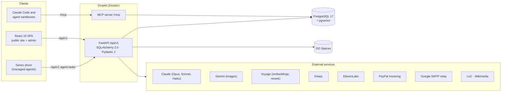

# Panama In Context

> A bilingual educational-tourism platform for Panama with an AI content factory behind it: research-first articles, narrated videos and study guides, claim-level fact-checking, a knowledge layer, and an agent that drives the pipeline.

This is the project I keep coming back to. On the surface it's a marketing website for a small Panama-based business: a school can book a curriculum-aligned field trip, a family can book a private guided tour, and anyone can read a 2,000-word article about why Panamá Viejo was sacked in 1671. Underneath, it's the system I'm most proud of: a content pipeline that turns a one-line topic suggestion into a published, bilingual, narrated article, or into a Spanish-narrated MP4 and a printable study guide for a classroom.

In July that pipeline was something I drove by hand, clicking through every stage. Since then it grew two things. A **knowledge layer** indexes everything the factory has written and verified, so the pipeline can find related articles, catch duplicate topics and answer questions about its own corpus. And an **agent drives it**: a deterministic task graph in the database, executed by an external driver over a narrowly scoped token. The human gates didn't disappear, they moved to where judgement is actually needed: I approve the research before anything is written, the fact-check waits hold a series until every claim is resolved, I run the Grammarly pass in both languages, and anything an agent on the MCP server wants published, unpublished or approved lands in an approvals queue that a person confirms.

I built and run the whole thing solo: React frontend, FastAPI backend, the data model, the LLM orchestration, the infrastructure, and the operational tooling. Diego, the business owner, is the guide on the tours and the cloned voice on the narration. These pages are my attempt to write down how it actually works.

---

## What it does

The business has three faces, and the platform serves all three from one codebase:

- **Academic field trips**: schools book guided historical excursions (Casco Antiguo, Panamá Viejo, the Biomuseo, the Miraflores locks). The promise is a *methodology*, not just a walk: a pre-visit presentation, an on-site observation guide, and a post-visit study guide, each adapted to the grade band. Those materials are now open to every teacher, with no sign-up gate in front of them.
- **Guided tours**: private, custom-priced tours for tourists, families, and corporate visitors, plus open-group event tours, with a real shopping-cart-and-checkout flow behind them.
- **History blog**: long-form, bilingual (Spanish/English) articles about Panama's history, produced through a research-first AI pipeline, fact-checked at the claim level, and narrated in Spanish.

Everything is **Spanish-first and English-second**. The audience is Panamanian classrooms and Latin-American visitors, so Spanish is the default language and English is the fallback, including the URLs.

---

## Feature highlights

A few things I think are worth a developer's attention:

- **An AI content factory with gates where judgement is needed.** Articles and educational materials are produced by the same shape of pipeline (*suggest → research → generate → check → translate → publish*), where each stage is an explicit, replay-safe endpoint. Opus writes (outlines, article bodies, study guides, slides, narration scripts), Sonnet reviews and curates (research prompts, tagging, a meaning check on proofreading fixes, a Spanish accuracy check after translation), Haiku does the cheap work (excerpts, summaries, coverage checks), DeepL translates against a glossary, and Gemini paints the feature images. The human gates are research approval, the fact-check waits, the Grammarly pass and the approvals queue.
- **A claim-level fact-checking layer.** Suggestions, research documents, articles and the educational materials are decomposed into atomic factual claims, stored as rows with verdicts, citations and corrections. Articles are grounded against their own research; anything the research doesn't cover goes to a free deep-research loop instead of being shrugged off as unverifiable; and a verified-claims knowledge base resolves repeats for free. A paid web-search tier was built, measured in production and then removed. About 13,800 claims have been checked so far, and 780 were corrected in the content itself.
- **A from-scratch narrated-video pipeline.** I render branded HTML slides to PNG with headless Chromium, synthesize Spanish narration in Diego's *cloned voice* (ElevenLabs), and assemble an MP4 with ffmpeg: no Gamma, no external SaaS. The finished videos are self-hosted and published per excursion and grade band. Blog articles are narrated in the same voice, with an automatic pitch check that re-takes a segment when the voice drifts.
- **A knowledge layer, and Ask PIC on top of it.** pgvector and Voyage embeddings over every article, claim and verified fact, in both languages, with hybrid vector and full-text retrieval and an evaluation harness behind every tuning decision. It powers related articles and duplicate-topic detection today. Ask PIC, a bilingual question-answering page with citations that abstains when the corpus doesn't cover a question, is built, measured and switched off by default.
- **An agent drives the pipeline.** A series of articles is a graph of task rows: a deterministic planner decides what runs next, an external driver claims a task, executes the exact HTTP calls the task carries, and reports back. Outside its own claim-and-report endpoints, the driver's token can reach 20 method and path pairs and nothing else, and the endpoints a replayed call is likely to hit converge instead of failing.
- **An MCP server with approval gates.** For judgement-shaped work, PIC is also an MCP server: hashed, scoped tokens, an audit row for every call (refused ones too), read tools, pipeline write tools, and requests (publish, unpublish, approve) that only a person can confirm.
- **A social pipeline with its own scheduler.** Research documents also feed the brand's Instagram: "¿Sabías que…?" fact cards and blog announcements are drafted by Sonnet, rendered server-side from the design system's feed templates, and scheduled by a crash-safe `SKIP LOCKED` publisher. Publishing is deliberately held behind an explicit switch.
- **A real pricing engine.** Private-tour prices are computed server-side from a configurable rate ladder (per-position hourly rates, senior discounts, per-attraction tickets by residency, zone-based transport), never trusted from the client.
- **A media-acquisition crawler.** The library is fed by crawling the Library of Congress and Wikimedia Commons, scoring every candidate image for relevance with Haiku, and only promoting the good ones, all behind an SSRF-hardened HTTP client.
- **No passwords anywhere.** Admins log in through an emailed magic link; customers view, cancel and renew orders through a single tokenized link carried in the URL *fragment*, never the query string. Agents get their own credentials: a service token for the driver and hashed, scoped tokens for MCP clients.

---

## The stack, broadly

| Layer | Technology |
|-------|-----------|
| **Frontend** | React 19, Vite 6, Tailwind CSS **v4**, i18next, react-router 7, TipTap + ag-grid (admin only), Sentry |
| **Backend** | FastAPI, SQLAlchemy 2.0 (sync), Pydantic 2, the official MCP SDK; Python 3.11 in production (3.12 in dev and CI) |
| **Database** | PostgreSQL 17 + pgvector (DigitalOcean Managed, a cluster shared with three other apps) |
| **AI / content** | Anthropic (Opus, Sonnet and Haiku 5.5), Gemini (feature images), Voyage (embeddings and rerank), DeepL (translation), ElevenLabs (TTS) |
| **Media** | Playwright/Chromium (slide and PDF render), ffmpeg (video), Pillow + PyMuPDF, boto3 → DO Spaces |
| **Payments** | PayPal Invoicing API v2 (automated); Yappy and credit card through Cuanto (handled from the admin) |
| **Email** | stdlib `smtplib` → Google Workspace SMTP relay (IP-allowlisted) |
| **Infra** | Docker, DO container registry, GitHub Actions deploy-on-merge, Watchtower, a shared nginx edge with Let's Encrypt, Sentry |

The whole thing is a monorepo: `frontend/` (React), `backend/` (FastAPI), `docker/` (production images), plus operational scripts and an `ai_generated_content/` working area for the research workflow.

---

## How the pieces fit

There's one public website and one admin dashboard, both single-page apps served from the same React bundle (admin routes are lazy-loaded so ag-grid and TipTap never reach a public visitor). The FastAPI backend exposes 25 routers under `/api/v1`, grouped by domain, and mounts the MCP server on its own route outside that prefix. PostgreSQL holds the content, the orders, the claims, the embeddings and the task graph; DO Spaces holds the binary artifacts (images, PDFs, audio, video). External services are all reached through unified client layers rather than scattered SDK calls. Anything that would outlive a proxy timeout (crawls, fact-check runs, guide generation, rendering, narration, video assembly) is a job row plus a FastAPI background task, polled by the client, so any worker can answer the poll.

The reason the architecture looks the way it does is that this started life as a Flask app and was migrated to FastAPI, and it's run by one developer for a real, paying business. So you'll see a strong bias toward: explicit review gates, idempotent operations that converge on replay, fail-closed security defaults, and conventions enforced by the database and the test suite rather than by discipline.

---

## Table of contents

Each system below has its own page. I'd read them in roughly this order, but they stand alone.

1. **[Frontend & Design System](01-frontend-and-design-system.md)**: the React SPA, bilingual routing, the i18n setup, and the design system that keeps the website, the slides, the study guides and the Instagram cards looking like one brand.
2. **[Blog & Content Pipeline](02-blog-and-content-pipeline.md)**: how a one-line topic becomes a published, bilingual, narrated article series, with Opus writing, Grammarly proofreading under a meaning check, Gemini images and curated tags.
3. **[Tours, Bookings & the Order/Pricing System](03-tours-bookings-and-orders.md)**: the cart-to-checkout flow, the server-side pricing engine, three payment methods, and magic-link self-service for managing orders.
4. **[The Educational Deliverables Pipeline](04-educational-deliverables-pipeline.md)**: turning research into a Spanish-narrated MP4 and a printable study guide per excursion and grade band, with background jobs and hard fact-check gates.
5. **[Media Library & Acquisition](05-media-library-and-acquisition.md)**: crawling the Library of Congress and Wikimedia, scoring images with Haiku, ranked search, the SSRF-hardened fetch layer, and the open public library.
6. **[The Fact-Checking Pipeline](06-fact-checking-pipeline.md)**: claims as data: extraction, grounding articles against their research, deep research for what the research doesn't cover, the verified-claims knowledge base, and one-click corrections.
7. **[The Instagram Pipeline & Editorial Calendar](07-instagram-pipeline.md)**: research becoming feed-native "¿Sabías que…?" cards, Meta's two-step publish, the first active scheduler in the codebase, and the switch that holds publishing.
8. **[The Knowledge Layer](08-knowledge-layer.md)**: pgvector and Voyage over a bilingual, section-aware index, hybrid retrieval, the evaluation harness, and the consumers it serves.
9. **[Ask PIC](09-ask-pic.md)**: a bilingual question-answering page with citations and abstention, its cost and abuse controls, and how the evals moved it.
10. **[An Agent Drives the Pipeline](10-agent-driven-pipeline.md)**: a deterministic task graph, the claim-and-report protocol, a token pinned to the exact calls, and why the endpoints a replay hits learned to converge instead of failing.
11. **[An MCP Server with Approval Gates](11-mcp-server.md)**: scoped tokens, an audit trail of every call, pipeline tools, and requests that only a person can confirm.
12. **[Admin Dashboard, Auth & CMS](12-admin-auth-and-cms.md)**: the passwordless admin, the three kinds of credentials, the dashboard shell, and the CMS surfaces that drive the pipelines.
13. **[Forms & Mailing List](13-forms-mailing-and-educator-access.md)**: the contact form, the double-opt-in mailing list, how email gets delivered, and why the educator gate is gone.
14. **[Architecture, Data & Operations](14-architecture-data-and-operations.md)**: the backend conventions, the unified LLM client, the shared database budget, migrations, deploy-on-merge, tests, and how the system gets built now.

---

*These pages describe the system as of October 2026. Since the first version of this write-up went live in July, 234 pull requests have merged. The backend is about 47,000 lines of Python with about 50,000 lines of tests behind it: 2,941 tests at 93% coverage. Screenshots are from the live site and from the admin dashboard running against a copy of production data; the slide, study-guide and Instagram images are real generated output.*
